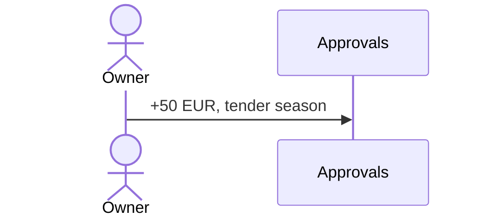

🏠 [Specs](../../../../README.md) › 🧩 [Functional capabilities](../../../README.md) ›
💸 [F22 Unified platform cost management](../../README.md) › 📝 [Use cases](../README.md) ›
📝 [Use cases: FL-F22-02 Budgets and stops](README.md) › 📝 UC-F22-09 Raise a budget or approve a run

# 📝 UC-F22-09 Raise a budget or approve a run

**Status:** ✅ specified

## Summary

The owner raises a budget or approves a run.

## Personas

- [U13 Owner](../../../../01-users/personas/u13-owner.md)

## Goal

Work resumes.

## Trigger

Request.

## Frequency

Occasional.

## Preconditions

- Request.

## Postconditions

- Success: resumed.
- Failure: refused.

## Main flow

1. Read (S-F22-09).
2. Raise or approve.
3. Reason.
4. Calls resume.

## Alternative flows

- 2a. Refuse.

## Error flows

- 2e. Not owner: refused.
- Any step: a service does not answer; the call is retried first (BR-F3-32), then the message follows the error pattern
  (D122) and what was typed stays on the screen.

## Business rules

- [BR-F22-04 Budgets at every level](../../business-rules/br-f22-04-budgets-at-every-level.md)

## Entities

- [E-F22-06 Cost budget](../../data/e-f22-06-cost-budget.md)
- [E-F22-08 Budget approval](../../data/e-f22-08-budget-approval.md)

## Permissions

Owner.

## Notifications

- Requester.

## Audit events

Approvals.

## AI involvement

None.

## API, MCP and A2A exposure

Through T5 and T6 with the caller's rights (BR-F3-34).

## Screens

- [S-F22-09 Approvals](../../screens/02-budgets-and-stops/s-f22-09-approvals.md)

## Flowchart

See [FL-F22-02 Budgets and stops](../../flows/fl-f22-02-budgets-and-stops.md#flowchart).

## Sequence diagram

## Acceptance criteria

1. **Given** +50.00 EUR **when** raised **then** calls resume.
2. **Given** refused **when** refused **then** stopped.
3. **Given** administrator **when** raising **then** refused.

## Non-functional notes

D408's targets ([Performance](../../../../05-non-functional/performance.md)): 95 % of screens within 1 second; lists
paged on the server, the first page within 1 second; reports within 5 seconds or in the background.

## Regulatory references

Billing and accounting rules of the France country pack:
[CR-FR-015 Mandatory invoice mentions](../../../../10-country-packs/france/invoicing/cr-fr-015-invoice-mandatory-mentions.md),
[CR-FR-016 Electronic invoicing](../../../../10-country-packs/france/invoicing/cr-fr-016-electronic-invoicing.md),
[CR-FR-100 VAT on services to clients abroad](../../../../10-country-packs/france/tax-and-vat/cr-fr-100-vat-on-services-abroad.md),
[CR-FR-002 Accounting records kept 10 years](../../../../10-country-packs/france/accounting/cr-fr-002-accounting-records-kept-ten-years.md),
[CR-FR-202 Price reductions on invoices](../../../../10-country-packs/france/invoicing/cr-fr-202-price-reductions-on-invoices.md),
[CR-FR-049 Processors and transfers outside the EU](../../../../10-country-packs/france/data-protection/cr-fr-049-processors-and-transfers.md).

## Related use cases

- [UC-F22-08 Stop paid calls at 100 %, legal duties kept](uc-f22-08-stop-paid-calls-at-100-legal-duties-kept.md)

## Open questions

None.

---

⬅️ [UC-F22-08 Stop paid calls at 100 %, legal duties kept](uc-f22-08-stop-paid-calls-at-100-legal-duties-kept.md) ·
⬆️ [Up](README.md) ·
➡️ [UC-F22-10 Estimate a run before it starts](../03-runs/uc-f22-10-estimate-a-run-before-it-starts.md)
