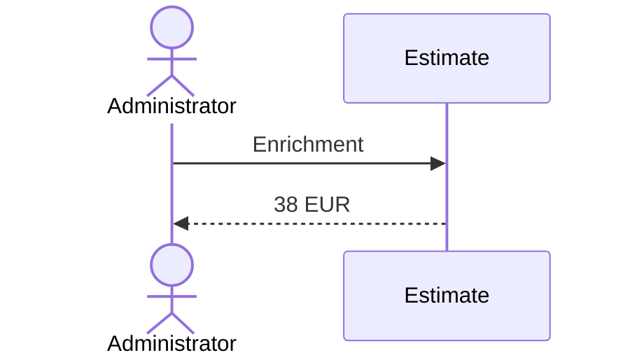

🏠 [Specs](../../../../README.md) › 🧩 [Functional capabilities](../../../README.md) ›
💸 [F22 Unified platform cost management](../../README.md) › 📝 [Use cases](../README.md) ›
📝 [Use cases: FL-F22-03 Runs](README.md) › 📝 UC-F22-10 Estimate a run before it starts

# 📝 UC-F22-10 Estimate a run before it starts

**Status:** ✅ specified

## Summary

An estimate is shown before a large run.

## Personas

- [U07 Administrator](../../../../01-users/personas/u07-administrator.md)
- [U02 Manager](../../../../01-users/personas/u02-manager.md)

## Goal

No surprise.

## Trigger

Large run.

## Frequency

Occasional.

## Preconditions

- Run prepared.

## Postconditions

- Success: confirmed.
- Failure: cancelled.

## Main flow

1. Prepare.
2. Estimate shown (S-F22-10) (BR-F22-08).
3. Confirm.
4. Run starts.

## Alternative flows

- 3a. Cancel.

## Error flows

- 2e. Above budget: approval.
- Any step: a service does not answer; the call is retried first (BR-F3-32), then the message follows the error pattern
  (D122) and what was typed stays on the screen.

## Business rules

- [BR-F22-08 Estimate before a large run](../../business-rules/br-f22-08-estimate-before-a-run.md)

## Entities

- [E-F22-10 Run estimate](../../data/e-f22-10-run-estimate.md)

## Permissions

Administrator, managers.

## Notifications

- None.

## Audit events

Estimates.

## AI involvement

Estimates.

## API, MCP and A2A exposure

Through T5 and T6 with the caller's rights (BR-F3-34).

## Screens

- [S-F22-10 Estimate](../../screens/03-runs/s-f22-10-estimate.md)

## Flowchart

See [FL-F22-03 Runs](../../flows/fl-f22-03-runs.md#flowchart).

## Sequence diagram

## Acceptance criteria

1. **Given** 38.00 EUR **when** shown **then** confirm needed.
2. **Given** cancel **when** cancelled **then** none.
3. **Given** above budget **when** shown **then** approval.

## Non-functional notes

D408's targets ([Performance](../../../../05-non-functional/performance.md)): 95 % of screens within 1 second; lists
paged on the server, the first page within 1 second; reports within 5 seconds or in the background.

## Regulatory references

Billing and accounting rules of the France country pack:
[CR-FR-015 Mandatory invoice mentions](../../../../10-country-packs/france/invoicing/cr-fr-015-invoice-mandatory-mentions.md),
[CR-FR-016 Electronic invoicing](../../../../10-country-packs/france/invoicing/cr-fr-016-electronic-invoicing.md),
[CR-FR-100 VAT on services to clients abroad](../../../../10-country-packs/france/tax-and-vat/cr-fr-100-vat-on-services-abroad.md),
[CR-FR-002 Accounting records kept 10 years](../../../../10-country-packs/france/accounting/cr-fr-002-accounting-records-kept-ten-years.md),
[CR-FR-202 Price reductions on invoices](../../../../10-country-packs/france/invoicing/cr-fr-202-price-reductions-on-invoices.md),
[CR-FR-049 Processors and transfers outside the EU](../../../../10-country-packs/france/data-protection/cr-fr-049-processors-and-transfers.md).

## Related use cases

- [UC-F22-11 Follow a run's cost live and stop it](uc-f22-11-follow-a-run-s-cost-live-and-stop-it.md)

## Open questions

None.

---

⬅️ [UC-F22-09 Raise a budget or approve a run](../02-budgets-and-stops/uc-f22-09-raise-a-budget-or-approve-a-run.md) ·
⬆️ [Up](README.md) ·
➡️ [UC-F22-11 Follow a run's cost live and stop it](uc-f22-11-follow-a-run-s-cost-live-and-stop-it.md)
