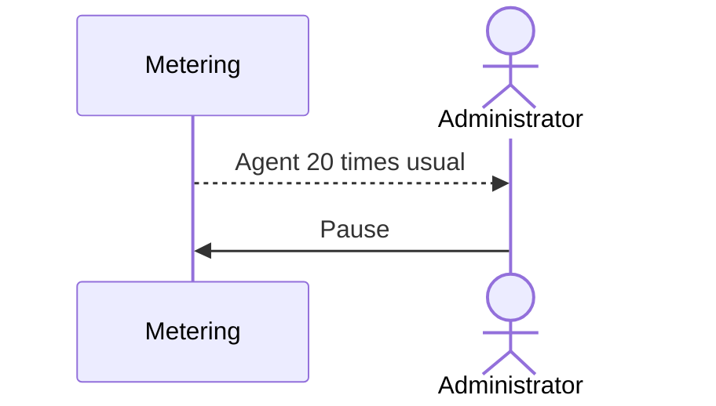

🏠 [Specs](../../../../README.md) › 🧩 [Functional capabilities](../../../README.md) ›
💸 [F22 Unified platform cost management](../../README.md) › 📝 [Use cases](../README.md) ›
📝 [Use cases: FL-F22-03 Runs](README.md) › 📝 UC-F22-18 Spot anomalies and runaway agents

# 📝 UC-F22-18 Spot anomalies and runaway agents

**Status:** ✅ specified

## Summary

Anomalies and runaway agents are flagged and paused.

## Personas

- [U07 Administrator](../../../../01-users/personas/u07-administrator.md)
- [U48 Hosting engineer](../../../../01-users/personas/u48-hosting-engineer.md)

## Goal

Stop runaway costs.

## Trigger

Anomaly.

## Frequency

Rare.

## Preconditions

- Usage.

## Postconditions

- Success: paused.
- Failure: allowed.

## Main flow

1. Alert (BR-F22-13).
2. Inspect (S-F22-18).
3. Pause or allow.
4. Fix.

## Alternative flows

- 3a. Allow.

## Error flows

- 3e. Pause fails: stop.
- Any step: a service does not answer; the call is retried first (BR-F3-32), then the message follows the error pattern
  (D122) and what was typed stays on the screen.

## Business rules

- [BR-F22-13 Anomalies flagged](../../business-rules/br-f22-13-anomalies-flagged.md)

## Entities

- [E-F22-07 Cost alert](../../data/e-f22-07-cost-alert.md)
- [E-F22-02 Metered call record](../../data/e-f22-02-metered-call-record.md)

## Permissions

Administrator, hosting engineer.

## Notifications

- Alert.

## Audit events

Pauses.

## AI involvement

Detection.

## API, MCP and A2A exposure

Through T5 and T6 with the caller's rights (BR-F3-34).

## Screens

- [S-F22-18 Anomalies](../../screens/03-runs/s-f22-18-anomalies.md)

## Flowchart

See [FL-F22-03 Runs](../../flows/fl-f22-03-runs.md#flowchart).

## Sequence diagram

## Acceptance criteria

1. **Given** 20 times usual **when** detected **then** alert.
2. **Given** paused **when** done **then** no calls.
3. **Given** allowed **when** allowed **then** logged.

## Non-functional notes

D408's targets ([Performance](../../../../05-non-functional/performance.md)): 95 % of screens within 1 second; lists
paged on the server, the first page within 1 second; reports within 5 seconds or in the background.

## Regulatory references

Billing and accounting rules of the France country pack:
[CR-FR-015 Mandatory invoice mentions](../../../../10-country-packs/france/invoicing/cr-fr-015-invoice-mandatory-mentions.md),
[CR-FR-016 Electronic invoicing](../../../../10-country-packs/france/invoicing/cr-fr-016-electronic-invoicing.md),
[CR-FR-100 VAT on services to clients abroad](../../../../10-country-packs/france/tax-and-vat/cr-fr-100-vat-on-services-abroad.md),
[CR-FR-002 Accounting records kept 10 years](../../../../10-country-packs/france/accounting/cr-fr-002-accounting-records-kept-ten-years.md),
[CR-FR-202 Price reductions on invoices](../../../../10-country-packs/france/invoicing/cr-fr-202-price-reductions-on-invoices.md),
[CR-FR-049 Processors and transfers outside the EU](../../../../10-country-packs/france/data-protection/cr-fr-049-processors-and-transfers.md).

## Related use cases

- [UC-F22-11 Follow a run's cost live and stop it](uc-f22-11-follow-a-run-s-cost-live-and-stop-it.md)

## Open questions

None.

---

⬅️ [UC-F22-17](../05-billing/uc-f22-17-follow-the-hosting-s-own-platform-costs.md) · ⬆️ [Up](README.md) ·
➡️ [UC-F22-19 Export and report costs](../04-accounting/uc-f22-19-export-and-report-costs.md)
