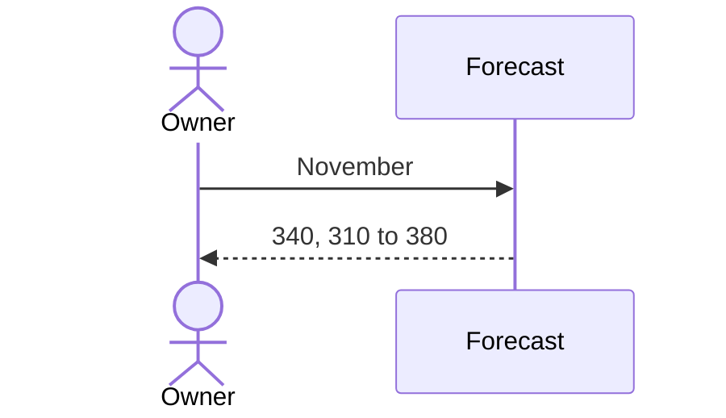

🏠 [Specs](../../../../README.md) › 🧩 [Functional capabilities](../../../README.md) ›
💸 [F22 Unified platform cost management](../../README.md) › 📝 [Use cases](../README.md) ›
📝 [Use cases: FL-F22-04 Accounting](README.md) › 📝 UC-F22-12 Forecast the month's costs

# 📝 UC-F22-12 Forecast the month's costs

**Status:** ✅ specified

## Summary

The owner and accounting forecast the month's costs.

## Personas

- [U13 Owner](../../../../01-users/personas/u13-owner.md)
- [U05 Accounting](../../../../01-users/personas/u05-accounting.md)

## Goal

No surprise.

## Trigger

Mid-month.

## Frequency

Monthly.

## Preconditions

- Usage.

## Postconditions

- Success: read.
- Failure: none.

## Main flow

1. Open (S-F22-12).
2. Read trend.
3. Range.
4. Adjust budgets.

## Alternative flows

- 4a. Savings (UC-F22-23).

## Error flows

- 2e. Few data.
- Any step: a service does not answer; the call is retried first (BR-F3-32), then the message follows the error pattern
  (D122) and what was typed stays on the screen.

## Business rules

- [BR-F22-02 Every paid call is metered](../../business-rules/br-f22-02-every-paid-call-metered.md)

## Entities

- [E-F22-11 Forecast](../../data/e-f22-11-forecast.md)

## Permissions

Owner, accounting.

## Notifications

- None.

## Audit events

None.

## AI involvement

Forecast.

## API, MCP and A2A exposure

Through T5 and T6 with the caller's rights (BR-F3-34).

## Screens

- [S-F22-12 Forecast](../../screens/04-accounting/s-f22-12-forecast.md)

## Flowchart

See [FL-F22-04 Accounting](../../flows/fl-f22-04-accounting.md#flowchart).

## Sequence diagram

## Acceptance criteria

1. **Given** usage **when** forecast **then** 340.00 EUR.
2. **Given** few data **when** forecast **then** wide range.
3. **Given** adjusted **when** saved **then** budgets updated.

## Non-functional notes

D408's targets ([Performance](../../../../05-non-functional/performance.md)): 95 % of screens within 1 second; lists
paged on the server, the first page within 1 second; reports within 5 seconds or in the background.

## Regulatory references

Billing and accounting rules of the France country pack:
[CR-FR-015 Mandatory invoice mentions](../../../../10-country-packs/france/invoicing/cr-fr-015-invoice-mandatory-mentions.md),
[CR-FR-016 Electronic invoicing](../../../../10-country-packs/france/invoicing/cr-fr-016-electronic-invoicing.md),
[CR-FR-100 VAT on services to clients abroad](../../../../10-country-packs/france/tax-and-vat/cr-fr-100-vat-on-services-abroad.md),
[CR-FR-002 Accounting records kept 10 years](../../../../10-country-packs/france/accounting/cr-fr-002-accounting-records-kept-ten-years.md),
[CR-FR-202 Price reductions on invoices](../../../../10-country-packs/france/invoicing/cr-fr-202-price-reductions-on-invoices.md),
[CR-FR-049 Processors and transfers outside the EU](../../../../10-country-packs/france/data-protection/cr-fr-049-processors-and-transfers.md).

## Related use cases

- [UC-F22-23 Act on savings recommendations](../06-savings-and-kpis/uc-f22-23-act-on-savings-recommendations.md)

## Open questions

None.

---

⬅️ [UC-F22-11 Follow a run's cost live and stop it](../03-runs/uc-f22-11-follow-a-run-s-cost-live-and-stop-it.md) ·
⬆️ [Up](README.md) ·
➡️ [UC-F22-13 Match suppliers' invoices in accounting](uc-f22-13-match-suppliers-invoices-in-accounting.md)
