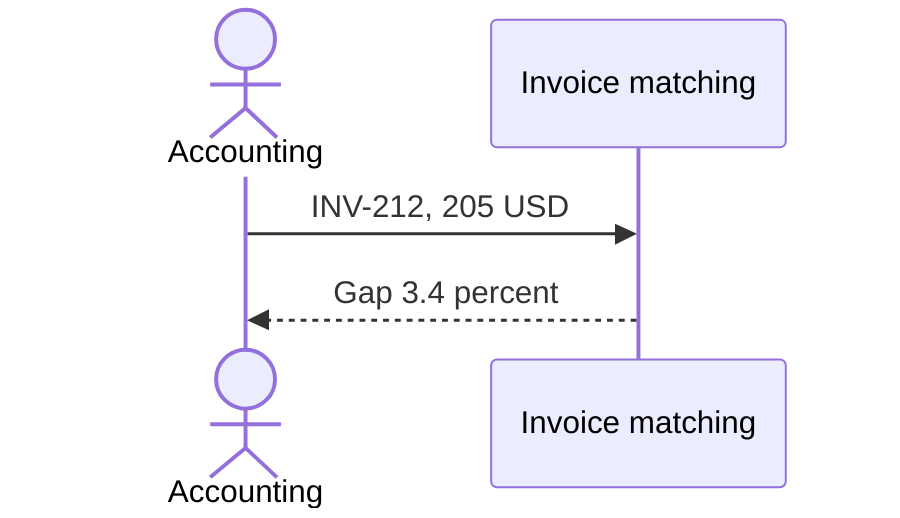

🏠 [Specs](../../../../README.md) › 🧩 [Functional capabilities](../../../README.md) ›
💸 [F22 Unified platform cost management](../../README.md) › 📝 [Use cases](../README.md) ›
📝 [Use cases: FL-F22-04 Accounting](README.md) › 📝 UC-F22-13 Match suppliers' invoices in accounting

# 📝 UC-F22-13 Match suppliers' invoices in accounting

**Status:** ✅ specified

## Summary

Accounting matches providers' invoices with metered costs, in the invoice's currency.

## Personas

- [U05 Accounting](../../../../01-users/personas/u05-accounting.md)

## Goal

Invoices checked.

## Trigger

Invoice.

## Frequency

Monthly.

## Preconditions

- Invoice.

## Postconditions

- Success: booked.
- Failure: flagged.

## Main flow

1. Receive (S-F22-13).
2. Match (BR-F22-11).
3. Gap checked in the invoice's currency (BR-F22-14).
4. Book.

## Alternative flows

- 3a. Gap explained.

## Error flows

- 3e. Above tolerance: flagged.
- Any step: a service does not answer; the call is retried first (BR-F3-32), then the message follows the error pattern
  (D122) and what was typed stays on the screen.

## Business rules

- [BR-F22-11 Suppliers' invoices matched](../../business-rules/br-f22-11-supplier-invoices-matched.md)
- [BR-F22-01 Bills and allocations follow the country pack](../../business-rules/br-f22-01-costs-follow-the-country-pack.md)
- [BR-F22-14 Foreign prices converted at the day's rate](../../business-rules/br-f22-14-foreign-prices-converted-at-the-days-rate.md)

## Entities

- [E-F22-12 Invoice match](../../data/e-f22-12-invoice-match.md)
- [E-F22-02 Metered call record](../../data/e-f22-02-metered-call-record.md)
- [E-F22-14 Exchange rate](../../data/e-f22-14-exchange-rate.md)

## Permissions

Accounting.

## Notifications

- Gap.

## Audit events

Matches.

## AI involvement

None.

## API, MCP and A2A exposure

Through T5 and T6 with the caller's rights (BR-F3-34).

## Screens

- [S-F22-13 Invoice matching](../../screens/04-accounting/s-f22-13-invoice-matching.md)

## Flowchart

See [FL-F22-04 Accounting](../../flows/fl-f22-04-accounting.md#flowchart).

## Sequence diagram

## Acceptance criteria

1. **Given** 3.4 % gap **when** matched **then** flagged.
2. **Given** USD invoice **when** matched **then** in USD.
3. **Given** within tolerance **when** matched **then** booked.

## Non-functional notes

D408's targets ([Performance](../../../../05-non-functional/performance.md)): 95 % of screens within 1 second; lists
paged on the server, the first page within 1 second; reports within 5 seconds or in the background.

## Regulatory references

Billing and accounting rules of the France country pack:
[CR-FR-015 Mandatory invoice mentions](../../../../10-country-packs/france/invoicing/cr-fr-015-invoice-mandatory-mentions.md),
[CR-FR-016 Electronic invoicing](../../../../10-country-packs/france/invoicing/cr-fr-016-electronic-invoicing.md),
[CR-FR-100 VAT on services to clients abroad](../../../../10-country-packs/france/tax-and-vat/cr-fr-100-vat-on-services-abroad.md),
[CR-FR-002 Accounting records kept 10 years](../../../../10-country-packs/france/accounting/cr-fr-002-accounting-records-kept-ten-years.md),
[CR-FR-202 Price reductions on invoices](../../../../10-country-packs/france/invoicing/cr-fr-202-price-reductions-on-invoices.md),
[CR-FR-049 Processors and transfers outside the EU](../../../../10-country-packs/france/data-protection/cr-fr-049-processors-and-transfers.md).

## Related use cases

- [UC-F22-21 Record a provider's prices in a foreign currency](../01-see-and-set-up/uc-f22-21-record-a-providers-prices-in-a-foreign-currency.md)

## Open questions

None.

---

⬅️ [UC-F22-12 Forecast the month's costs](uc-f22-12-forecast-the-month-s-costs.md) · ⬆️ [Up](README.md) ·
➡️ [UC-F22-14 Allocate costs to accounts and projects](uc-f22-14-allocate-costs-to-accounts-and-projects.md)
