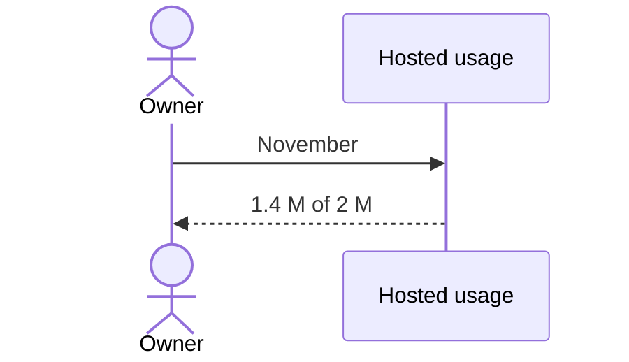

🏠 [Specs](../../../../README.md) › 🧩 [Functional capabilities](../../../README.md) ›
💸 [F22 Unified platform cost management](../../README.md) › 📝 [Use cases](../README.md) ›
📝 [Use cases: FL-F22-05 Billing](README.md) › 📝 UC-F22-15 See the hosted quota and units billed

# 📝 UC-F22-15 See the hosted quota and units billed

**Status:** ✅ specified

## Summary

The owner sees the hosted quota and units billed beyond it.

## Personas

- [U13 Owner](../../../../01-users/personas/u13-owner.md)
- [U05 Accounting](../../../../01-users/personas/u05-accounting.md)

## Goal

Know the bill.

## Trigger

Month.

## Frequency

Monthly.

## Preconditions

- Hosted.

## Postconditions

- Success: read.
- Failure: none.

## Main flow

1. Open (S-F22-15).
2. See used.
3. Units beyond (BR-F22-09).
4. Open the invoice.

## Alternative flows

- 3a. Within quota.

## Error flows

- 4e. None.
- Any step: a service does not answer; the call is retried first (BR-F3-32), then the message follows the error pattern
  (D122) and what was typed stays on the screen.

## Business rules

- [BR-F22-09 Hosted: quota, then units](../../business-rules/br-f22-09-hosted-quota-then-units.md)
- [BR-F22-01 Bills and allocations follow the country pack](../../business-rules/br-f22-01-costs-follow-the-country-pack.md)

## Entities

- [E-F22-05 Hosted quota](../../data/e-f22-05-hosted-quota.md)
- [E-F22-13 Usage invoice](../../data/e-f22-13-usage-invoice.md)

## Permissions

Owner, accounting.

## Notifications

- Near quota.

## Audit events

None.

## AI involvement

None.

## API, MCP and A2A exposure

Through T5 and T6 with the caller's rights (BR-F3-34).

## Screens

- [S-F22-15 Hosted usage](../../screens/05-billing/s-f22-15-hosted-usage.md)

## Flowchart

See [FL-F22-05 Billing](../../flows/fl-f22-05-billing.md#flowchart).

## Sequence diagram

## Acceptance criteria

1. **Given** 1.4 M of 2 M **when** read **then** within.
2. **Given** 2.4 M **when** read **then** 0.4 M billed.
3. **Given** invoice **when** opened **then** units.

## Non-functional notes

D408's targets ([Performance](../../../../05-non-functional/performance.md)): 95 % of screens within 1 second; lists
paged on the server, the first page within 1 second; reports within 5 seconds or in the background.

## Regulatory references

Billing and accounting rules of the France country pack:
[CR-FR-015 Mandatory invoice mentions](../../../../10-country-packs/france/invoicing/cr-fr-015-invoice-mandatory-mentions.md),
[CR-FR-016 Electronic invoicing](../../../../10-country-packs/france/invoicing/cr-fr-016-electronic-invoicing.md),
[CR-FR-100 VAT on services to clients abroad](../../../../10-country-packs/france/tax-and-vat/cr-fr-100-vat-on-services-abroad.md),
[CR-FR-002 Accounting records kept 10 years](../../../../10-country-packs/france/accounting/cr-fr-002-accounting-records-kept-ten-years.md),
[CR-FR-202 Price reductions on invoices](../../../../10-country-packs/france/invoicing/cr-fr-202-price-reductions-on-invoices.md),
[CR-FR-049 Processors and transfers outside the EU](../../../../10-country-packs/france/data-protection/cr-fr-049-processors-and-transfers.md).

## Related use cases

- [UC-F22-05 Bring own keys or use the hosted quota](../01-see-and-set-up/uc-f22-05-bring-own-keys-or-use-the-hosted-quota.md)

## Open questions

None.

---

⬅️ [UC-F22-14](../04-accounting/uc-f22-14-allocate-costs-to-accounts-and-projects.md) · ⬆️ [Up](README.md) ·
➡️ [UC-F22-16 Re-bill clients as an IT provider](uc-f22-16-re-bill-clients-as-an-it-provider.md)
