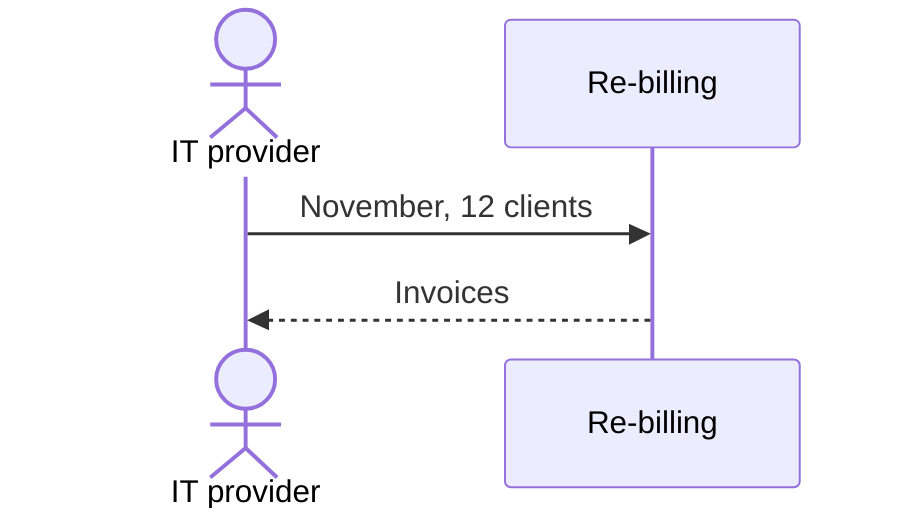

🏠 [Specs](../../../../README.md) › 🧩 [Functional capabilities](../../../README.md) ›
💸 [F22 Unified platform cost management](../../README.md) › 📝 [Use cases](../README.md) ›
📝 [Use cases: FL-F22-05 Billing](README.md) › 📝 UC-F22-16 Re-bill clients as an IT provider

# 📝 UC-F22-16 Re-bill clients as an IT provider

**Status:** ✅ specified

## Summary

An IT provider re-bills clients for the period by their rules (UC-F22-25) with the statements (UC-F22-26).

## Personas

- [U11 IT provider administrator](../../../../01-users/personas/u11-provider-admin.md)

## Goal

Clients billed.

## Trigger

Month.

## Frequency

Monthly.

## Preconditions

- Rules.

## Postconditions

- Success: invoiced.
- Failure: corrected.

## Main flow

1. Choose the period (S-F22-16).
2. Review per client.
3. Apply rules (BR-F22-17).
4. Invoice.

## Alternative flows

- 2a. Correct a line (UC-F22-26).

## Error flows

- 3e. No rule: default.
- Any step: a service does not answer; the call is retried first (BR-F3-32), then the message follows the error pattern
  (D122) and what was typed stays on the screen.

## Business rules

- [BR-F22-12 Costs allocated to accounts](../../business-rules/br-f22-12-allocation-to-accounts.md)
- [BR-F22-01 Bills and allocations follow the country pack](../../business-rules/br-f22-01-costs-follow-the-country-pack.md)
- [BR-F22-17 Re-billing rules per client](../../business-rules/br-f22-17-re-billing-rules-per-client.md)

## Entities

- [E-F22-09 Allocation rule](../../data/e-f22-09-allocation-rule.md)
- [E-F22-13 Usage invoice](../../data/e-f22-13-usage-invoice.md)
- [E-F22-17 Re-billing rule](../../data/e-f22-17-re-billing-rule.md)
- [E-F22-18 Client usage statement](../../data/e-f22-18-client-usage-statement.md)

## Permissions

IT provider.

## Notifications

- Clients.

## Audit events

Invoices.

## AI involvement

None.

## API, MCP and A2A exposure

Through T5 and T6 with the caller's rights (BR-F3-34).

## Screens

- [S-F22-16 Client re-billing](../../screens/05-billing/s-f22-16-client-re-billing.md)

## Flowchart

See [FL-F22-05 Billing](../../flows/fl-f22-05-billing.md#flowchart).

## Sequence diagram

## Acceptance criteria

1. **Given** 12 clients **when** invoiced **then** 12 invoices.
2. **Given** no rule **when** invoiced **then** default.
3. **Given** a correction **when** invoiced **then** included.

## Non-functional notes

D408's targets ([Performance](../../../../05-non-functional/performance.md)): 95 % of screens within 1 second; lists
paged on the server, the first page within 1 second; reports within 5 seconds or in the background.

## Regulatory references

Billing and accounting rules of the France country pack:
[CR-FR-015 Mandatory invoice mentions](../../../../10-country-packs/france/invoicing/cr-fr-015-invoice-mandatory-mentions.md),
[CR-FR-016 Electronic invoicing](../../../../10-country-packs/france/invoicing/cr-fr-016-electronic-invoicing.md),
[CR-FR-100 VAT on services to clients abroad](../../../../10-country-packs/france/tax-and-vat/cr-fr-100-vat-on-services-abroad.md),
[CR-FR-002 Accounting records kept 10 years](../../../../10-country-packs/france/accounting/cr-fr-002-accounting-records-kept-ten-years.md),
[CR-FR-202 Price reductions on invoices](../../../../10-country-packs/france/invoicing/cr-fr-202-price-reductions-on-invoices.md),
[CR-FR-049 Processors and transfers outside the EU](../../../../10-country-packs/france/data-protection/cr-fr-049-processors-and-transfers.md).

## Related use cases

- [UC-F22-25 Set re-billing rules per client](../07-it-provider-re-billing/uc-f22-25-set-re-billing-rules-per-client.md)
- [UC-F22-26 Send each client its usage statement](../07-it-provider-re-billing/uc-f22-26-send-each-client-its-usage-statement.md)

## Open questions

None.

---

⬅️ [UC-F22-15 See the hosted quota and units billed](uc-f22-15-see-the-hosted-quota-and-units-billed.md) ·
⬆️ [Up](README.md) ·
➡️ [UC-F22-17 Follow the hosting's own platform costs](uc-f22-17-follow-the-hosting-s-own-platform-costs.md)
