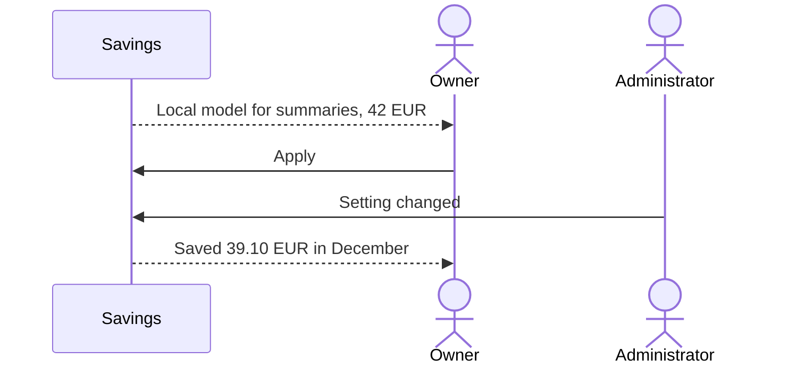

🏠 [Specs](../../../../README.md) › 🧩 [Functional capabilities](../../../README.md) ›
💸 [F22 Unified platform cost management](../../README.md) › 📝 [Use cases](../README.md) ›
📝 [Use cases: FL-F22-06 Savings and KPIs](README.md) › 📝 UC-F22-23 Act on savings recommendations

# 📝 UC-F22-23 Act on savings recommendations

**Status:** ✅ specified

## Summary

SimpleERP proposes savings from three months of usage (a local model, caching, a cheaper model per feature) with their
expected saving and quality effect; the owner applies or dismisses each and sees the saving made.

## Personas

- [U13 Owner](../../../../01-users/personas/u13-owner.md)
- [U07 Administrator](../../../../01-users/personas/u07-administrator.md), who applies the change

## Goal

Lower costs by decisions that keep quality.

## Trigger

Monthly analysis.

## Frequency

Monthly.

## Preconditions

- Three months of usage.

## Postconditions

- Success: savings applied and measured.
- Failure: dismissed with a reason.

## Main flow

1. The owner opens Savings (S-F22-23).
2. SimpleERP shows each recommendation with expected saving and quality effect (BR-F22-16).
3. The owner applies one; the administrator changes the setting in F1.
4. Next month the saving made is measured.

## Alternative flows

- 3a. Dismissed with a reason.

## Error flows

- 2e. Quality below the bar: not shown.
- Any step: a service does not answer; the call is retried first (BR-F3-32), then the message follows the error pattern
  (D122) and what was typed stays on the screen.

## Business rules

- [BR-F22-16 Recommendations show their saving and never act alone](../../business-rules/br-f22-16-recommendations-show-their-saving-and-never-act-alone.md)

## Entities

- [E-F22-16 Savings recommendation](../../data/e-f22-16-savings-recommendation.md)

## Permissions

Owner decides; administrator applies.

## Notifications

- The owner monthly when new recommendations exist.

## Audit events

Decisions and measured savings.

## AI involvement

The analysis proposes; people decide.

## API, MCP and A2A exposure

Through the API (T5) and as AI assistant tools (T6), with the caller's rights (BR-F3-34).

## Screens

- [S-F22-23 Savings](../../screens/06-savings-and-kpis/s-f22-23-savings.md)

## Flowchart

See [FL-F22-06 Savings and KPIs](../../flows/fl-f22-06-savings-and-kpis.md#flowchart).

## Sequence diagram

## Acceptance criteria

1. **Given** summaries costing 48.00 EUR a month on a paid model **when** analysed **then** a recommendation shows 42.00
   EUR expected.
2. **Given** applied **when** December closes **then** the saving measured shows.
3. **Given** a change lowering quality below the bar **when** analysed **then** not shown.

## Non-functional notes

D408's targets ([Performance](../../../../05-non-functional/performance.md)): 95 % of screens within 1 second; lists
paged on the server, the first page within 1 second; reports within 5 seconds or in the background.

## Regulatory references

None.

## Related use cases

- [UC-F22-24 Read the cost KPIs](uc-f22-24-read-the-cost-kpis.md)
- [UC-F22-22 Count the cost of self-hosted compute](../01-see-and-set-up/uc-f22-22-count-the-cost-of-self-hosted-compute.md)

## Open questions

None.

---

⬅️ [UC-F22-22](../01-see-and-set-up/uc-f22-22-count-the-cost-of-self-hosted-compute.md) · ⬆️ [Up](README.md) ·
➡️ [UC-F22-24 Read the cost KPIs](uc-f22-24-read-the-cost-kpis.md)
