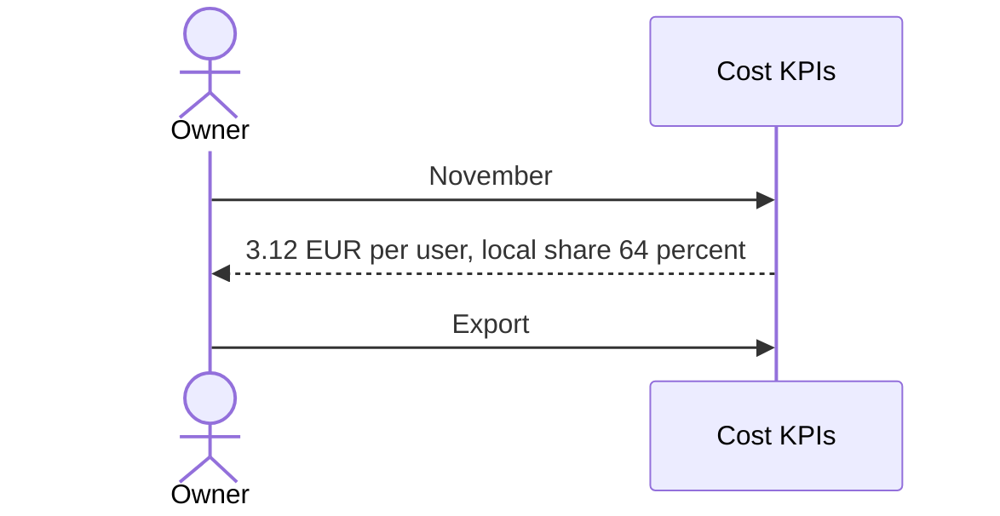

🏠 [Specs](../../../../README.md) › 🧩 [Functional capabilities](../../../README.md) ›
💸 [F22 Unified platform cost management](../../README.md) › 📝 [Use cases](../README.md) ›
📝 [Use cases: FL-F22-06 Savings and KPIs](README.md) › 📝 UC-F22-24 Read the cost KPIs

# 📝 UC-F22-24 Read the cost KPIs

**Status:** ✅ specified

## Summary

The owner and accounting read the cost KPIs over time: cost per active user, per feature, per document produced, budget
use, invoice gap, savings made and the share of local versus paid models.

## Personas

- [U13 Owner](../../../../01-users/personas/u13-owner.md)
- [U05 Accounting](../../../../01-users/personas/u05-accounting.md)

## Goal

Know whether the platform's cost is under control.

## Trigger

Monthly review.

## Frequency

Monthly.

## Preconditions

- Costs metered.

## Postconditions

- Success: KPIs read and exported.
- Failure: none.

## Main flow

1. The owner opens Cost KPIs (S-F22-24).
2. They choose the period.
3. They read each KPI with its trend.
4. They open a KPI's details.
5. They export.

## Alternative flows

- 3a. Per department.

## Error flows

- 2e. First month: no trend.
- Any step: a service does not answer; the call is retried first (BR-F3-32), then the message follows the error pattern
  (D122) and what was typed stays on the screen.

## Business rules

- [BR-F22-02 Every paid call is metered](../../business-rules/br-f22-02-every-paid-call-metered.md)

## Entities

- [E-F22-01 Cost period](../../data/e-f22-01-cost-period.md)
- [E-F22-16 Savings recommendation](../../data/e-f22-16-savings-recommendation.md)

## Permissions

Owner and accounting; managers their team.

## Notifications

- None.

## Audit events

Exports.

## AI involvement

The AI assistant comments a change.

## API, MCP and A2A exposure

Through the API (T5) and as AI assistant tools (T6), with the caller's rights (BR-F3-34).

## Screens

- [S-F22-24 Cost KPIs](../../screens/06-savings-and-kpis/s-f22-24-cost-kpis.md)

## Flowchart

See [FL-F22-06 Savings and KPIs](../../flows/fl-f22-06-savings-and-kpis.md#flowchart).

## Sequence diagram

## Acceptance criteria

1. **Given** 312.40 EUR for 100 active users **when** read **then** 3.12 EUR per user.
2. **Given** 64 % of AI hours local **when** read **then** the share shows 64 %.
3. **Given** the first month **when** read **then** no trend.

## Non-functional notes

D408's targets ([Performance](../../../../05-non-functional/performance.md)): 95 % of screens within 1 second; lists
paged on the server, the first page within 1 second; reports within 5 seconds or in the background.

## Regulatory references

None.

## Related use cases

- [UC-F22-23 Act on savings recommendations](uc-f22-23-act-on-savings-recommendations.md)
- [UC-F22-19 Export and report costs](../04-accounting/uc-f22-19-export-and-report-costs.md)

## Open questions

None.

---

⬅️ [UC-F22-23 Act on savings recommendations](uc-f22-23-act-on-savings-recommendations.md) · ⬆️ [Up](README.md) ·
➡️ [UC-F22-25](../07-it-provider-re-billing/uc-f22-25-set-re-billing-rules-per-client.md)
