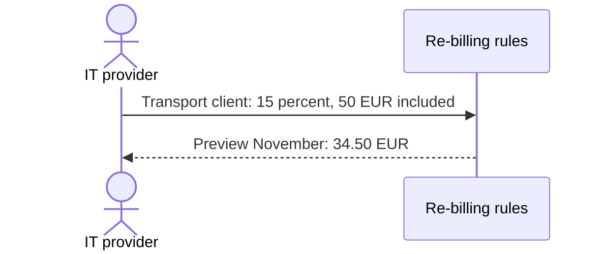

🏠 [Specs](../../../../README.md) › 🧩 [Functional capabilities](../../../README.md) ›
💸 [F22 Unified platform cost management](../../README.md) › 📝 [Use cases](../README.md) ›
📝 [Use cases: FL-F22-07 IT provider re-billing](README.md) › 📝 UC-F22-25 Set re-billing rules per client

# 📝 UC-F22-25 Set re-billing rules per client

**Status:** ✅ specified

## Summary

The IT provider sets for each client how platform costs are re-billed: margin, included amount, rounding.

## Personas

- [U11 IT provider administrator](../../../../01-users/personas/u11-provider-admin.md)

## Goal

Each client billed by its own terms.

## Trigger

A new client; a contract change.

## Frequency

Per client.

## Preconditions

- The provider manages the client.

## Postconditions

- Success: rule saved.
- Failure: default rule.

## Main flow

1. The provider opens Re-billing rules (S-F22-25).
2. They choose a client.
3. They set margin, included amount and rounding (BR-F22-17).
4. They preview last month with the rule.

## Alternative flows

- 2a. Copy a rule to several clients.

## Error flows

- 3e. Negative margin: refused.
- Any step: a service does not answer; the call is retried first (BR-F3-32), then the message follows the error pattern
  (D122) and what was typed stays on the screen.

## Business rules

- [BR-F22-17 Re-billing rules per client](../../business-rules/br-f22-17-re-billing-rules-per-client.md)

## Entities

- [E-F22-17 Re-billing rule](../../data/e-f22-17-re-billing-rule.md)

## Permissions

IT provider.

## Notifications

- None.

## Audit events

Rule changes.

## AI involvement

None.

## API, MCP and A2A exposure

Through the API (T5) and as AI assistant tools (T6), with the caller's rights (BR-F3-34).

## Screens

- [S-F22-25 Re-billing rules](../../screens/07-it-provider-re-billing/s-f22-25-re-billing-rules.md)

## Flowchart

See [FL-F22-07 IT provider re-billing](../../flows/fl-f22-07-it-provider-re-billing.md#flowchart).

## Sequence diagram

## Acceptance criteria

1. **Given** 15 % and 50.00 EUR included and 80.00 EUR usage **when** previewed **then** 34.50 EUR.
2. **Given** a negative margin **when** saved **then** refused.
3. **Given** a rule copied to 5 clients **when** saved **then** 5 rules.

## Non-functional notes

D408's targets ([Performance](../../../../05-non-functional/performance.md)): 95 % of screens within 1 second; lists
paged on the server, the first page within 1 second; reports within 5 seconds or in the background.

## Regulatory references

None.

## Related use cases

- [UC-F22-26 Send each client its usage statement](uc-f22-26-send-each-client-its-usage-statement.md)
- [UC-F22-16 Re-bill clients as an IT provider](../05-billing/uc-f22-16-re-bill-clients-as-an-it-provider.md)

## Open questions

None.

---

⬅️ [UC-F22-24 Read the cost KPIs](../06-savings-and-kpis/uc-f22-24-read-the-cost-kpis.md) · ⬆️ [Up](README.md) ·
➡️ [UC-F22-26 Send each client its usage statement](uc-f22-26-send-each-client-its-usage-statement.md)
