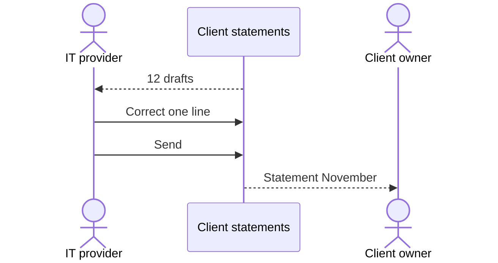

🏠 [Specs](../../../../README.md) › 🧩 [Functional capabilities](../../../README.md) ›
💸 [F22 Unified platform cost management](../../README.md) › 📝 [Use cases](../README.md) ›
📝 [Use cases: FL-F22-07 IT provider re-billing](README.md) › 📝 UC-F22-26 Send each client its usage statement

# 📝 UC-F22-26 Send each client its usage statement

**Status:** ✅ specified

## Summary

At the month's end the IT provider reviews each client's usage statement, corrects disputed lines, and sends it with the
invoice; the client's owner reads it.

## Personas

- [U11 IT provider administrator](../../../../01-users/personas/u11-provider-admin.md)
- [U13 Owner](../../../../01-users/personas/u13-owner.md), the client's owner

## Goal

Clients understand what they pay.

## Trigger

Month closed.

## Frequency

Monthly.

## Preconditions

- Rules set.

## Postconditions

- Success: statements sent.
- Failure: corrected.

## Main flow

1. The month closes; statements are drafted (S-F22-26).
2. The provider reviews each.
3. They correct disputed lines.
4. They send statement and invoice (UC-F22-16).
5. The client's owner reads it.

## Alternative flows

- 3a. Credit for a disputed line.

## Error flows

- 2e. Client without rule: default, told.
- Any step: a service does not answer; the call is retried first (BR-F3-32), then the message follows the error pattern
  (D122) and what was typed stays on the screen.

## Business rules

- [BR-F22-17 Re-billing rules per client](../../business-rules/br-f22-17-re-billing-rules-per-client.md)

## Entities

- [E-F22-18 Client usage statement](../../data/e-f22-18-client-usage-statement.md)

## Permissions

IT provider; the client's owner reads their own.

## Notifications

- The client's owner when sent.

## Audit events

Statements.

## AI involvement

None.

## API, MCP and A2A exposure

Through the API (T5) and as AI assistant tools (T6), with the caller's rights (BR-F3-34).

## Screens

- [S-F22-26 Client statements](../../screens/07-it-provider-re-billing/s-f22-26-client-statements.md)

## Flowchart

See [FL-F22-07 IT provider re-billing](../../flows/fl-f22-07-it-provider-re-billing.md#flowchart).

## Sequence diagram

## Acceptance criteria

1. **Given** 12 clients **when** the month closes **then** 12 drafts.
2. **Given** a disputed 5.00 EUR line **when** corrected **then** the statement shows it.
3. **Given** a client **when** reading **then** only its own usage.

## Non-functional notes

D408's targets ([Performance](../../../../05-non-functional/performance.md)): 95 % of screens within 1 second; lists
paged on the server, the first page within 1 second; reports within 5 seconds or in the background.

## Regulatory references

None.

## Related use cases

- [UC-F22-25 Set re-billing rules per client](uc-f22-25-set-re-billing-rules-per-client.md)
- [UC-F22-16 Re-bill clients as an IT provider](../05-billing/uc-f22-16-re-bill-clients-as-an-it-provider.md)

## Open questions

None.

---

⬅️ [UC-F22-25 Set re-billing rules per client](uc-f22-25-set-re-billing-rules-per-client.md) · ⬆️ [Up](README.md) ·
➡️ [UC-F22-27 Buy prepaid credit packs](../08-credits-saas-and-carbon/uc-f22-27-buy-prepaid-credit-packs.md)
