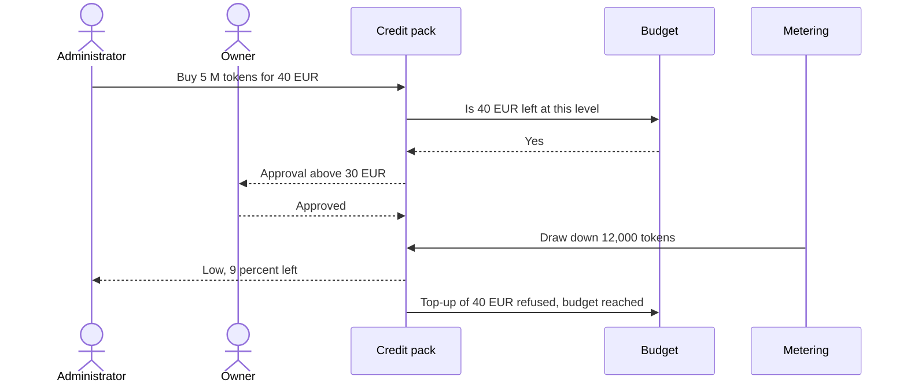

🏠 [Specs](../../../../README.md) › 🧩 [Functional capabilities](../../../README.md) ›
💸 [F22 Unified platform cost management](../../README.md) › 📝 [Use cases](../README.md) ›
📝 [Use cases: FL-F22-08 Credits, SaaS subscriptions, carbon and routing](README.md) ›
📝 UC-F22-27 Buy prepaid credit packs

# 📝 UC-F22-27 Buy prepaid credit packs

**Status:** 🔄 waiting for the owner

## Summary

The administrator buys prepaid packs of units (AI tokens, scraped pages, connector calls) for one kind of paid usage,
and may let SimpleERP top a pack up automatically when it runs low. Usage draws a pack down after the plan's monthly
quota and before units are billed one by one. The owner approves packs above a set amount. A pack never buys more than
the budget of its level leaves.

## Personas

- [U07 Administrator](../../../../01-users/personas/u07-administrator.md), who buys and watches the packs
- [U13 Owner](../../../../01-users/personas/u13-owner.md), who approves large purchases

## Goal

Predictable prices for heavy usage, no interruption when a balance runs out, and no purchase the budget did not allow.

## Trigger

The administrator decides to buy a pack, or the balance of a pack with automatic top-up falls below its threshold.

## Frequency

A few packs a year per kind of usage; automatic top-ups when usage is high.

## Preconditions

- The paid provider and its price list exist ([E-F22-04 Paid provider](../../data/e-f22-04-paid-provider.md),
  [E-F22-03 Provider price list](../../data/e-f22-03-provider-price-list.md)).
- A budget exists at the level the pack is charged to ([E-F22-06 Cost budget](../../data/e-f22-06-cost-budget.md)).
- A payment method is set for the hosted bill, or the provider's own prepaid account is known
  ([BR-F22-10](../../business-rules/br-f22-10-own-keys-billed-by-the-provider.md)).

## Postconditions

- **Succeeded:** the pack is Active with its units; each metered call draws it down
  ([BR-F22-02](../../business-rules/br-f22-02-every-paid-call-metered.md)); the purchase is counted in the budget of its
  level.
- **Failed:** no pack is bought, no money is taken and the balance is unchanged; usage goes on under the quota and units
  rules.

## Main flow

1. The administrator opens the credit packs screen
   ([S-F22-27 Credit packs](../../screens/08-credits-saas-and-carbon/s-f22-27-credit-packs.md)) and chooses the kind of
   usage, the provider and a pack size from the published price list.
2. SimpleERP shows the unit price, the saving against units billed one by one, the expiry and the budget left at the
   pack's level ([BR-F22-18](../../business-rules/br-f22-18-automatic-top-ups-stay-within-the-budget.md)).
3. The administrator confirms; above the owner's set amount the purchase waits for the owner's approval
   ([UC-F22-09](../02-budgets-and-stops/uc-f22-09-raise-a-budget-or-approve-a-run.md)).
4. The pack becomes Active when the payment is confirmed; metered calls draw it down after the monthly quota
   ([BR-F22-09](../../business-rules/br-f22-09-hosted-quota-then-units.md)).
5. When the balance falls below the threshold the pack turns Low and the administrator is warned; with automatic top-up
   on, a new pack of the same size is bought if the budget allows it.
6. When the balance reaches zero or the expiry passes, the pack ends and usage falls back to units billed one by one.

## Alternative flows

- 2a. The administrator sets automatic top-up with a threshold and a monthly maximum of packs.
- 3a. The purchase is above the owner's amount: the owner approves or refuses on a phone or a desktop.
- 5a. The budget left is smaller than the top-up: nothing is bought and the owner is told why.

## Error flows

- 3e. The payment fails: the pack stays Ordered for 7 days, then is cancelled; usage is not interrupted.
- 5e. The budget is reached: the automatic top-up is not bought
  ([BR-F22-18](../../business-rules/br-f22-18-automatic-top-ups-stay-within-the-budget.md)); new paid calls stop only as
  [BR-F22-06](../../business-rules/br-f22-06-stop-at-budget-legal-duties-kept.md) says, and legal duties go on.
- 6e. A pack expires with units left: they are lost as the terms shown at purchase say.
- Any step: a service does not answer; the call is retried first
  ([BR-F3-32](../../../f03-assistant/business-rules/br-f03-32-retry-before-an-error.md)), then the message follows the
  error pattern ([D122](../../../../06-decisions/ux/d122-error-message-standard.md)) and what the user typed stays on
  the screen.

## Business rules

- [BR-F22-18](../../business-rules/br-f22-18-automatic-top-ups-stay-within-the-budget.md)
- [BR-F22-06](../../business-rules/br-f22-06-stop-at-budget-legal-duties-kept.md)
- [BR-F22-09 Hosted: quota, then units](../../business-rules/br-f22-09-hosted-quota-then-units.md)
- [BR-F22-10](../../business-rules/br-f22-10-own-keys-billed-by-the-provider.md)

## Entities

- [E-F22-19 Credit pack](../../data/e-f22-19-credit-pack.md): created, changed
- [E-F22-04 Paid provider](../../data/e-f22-04-paid-provider.md): read, the provider the pack is for
- [E-F22-05 Hosted quota](../../data/e-f22-05-hosted-quota.md): read, the quota used before the pack
- [E-F22-06 Cost budget](../../data/e-f22-06-cost-budget.md): read, the budget the purchase counts in
- [E-F22-02 Metered call record](../../data/e-f22-02-metered-call-record.md): read, the calls that draw it down

## Permissions

Administrator buys packs and sets automatic top-up. Owner approves purchases above the set amount and reads every pack.
Accounting reads the packs and their invoices.

## Notifications

The administrator: a pack Low, a pack ending in 30 days, a refused top-up. The owner: a purchase waiting for approval, a
top-up bought.

## Audit events

Each purchase, approval, payment, top-up, refusal, draw-down total per day, expiry and cancellation, with who and when.

## AI involvement

No AI step of its own. The AI assistant may open the screen and prefill it from the user's words; the user checks and
confirms ([BR-F3-07](../../../f03-assistant/business-rules/br-f03-07-no-deletes-no-irreversible-acts.md)).

## API, MCP and A2A exposure

T5 operations of the capability for the personas above: create, read, update and list. The MCP tool of the
capability may read and propose, never confirm alone. No A2A skill.

## Screens

- [S-F22-27 Credit packs](../../screens/08-credits-saas-and-carbon/s-f22-27-credit-packs.md)

## Flowchart

See
[FL-F22-08 Credits, SaaS subscriptions, carbon and routing](../../flows/fl-f22-08-credits-saas-and-carbon.md#flowchart).

## Sequence diagram

## Acceptance criteria

1. **Given** a pack of 5 M tokens at 40 EUR **when** calls use 12,000 tokens beyond the quota **then** the pack's
   balance falls by 12,000 and the call is not billed by unit.
2. **Given** automatic top-up on and a budget with 20 EUR left **when** the pack falls below its threshold **then** no
   pack of 40 EUR is bought and the owner is told that the budget stopped it.
3. **Given** a purchase above the owner's amount **when** the administrator confirms **then** no money is taken until
   the owner approves.
4. **Given** a pack past its expiry **when** usage continues **then** the units left are no longer drawn and usage is
   billed by unit.

## Non-functional notes

The screen answers within 2 seconds for 10,000 records; every change is audited.

## Regulatory references

Prepaid credits sold to a sole trader or a consumer need the information before an online order, a stated
validity and expiry, and the withdrawal right for digital services not yet started:
[CR-FR-065](../../../../10-country-packs/france/consumer/cr-fr-065-online-pre-contract-information.md),
[CR-FR-036](../../../../10-country-packs/france/consumer/cr-fr-036-withdrawal-right.md). (Proposed) The VAT treatment of
a prepaid pack, due at purchase or at use, follows the France pack and is decided with the accountant: see
[CR-FR-013](../../../../10-country-packs/france/tax-and-vat/cr-fr-013-vouchers-vat.md) for vouchers. The France-pack
rule on prepaid credits is written later.

## Related use cases

- [UC-F22-28 Manage SaaS subscriptions](uc-f22-28-manage-saas-subscriptions.md)
- [UC-F22-08](../02-budgets-and-stops/uc-f22-08-stop-paid-calls-at-100-legal-duties-kept.md)
- [UC-F22-15](../05-billing/uc-f22-15-see-the-hosted-quota-and-units-billed.md)
- [UC-F22-09](../02-budgets-and-stops/uc-f22-09-raise-a-budget-or-approve-a-run.md)
- [UC-F22-23](../06-savings-and-kpis/uc-f22-23-act-on-savings-recommendations.md)

## Open questions

None.

---

⬅️ [UC-F22-26](../07-it-provider-re-billing/uc-f22-26-send-each-client-its-usage-statement.md) · ⬆️ [Up](README.md) ·
➡️ [UC-F22-28 Manage SaaS subscriptions](uc-f22-28-manage-saas-subscriptions.md)
