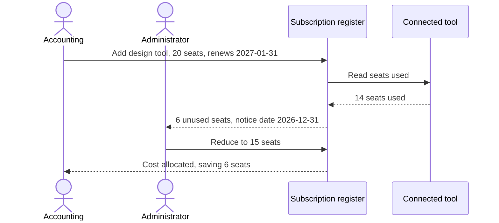

🏠 [Specs](../../../../README.md) › 🧩 [Functional capabilities](../../../README.md) ›
💸 [F22 Unified platform cost management](../../README.md) › 📝 [Use cases](../README.md) ›
📝 [Use cases: FL-F22-08 Credits, SaaS subscriptions, carbon and routing](README.md) ›
📝 UC-F22-28 Manage SaaS subscriptions

# 📝 UC-F22-28 Manage SaaS subscriptions

**Status:** ✅ specified

## Summary

Accounting and the administrator keep a light register of the company's other software subscriptions: the tool, the
seats paid and the seats used, the price, the renewal date and the notice period. Seats nobody uses are flagged before
the renewal date, so the company can cancel or reduce in time. The costs flow into the budgets and the allocation like
any other platform cost.

## Personas

- [U07 Administrator](../../../../01-users/personas/u07-administrator.md), who reviews seats and tools
- [U05 Accounting](../../../../01-users/personas/u05-accounting.md), who records, allocates and matches the invoices

## Goal

No subscription renews unseen, and the company stops paying for seats nobody uses.

## Trigger

A subscription is added, its renewal approaches, or the yearly review of tools starts.

## Frequency

A few additions a month; a check of every subscription each week.

## Preconditions

- The company has subscriptions to record; seats used come from a connection
  [UC-F24-02](../../../f24-integrations-hub/use-cases/01-find-and-connect/uc-f24-02-connect-a-tool-in-the-fewest-steps.md)
  or are entered by hand.
- Budgets exist for the SaaS level ([E-F22-06 Cost budget](../../data/e-f22-06-cost-budget.md)).

## Postconditions

- **Succeeded:** the subscription is in the register with its renewal date; unused seats are flagged before the notice
  date; the cost is counted in the budget and allocated.
- **Failed:** the subscription is not recorded; nothing is flagged for it.

## Main flow

1. Accounting opens the SaaS subscriptions screen
   ([S-F22-28](../../screens/08-credits-saas-and-carbon/s-f22-28-saas-subscriptions.md)) and adds a subscription: tool,
   price per seat, seats paid, billing period, renewal date and notice period.
2. SimpleERP reads the seats used from the connected tool when there is a connection, or takes the figure the
   administrator enters.
3. Each week SimpleERP compares seats used with seats paid and flags the unused ones
   ([BR-F22-19](../../business-rules/br-f22-19-unused-seats-are-flagged-before-renewal.md)), at least 30 days before the
   notice date.
4. The administrator reduces the seats, cancels or confirms the renewal; the decision is recorded.
5. The cost is allocated to a department or a project
   ([UC-F22-14](../04-accounting/uc-f22-14-allocate-costs-to-accounts-and-projects.md)) and counted in the budget.
6. Accounting matches the vendor's invoice
   ([UC-F22-13](../04-accounting/uc-f22-13-match-suppliers-invoices-in-accounting.md)) when it arrives.

## Alternative flows

- 2a. No connection exists: the administrator enters the seats used each quarter, and the screen says the figure is
  declared, not measured.
- 4a. The company confirms the renewal: the next renewal date is set from the billing period.
- 4b. A tool is replaced: the old subscription is cancelled and the new one starts from the same screen.

## Error flows

- 3e. The tool's seats cannot be read: the last known figure is kept and marked old.
- 4e. The notice date is already past: the renewal is shown as locked in and the saving is lost for this period.
- Any step: a service does not answer; the call is retried first
  ([BR-F3-32](../../../f03-assistant/business-rules/br-f03-32-retry-before-an-error.md)), then the message follows the
  error pattern ([D122](../../../../06-decisions/ux/d122-error-message-standard.md)) and what the user typed stays on
  the screen.

## Business rules

- [BR-F22-19](../../business-rules/br-f22-19-unused-seats-are-flagged-before-renewal.md)
- [BR-F22-12](../../business-rules/br-f22-12-allocation-to-accounts.md)

## Entities

- [E-F22-20 SaaS subscription](../../data/e-f22-20-saas-subscription.md): created, changed
- [E-F22-06 Cost budget](../../data/e-f22-06-cost-budget.md): read, the SaaS budget
- [E-F22-09 Allocation rule](../../data/e-f22-09-allocation-rule.md): read, the allocation rule
- [E-F22-12 Invoice match](../../data/e-f22-12-invoice-match.md): read, the vendor's invoice match

## Permissions

Accounting and administrator add and change subscriptions. The owner reads the register and its costs. A
department head reads the subscriptions allocated to the department.

## Notifications

The administrator and accounting: unused seats 30 days before the notice date, a renewal in 14 days, a renewal that went
through.

## Audit events

Each subscription added, changed, flagged, reduced, renewed and cancelled, with the seats before and after and who
decided.

## AI involvement

No AI step of its own. The AI assistant may open the screen and prefill it from the user's words; the user checks and
confirms ([BR-F3-07](../../../f03-assistant/business-rules/br-f03-07-no-deletes-no-irreversible-acts.md)).

## API, MCP and A2A exposure

T5 operations of the capability for the personas above: create, read, update and list. The MCP tool of the
capability may read and propose, never confirm alone. No A2A skill.

## Screens

- [S-F22-28](../../screens/08-credits-saas-and-carbon/s-f22-28-saas-subscriptions.md)

## Flowchart

See
[FL-F22-08 Credits, SaaS subscriptions, carbon and routing](../../flows/fl-f22-08-credits-saas-and-carbon.md#flowchart).

## Sequence diagram

## Acceptance criteria

1. **Given** 20 seats paid and 14 used **when** the weekly check runs 40 days before the notice date **then** 6 unused
   seats are flagged to the administrator.
2. **Given** a subscription with a notice date in 10 days **when** no decision is recorded **then** the renewal is shown
   at risk and the owner is warned.
3. **Given** a tool with no connection **when** seats used are declared by hand **then** the screen shows the figure as
   declared.
4. **Given** a subscription reduced to 15 seats **when** the renewal date arrives **then** the cost counted is that of
   15 seats.

## Non-functional notes

The screen answers within 2 seconds for 10,000 records; every change is audited.

## Regulatory references

A contract's tacit renewal and its notice period are those of the vendor's terms and are copied as stated by
the company; SimpleERP gives no legal advice on them. Personal data of seat holders is limited to what the check needs
([CR-FR-052](../../../../10-country-packs/france/data-protection/cr-fr-052-storage-limitation.md)).

## Related use cases

- [UC-F22-27 Buy prepaid credit packs](uc-f22-27-buy-prepaid-credit-packs.md)
- [UC-F22-29 Measure the carbon of compute](uc-f22-29-measure-the-carbon-of-compute.md)
- [UC-F22-13](../04-accounting/uc-f22-13-match-suppliers-invoices-in-accounting.md)
- [UC-F22-14](../04-accounting/uc-f22-14-allocate-costs-to-accounts-and-projects.md)
- [UC-F22-23](../06-savings-and-kpis/uc-f22-23-act-on-savings-recommendations.md)
- [UC-F24-02](../../../f24-integrations-hub/use-cases/01-find-and-connect/uc-f24-02-connect-a-tool-in-the-fewest-steps.md)

## Open questions

None.

---

⬅️ [UC-F22-27 Buy prepaid credit packs](uc-f22-27-buy-prepaid-credit-packs.md) · ⬆️ [Up](README.md) ·
➡️ [UC-F22-29 Measure the carbon of compute](uc-f22-29-measure-the-carbon-of-compute.md)
