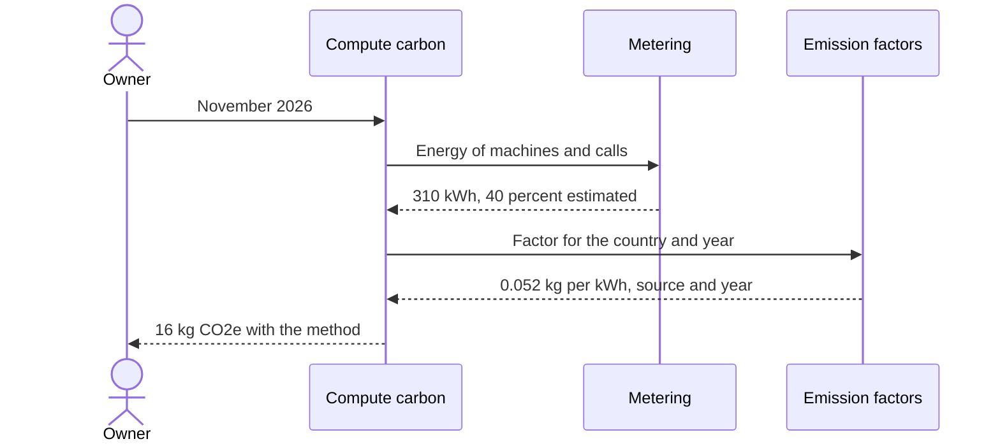

🏠 [Specs](../../../../README.md) › 🧩 [Functional capabilities](../../../README.md) ›
💸 [F22 Unified platform cost management](../../README.md) › 📝 [Use cases](../README.md) ›
📝 [Use cases: FL-F22-08 Credits, SaaS subscriptions, carbon and routing](README.md) ›
📝 UC-F22-29 Measure the carbon of compute

# 📝 UC-F22-29 Measure the carbon of compute

**Status:** ✅ specified

## Summary

The owner sees the carbon footprint of the company's compute: its self-hosted machines and the AI and scraping calls it
pays for. Every figure is an energy amount multiplied by an emission factor, and carries its method, its factor's source
and year, and whether it was measured or estimated. The figures can feed the company's sustainability report.

## Personas

- [U13 Owner](../../../../01-users/personas/u13-owner.md), who reads and explains the figures

## Goal

The owner knows what the platform's usage emits and can trust and explain each figure.

## Trigger

The owner opens the carbon screen, or the sustainability report asks for the compute figures
[UC-F8-28](../../../f08-accounting/use-cases/09-pay-analyse-and-report/uc-f08-28-prepare-the-sustainability-report.md).

## Frequency

Monthly; at the yearly sustainability report.

## Preconditions

- Metered usage exists ([E-F22-02 Metered call record](../../data/e-f22-02-metered-call-record.md)).
- Self-hosted machines are registered with their power and hours
  ([E-F22-15 Compute machine](../../data/e-f22-15-compute-machine.md)).
- The country pack names the emission factors and their source
  ([BR-F22-01](../../business-rules/br-f22-01-costs-follow-the-country-pack.md)).

## Postconditions

- **Succeeded:** the figures per module, provider and machine are shown with their method, source and year, in kg of CO2
  equivalent.
- **Failed:** no figure is shown for a source that has no factor; the screen says which factor is missing.

## Main flow

1. The owner opens the compute carbon screen
   ([S-F22-29 Compute carbon](../../screens/08-credits-saas-and-carbon/s-f22-29-compute-carbon.md)) and picks a period.
2. simple-ERP computes the energy of each self-hosted machine from its power and hours
   ([E-F22-15 Compute machine](../../data/e-f22-15-compute-machine.md)), and the energy of each paid call from the
   provider's published figure or, if none, from an estimate per unit marked as such.
3. It multiplies the energy by the emission factor of the country and year of the pack, and shows kg of CO2 equivalent
   per module, provider and machine.
4. Each figure opens its method: formula, factor, source, year and measured or estimated
   ([BR-F22-20](../../business-rules/br-f22-20-carbon-figures-carry-their-method-and-source.md)).
5. The owner compares months and sees what the savings recommendations would change
   ([UC-F22-23](../06-savings-and-kpis/uc-f22-23-act-on-savings-recommendations.md)).
6. The owner exports the figures for the sustainability report
   [UC-F8-28](../../../f08-accounting/use-cases/09-pay-analyse-and-report/uc-f08-28-prepare-the-sustainability-report.md).

## Alternative flows

- 2a. A provider publishes no figure: an estimate per unit is used, shown with a range and marked estimated.
- 3a. The company chose a different factor in its settings: the figure shows which one and why.
- 5a. A routing rule would change the model: the screen shows the carbon change next to the cost saving
  ([UC-F22-30](uc-f22-30-route-ai-tasks-to-save-costs.md)).

## Error flows

- 3e. No emission factor exists for the country and year: no figure is shown and the missing factor is named.
- 6e. The export is refused for a reader without the right: nothing leaves.
- Any step: a service does not answer; the call is retried first
  ([BR-F3-32](../../../f03-assistant/business-rules/br-f03-32-retry-before-an-error.md)), then the message follows the
  error pattern ([D122](../../../../06-decisions/ux/d122-error-message-standard.md)) and what the user typed stays on
  the screen.

## Business rules

- [BR-F22-20](../../business-rules/br-f22-20-carbon-figures-carry-their-method-and-source.md)

## Entities

- [E-F22-02 Metered call record](../../data/e-f22-02-metered-call-record.md): read, the metered calls
- [E-F22-15 Compute machine](../../data/e-f22-15-compute-machine.md): read, the self-hosted machines
- [E-F22-16 Savings recommendation](../../data/e-f22-16-savings-recommendation.md): read, the savings that change the
  footprint

## Permissions

Owner reads every figure. Administrator reads and exports them. Accounting reads the figures for the
sustainability report.

## Notifications

None: the screen is read when the owner wants it; the monthly summary goes in the owner's briefing.

## Audit events

Each calculation run (period, factors used and their versions), each export and each change of the factor chosen.

## AI involvement

The AI assistant may explain a figure and its method; it never invents a factor, and a figure without a source is not
read out ([BR-F3-04](../../../f03-assistant/business-rules/br-f03-04-never-invent.md)).

## API, MCP and A2A exposure

T5 operations of the capability for the personas above: create, read, update and list. The MCP tool of the
capability may read and propose, never confirm alone. No A2A skill.

## Screens

- [S-F22-29 Compute carbon](../../screens/08-credits-saas-and-carbon/s-f22-29-compute-carbon.md)

## Flowchart

See
[FL-F22-08 Credits, SaaS subscriptions, carbon and routing](../../flows/fl-f22-08-credits-saas-and-carbon.md#flowchart).

## Sequence diagram

## Acceptance criteria

1. **Given** a self-hosted machine of 200 W running 400 hours **when** the owner opens the month **then** the energy is
   80 kWh and the figure shows the factor, its source and its year.
2. **Given** a provider with no published figure **when** its calls are counted **then** the figure is marked estimated,
   with a range.
3. **Given** a country with no factor for the year **when** the screen is opened **then** no figure is shown and the
   missing factor is named.
4. **Given** a figure on the screen **when** the owner opens its method **then** the formula, factor, source, year and
   the kind measured or estimated are shown.

## Non-functional notes

The screen answers within 2 seconds for 10,000 records; every change is audited.

## Regulatory references

The reporting method (which emissions are counted, location-based or market-based factors, the framework the
report follows) is decided with the sustainability report of
[UC-F8-28](../../../f08-accounting/use-cases/09-pay-analyse-and-report/uc-f08-28-prepare-the-sustainability-report.md);
this screen applies the method chosen there. The company's own duty to report depends on its size and sector and is not
decided here. Carbon figures for purchases follow
[BR-F7-17](../../../f07-purchasing-and-stock/business-rules/br-f07-17-carbon-figures-say-how-they-were-computed.md).

## Related use cases

- [UC-F22-28 Manage SaaS subscriptions](uc-f22-28-manage-saas-subscriptions.md)
- [UC-F22-30 Route AI tasks to save costs](uc-f22-30-route-ai-tasks-to-save-costs.md)
- [UC-F22-22](../01-see-and-set-up/uc-f22-22-count-the-cost-of-self-hosted-compute.md)
- [UC-F22-23](../06-savings-and-kpis/uc-f22-23-act-on-savings-recommendations.md)
- [UC-F8-28](../../../f08-accounting/use-cases/09-pay-analyse-and-report/uc-f08-28-prepare-the-sustainability-report.md)
- [UC-F7-24](../../../f07-purchasing-and-stock/use-cases/09-compliance-and-carbon/uc-f07-24-measure-the-carbon-of-purchases.md)

## Open questions

None.

---

⬅️ [UC-F22-28 Manage SaaS subscriptions](uc-f22-28-manage-saas-subscriptions.md) · ⬆️ [Up](README.md) ·
➡️ [UC-F22-30 Route AI tasks to save costs](uc-f22-30-route-ai-tasks-to-save-costs.md)
