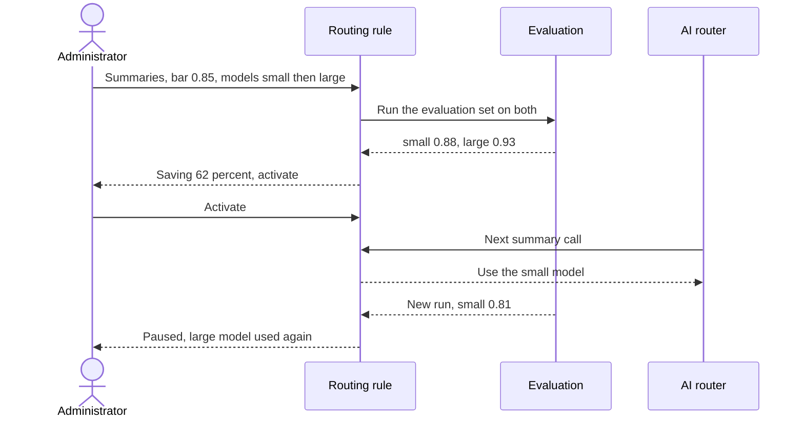

🏠 [Specs](../../../../README.md) › 🧩 [Functional capabilities](../../../README.md) ›
💸 [F22 Unified platform cost management](../../README.md) › 📝 [Use cases](../README.md) ›
📝 [Use cases: FL-F22-08 Credits, SaaS subscriptions, carbon and routing](README.md) ›
📝 UC-F22-30 Route AI tasks to save costs

# 📝 UC-F22-30 Route AI tasks to save costs

**Status:** ✅ specified

## Summary

The administrator sets routing rules: for each kind of AI task, the models in order of preference, the quality bar the
answers must reach, and a cost cap. The router picks the cheapest model whose last evaluation score meets the bar, and
falls back to a better one when none does. The screen shows the saving made and the quality measured.

## Personas

- [U07 Administrator](../../../../01-users/personas/u07-administrator.md), who sets, tests and retires the rules

## Goal

AI tasks cost less without a worse answer: the cheaper model is used only where it is good enough.

## Trigger

The administrator opens the routing screen, accepts a savings recommendation, or an evaluation run ends.

## Frequency

A few rules a quarter; the router decides on every AI call.

## Preconditions

- Several models are available in the AI providers ([E-F22-04 Paid provider](../../data/e-f22-04-paid-provider.md)) with
  their prices ([E-F22-03 Provider price list](../../data/e-f22-03-provider-price-list.md)).
- An evaluation set exists for the task kind
  ([E-F3-17 Evaluation question](../../../f03-assistant/data/e-f03-17-evaluation-question.md)) and can be run
  ([E-F3-18 Evaluation run](../../../f03-assistant/data/e-f03-18-evaluation-run.md)).
- Calls are metered ([BR-F22-02](../../business-rules/br-f22-02-every-paid-call-metered.md)).

## Postconditions

- **Succeeded:** the rule is Active; calls of the task kind go to the cheapest model that meets the bar; the saving and
  the quality are measured and shown.
- **Failed:** no rule is activated; calls keep going to the model they used before.

## Main flow

1. The administrator opens the model routing screen
   ([S-F22-30 Model routing](../../screens/08-credits-saas-and-carbon/s-f22-30-model-routing.md)) and adds a rule: the
   task kind, the models in order, the quality bar and the cost cap per call.
2. SimpleERP runs the task kind's evaluation set on each model of the rule and shows score, cost per call and expected
   saving
   ([UC-F3-14](../../../f03-assistant/use-cases/11-trust-the-answers/uc-f03-14-run-the-quality-evaluation-set.md)).
3. The rule can be activated only when the model chosen for the traffic reaches the bar
   ([BR-F22-21](../../business-rules/br-f22-21-routing-never-goes-below-a-tasks-quality-bar.md)).
4. From then on the router sends each call to the cheapest model whose last score meets the bar.
5. When an evaluation run drops below the bar, the rule is paused and calls go to the next model in order
   ([BR-F3-37](../../../f03-assistant/business-rules/br-f03-37-a-quality-drop-blocks-a-model-or-prompt-change.md)).
6. The administrator reads the saving made and the quality measured, and may retire the rule.

## Alternative flows

- 1a. A savings recommendation proposes a cheaper model for a task kind: accepting it opens the rule prefilled
  ([UC-F22-23](../06-savings-and-kpis/uc-f22-23-act-on-savings-recommendations.md)).
- 4a. A call needs a capability only one model has: the router uses it whatever its price, and the rule says so.
- 5a. All models of the rule are below the bar: calls go to the best model and the administrator is warned.

## Error flows

- 3e. The model chosen scores below the bar: the rule stays in Testing and is not activated.
- 4e. The cost cap of a call is exceeded by every model: the call is refused with a message and the administrator is
  told.
- Any step: a service does not answer; the call is retried first
  ([BR-F3-32](../../../f03-assistant/business-rules/br-f03-32-retry-before-an-error.md)), then the message follows the
  error pattern ([D122](../../../../06-decisions/ux/d122-error-message-standard.md)) and what the user typed stays on
  the screen.

## Business rules

- [BR-F22-21](../../business-rules/br-f22-21-routing-never-goes-below-a-tasks-quality-bar.md)
- [BR-F22-02](../../business-rules/br-f22-02-every-paid-call-metered.md)
- [BR-F22-16](../../business-rules/br-f22-16-recommendations-show-their-saving-and-never-act-alone.md)

## Entities

- [E-F22-21 Routing rule](../../data/e-f22-21-routing-rule.md): created, changed
- [E-F22-16 Savings recommendation](../../data/e-f22-16-savings-recommendation.md): read, the recommendation a rule may
  come from
- [E-F22-04 Paid provider](../../data/e-f22-04-paid-provider.md): read, the models
- [E-F3-18 Evaluation run](../../../f03-assistant/data/e-f03-18-evaluation-run.md): read, the evaluation run that gives
  the score

## Permissions

Administrator creates, tests, activates and retires rules. Owner reads the rules and the savings. Accounting
reads the savings.

## Notifications

The administrator: a rule paused for quality, a call refused by its cost cap, a saving above the monthly target.

## Audit events

Each rule created, tested, activated, paused, resumed and retired, with the scores and the models, and the daily total
of calls per model.

## AI involvement

No AI step of its own. The AI assistant may open the screen and prefill it from the user's words; the user checks and
confirms ([BR-F3-07](../../../f03-assistant/business-rules/br-f03-07-no-deletes-no-irreversible-acts.md)).

## API, MCP and A2A exposure

T5 operations of the capability for the personas above: create, read, update and list. The MCP tool of the
capability may read and propose, never confirm alone. No A2A skill.

## Screens

- [S-F22-30 Model routing](../../screens/08-credits-saas-and-carbon/s-f22-30-model-routing.md)

## Flowchart

See
[FL-F22-08 Credits, SaaS subscriptions, carbon and routing](../../flows/fl-f22-08-credits-saas-and-carbon.md#flowchart).

## Sequence diagram

## Acceptance criteria

1. **Given** a bar of 0.85 and a cheaper model scoring 0.88 **when** the rule is activated **then** calls go to the
   cheaper model.
2. **Given** the cheaper model scores 0.81 on a later run **when** the evaluation ends **then** the rule is paused and
   calls go to the next model.
3. **Given** a model scoring below the bar **when** the administrator tries to activate the rule **then** the activation
   is refused and the score is shown.
4. **Given** an active rule **when** a month passes **then** the screen shows the cost saved and the score measured.

## Non-functional notes

The screen answers within 2 seconds for 10,000 records; every change is audited.

## Regulatory references

None specific to this use case beyond the rules above.

## Related use cases

- [UC-F22-29 Measure the carbon of compute](uc-f22-29-measure-the-carbon-of-compute.md)
- [UC-F22-23](../06-savings-and-kpis/uc-f22-23-act-on-savings-recommendations.md)
- [UC-F22-18](../03-runs/uc-f22-18-spot-anomalies-and-runaway-agents.md)
- [UC-F3-14](../../../f03-assistant/use-cases/11-trust-the-answers/uc-f03-14-run-the-quality-evaluation-set.md)

## Open questions

None.

---

⬅️ [UC-F22-29 Measure the carbon of compute](uc-f22-29-measure-the-carbon-of-compute.md) · ⬆️ [Up](README.md)
