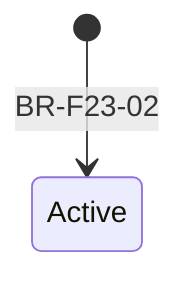

🏠 [Specs](../../../README.md) › 🧩 [Functional capabilities](../../README.md) ›
🔮 [F23 What-if simulation and impact](../README.md) › 🗃️ [Data](README.md) › 🗃️ E-F23-01 Baseline forecast

# 🗃️ E-F23-01 Baseline forecast

**Status:** ✅ specified

## Purpose

The current forecast.

## Fields

| Name | Type | Required | Validation | Default | Example | Personal data | Custom fields |
|---|---|---|---|---|---|---|---|
| company, horizon, method, built on | records | yes | BR-F23-02 | - | Acme, 18 months, history and plans, 2026-11-12 | no | no |

## Relations

As its use cases.

## Lifecycle

## Indexes and search

By number, date, partner.

## Retention

Kept for the period of its kind of record in the country pack (D293), or else its kind's default in the
[retention schedule](../../../05-non-functional/data-retention.md).

## Audit

Every change.

## Import and export

CSV, FEC where relevant.

## Used by

- [UC-F23-01](../use-cases/01-build-a-scenario/uc-f23-01-see-the-baseline-forecast.md)
- [UC-F23-24 Measure forecast accuracy and recalibrate](../use-cases/07-accuracy-and-drivers/uc-f23-24-measure-forecast-accuracy-and-recalibrate.md)

## Open questions

None.

---

⬆️ [Up](README.md) · ➡️ [E-F23-02 Scenario](e-f23-02-scenario.md)
