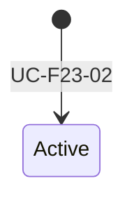

🏠 [Specs](../../../README.md) › 🧩 [Functional capabilities](../../README.md) ›
🔮 [F23 What-if simulation and impact](../README.md) › 🗃️ [Data](README.md) › 🗃️ E-F23-02 Scenario

# 🗃️ E-F23-02 Scenario

**Status:** ✅ specified

## Purpose

A named set of changes.

## Fields

| Name | Type | Required | Validation | Default | Example | Personal data | Custom fields |
|---|---|---|---|---|---|---|---|
| name, owner, horizon, readers, built by | records | yes | BR-F23-03, BR-F23-09 | - | Supplier +8 %, owner, 12 months, finance, AI assistant | no | no |

## Relations

As its use cases.

## Lifecycle

## Indexes and search

By number, date, partner.

## Retention

Kept for the period of its kind of record in the country pack (D293), or else its kind's default in the
[retention schedule](../../../05-non-functional/data-retention.md).

## Audit

Every change.

## Import and export

CSV, FEC where relevant.

## Used by

- [UC-F23-02](../use-cases/01-build-a-scenario/uc-f23-02-create-a-scenario.md)
- [UC-F23-15](../use-cases/04-decide/uc-f23-15-compare-scenarios-side-by-side.md)
- [UC-F23-19](../use-cases/04-decide/uc-f23-19-share-and-comment-a-scenario.md)
- [UC-F23-20](../use-cases/02-run/uc-f23-20-ask-the-assistant-what-if.md)
- [UC-F23-21 Seek a goal](../use-cases/06-goals-and-financing/uc-f23-21-seek-a-goal.md)

## Open questions

None.

---

⬅️ [E-F23-01 Baseline forecast](e-f23-01-baseline-forecast.md) · ⬆️ [Up](README.md) ·
➡️ [E-F23-03 Scenario change](e-f23-03-scenario-change.md)
