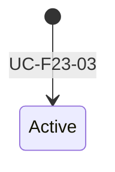

🏠 [Specs](../../../README.md) › 🧩 [Functional capabilities](../../README.md) ›
🔮 [F23 What-if simulation and impact](../README.md) › 🗃️ [Data](README.md) › 🗃️ E-F23-03 Scenario change

# 🗃️ E-F23-03 Scenario change

**Status:** ✅ specified

## Purpose

One element changed.

## Fields

| Name | Type | Required | Validation | Default | Example | Personal data | Custom fields |
|---|---|---|---|---|---|---|---|
| scenario, element, change, from, range | records | yes | BR-F23-07 | - | S-4, supplier Bois & Co prices, +8 %, 2027-01, 5 % to 10 % | no | no |

## Relations

As its use cases.

## Lifecycle

## Indexes and search

By number, date, partner.

## Retention

Kept for the period of its kind of record in the country pack (D293), or else its kind's default in the
[retention schedule](../../../05-non-functional/data-retention.md).

## Audit

Every change.

## Import and export

CSV, FEC where relevant.

## Used by

- [UC-F23-03](../use-cases/01-build-a-scenario/uc-f23-03-change-one-or-several-elements.md)
- [UC-F23-04](../use-cases/01-build-a-scenario/uc-f23-04-give-uncertain-inputs-as-ranges.md)
- [UC-F23-13](../use-cases/03-see-the-impact/uc-f23-13-include-platform-costs-in-a-scenario.md)
- [UC-F23-25 Use sector drivers](../use-cases/07-accuracy-and-drivers/uc-f23-25-use-sector-drivers.md)

## Open questions

None.

---

⬅️ [E-F23-02 Scenario](e-f23-02-scenario.md) · ⬆️ [Up](README.md) ·
➡️ [E-F23-04 Simulation run](e-f23-04-simulation-run.md)
