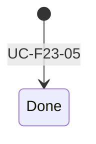

🏠 [Specs](../../../README.md) › 🧩 [Functional capabilities](../../README.md) ›
🔮 [F23 What-if simulation and impact](../README.md) › 🗃️ [Data](README.md) › 🗃️ E-F23-04 Simulation run

# 🗃️ E-F23-04 Simulation run

**Status:** ✅ specified

## Purpose

One run of a scenario.

## Fields

| Name | Type | Required | Validation | Default | Example | Personal data | Custom fields |
|---|---|---|---|---|---|---|---|
| scenario, data date, draws, state | records | yes | BR-F23-04 | - | S-4, 2026-11-12, 1 000, done | no | no |

## Relations

As its use cases.

## Lifecycle

## Indexes and search

By number, date, partner.

## Retention

Kept for the period of its kind of record in the country pack (D293), or else its kind's default in the
[retention schedule](../../../05-non-functional/data-retention.md).

## Audit

Every change.

## Import and export

CSV, FEC where relevant.

## Used by

- [UC-F23-05](../use-cases/02-run/uc-f23-05-run-the-scenario-on-a-copy-with-the-real-rules.md)
- [UC-F23-20](../use-cases/02-run/uc-f23-20-ask-the-assistant-what-if.md)

## Open questions

None.

---

⬅️ [E-F23-03 Scenario change](e-f23-03-scenario-change.md) · ⬆️ [Up](README.md) ·
➡️ [E-F23-05 Impact result](e-f23-05-impact-result.md)
