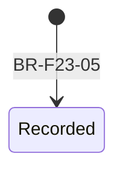

🏠 [Specs](../../../README.md) › 🧩 [Functional capabilities](../../README.md) ›
🔮 [F23 What-if simulation and impact](../README.md) › 🗃️ [Data](README.md) › 🗃️ E-F23-05 Impact result

# 🗃️ E-F23-05 Impact result

**Status:** ✅ specified

## Purpose

An area's result against the baseline.

## Fields

| Name | Type | Required | Validation | Default | Example | Personal data | Custom fields |
|---|---|---|---|---|---|---|---|
| run, area, measure, baseline, scenario, range | records | yes | BR-F23-05 | - | R-9, cash, June low, 92 k, 63 k, 42 k to 81 k | no | no |

## Relations

As its use cases.

## Lifecycle

## Indexes and search

By number, date, partner.

## Retention

Kept for the period of its kind of record in the country pack (D293), or else its kind's default in the
[retention schedule](../../../05-non-functional/data-retention.md).

## Audit

Every change.

## Import and export

CSV, FEC where relevant.

## Used by

- [UC-F23-06](../use-cases/03-see-the-impact/uc-f23-06-see-the-impact-on-sales-and-margin.md)
- [UC-F23-07](../use-cases/03-see-the-impact/uc-f23-07-see-the-impact-on-cash-and-treasury.md)
- [UC-F23-08](../use-cases/03-see-the-impact/uc-f23-08-see-the-impact-on-the-profit-and-loss-and-balance-sheet.md)
- [UC-F23-09](../use-cases/03-see-the-impact/uc-f23-09-see-the-impact-on-stock-and-purchases.md)
- [UC-F23-10](../use-cases/03-see-the-impact/uc-f23-10-see-the-impact-on-production-and-capacity.md)
- [UC-F23-11](../use-cases/03-see-the-impact/uc-f23-11-see-the-impact-on-staff-payroll-and-planning.md)
- [UC-F23-12](../use-cases/03-see-the-impact/uc-f23-12-see-legal-thresholds-and-taxes-crossed.md)
- [UC-F23-13](../use-cases/03-see-the-impact/uc-f23-13-include-platform-costs-in-a-scenario.md)
- [UC-F23-20](../use-cases/02-run/uc-f23-20-ask-the-assistant-what-if.md)
- [UC-F23-23 Simulate financing options](../use-cases/06-goals-and-financing/uc-f23-23-simulate-financing-options.md)

## Open questions

None.

---

⬅️ [E-F23-04 Simulation run](e-f23-04-simulation-run.md) · ⬆️ [Up](README.md) ·
➡️ [E-F23-06 Sensitivity](e-f23-06-sensitivity.md)
