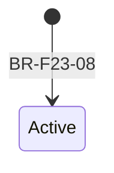

🏠 [Specs](../../../README.md) › 🧩 [Functional capabilities](../../README.md) ›
🔮 [F23 What-if simulation and impact](../README.md) › 🗃️ [Data](README.md) › 🗃️ E-F23-06 Sensitivity

# 🗃️ E-F23-06 Sensitivity

**Status:** ✅ specified

## Purpose

Inputs ranked by effect.

## Fields

| Name | Type | Required | Validation | Default | Example | Personal data | Custom fields |
|---|---|---|---|---|---|---|---|
| run, input, effect | records | yes | BR-F23-08 | - | R-9, supplier price, 61 % | no | no |

## Relations

As its use cases.

## Lifecycle

## Indexes and search

By number, date, partner.

## Retention

Kept for the period of its kind of record in the country pack (D293), or else its kind's default in the
[retention schedule](../../../05-non-functional/data-retention.md).

## Audit

Every change.

## Import and export

CSV, FEC where relevant.

## Used by

- [UC-F23-14](../use-cases/04-decide/uc-f23-14-see-what-matters-most.md)
- [UC-F23-15](../use-cases/04-decide/uc-f23-15-compare-scenarios-side-by-side.md)

## Open questions

None.

---

⬅️ [E-F23-05 Impact result](e-f23-05-impact-result.md) · ⬆️ [Up](README.md) ·
➡️ [E-F23-07 Counter-measure](e-f23-07-counter-measure.md)
