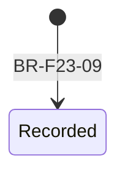

🏠 [Specs](../../../README.md) › 🧩 [Functional capabilities](../../README.md) ›
🔮 [F23 What-if simulation and impact](../README.md) › 🗃️ [Data](README.md) › 🗃️ E-F23-07 Counter-measure

# 🗃️ E-F23-07 Counter-measure

**Status:** ✅ specified

## Purpose

An option to soften an impact.

## Fields

| Name | Type | Required | Validation | Default | Example | Personal data | Custom fields |
|---|---|---|---|---|---|---|---|
| scenario, option, effect | records | yes | BR-F23-09 | - | S-4, raise prices 3 %, margin back to 31 % | no | no |

## Relations

As its use cases.

## Lifecycle

## Indexes and search

By number, date, partner.

## Retention

Kept for the period of its kind of record in the country pack (D293), or else its kind's default in the
[retention schedule](../../../05-non-functional/data-retention.md).

## Audit

Every change.

## Import and export

CSV, FEC where relevant.

## Used by

- [UC-F23-16](../use-cases/04-decide/uc-f23-16-get-counter-measures-proposed.md)

## Open questions

None.

---

⬅️ [E-F23-06 Sensitivity](e-f23-06-sensitivity.md) · ⬆️ [Up](README.md) ·
➡️ [E-F23-08 Action proposal](e-f23-08-action-proposal.md)
