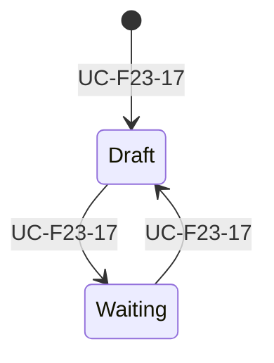

🏠 [Specs](../../../README.md) › 🧩 [Functional capabilities](../../README.md) ›
🔮 [F23 What-if simulation and impact](../README.md) › 🗃️ [Data](README.md) › 🗃️ E-F23-08 Action proposal

# 🗃️ E-F23-08 Action proposal

**Status:** ✅ specified

## Purpose

A proposal created in a capability.

## Fields

| Name | Type | Required | Validation | Default | Example | Personal data | Custom fields |
|---|---|---|---|---|---|---|---|
| scenario, capability, proposal, state | records | yes | BR-F23-10 | - | S-4, F6, price list draft, waiting | no | no |

## Relations

As its use cases.

## Lifecycle

## Indexes and search

By number, date, partner.

## Retention

Kept for the period of its kind of record in the country pack (D293), or else its kind's default in the
[retention schedule](../../../05-non-functional/data-retention.md).

## Audit

Every change.

## Import and export

CSV, FEC where relevant.

## Used by

- [UC-F23-17](../use-cases/05-act-and-watch/uc-f23-17-turn-a-scenario-into-actions.md)

## Open questions

None.

---

⬅️ [E-F23-07 Counter-measure](e-f23-07-counter-measure.md) · ⬆️ [Up](README.md) ·
➡️ [E-F23-09 Change warning](e-f23-09-change-warning.md)
