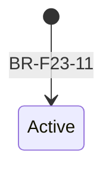

🏠 [Specs](../../../README.md) › 🧩 [Functional capabilities](../../README.md) ›
🔮 [F23 What-if simulation and impact](../README.md) › 🗃️ [Data](README.md) › 🗃️ E-F23-09 Change warning

# 🗃️ E-F23-09 Change warning

**Status:** ✅ specified

## Purpose

A real change against the baseline.

## Fields

| Name | Type | Required | Validation | Default | Example | Personal data | Custom fields |
|---|---|---|---|---|---|---|---|
| change, impact, sent | records | yes | BR-F23-11 | - | supplier price +6 %, cash -14 k, yes | no | no |

## Relations

As its use cases.

## Lifecycle

## Indexes and search

By number, date, partner.

## Retention

Kept for the period of its kind of record in the country pack (D293), or else its kind's default in the
[retention schedule](../../../05-non-functional/data-retention.md).

## Audit

Every change.

## Import and export

CSV, FEC where relevant.

## Used by

- [UC-F23-18](../use-cases/05-act-and-watch/uc-f23-18-be-warned-when-a-real-change-hits-the-forecast.md)

## Open questions

None.

---

⬅️ [E-F23-08 Action proposal](e-f23-08-action-proposal.md) · ⬆️ [Up](README.md) ·
➡️ [E-F23-10 Scenario comment](e-f23-10-scenario-comment.md)
