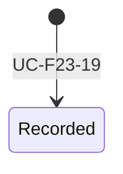

🏠 [Specs](../../../README.md) › 🧩 [Functional capabilities](../../README.md) ›
🔮 [F23 What-if simulation and impact](../README.md) › 🗃️ [Data](README.md) › 🗃️ E-F23-10 Scenario comment

# 🗃️ E-F23-10 Scenario comment

**Status:** ✅ specified

## Purpose

A comment on a scenario.

## Fields

| Name | Type | Required | Validation | Default | Example | Personal data | Custom fields |
|---|---|---|---|---|---|---|---|
| scenario, author, text | records | yes | - | - | S-4, accountant, check the energy line | yes | no |

## Relations

As its use cases.

## Lifecycle

## Indexes and search

By number, date, partner.

## Retention

Kept for the period of its kind of record in the country pack (D293), or else its kind's default in the
[retention schedule](../../../05-non-functional/data-retention.md).

## Audit

Every change.

## Import and export

CSV, FEC where relevant.

## Used by

- [UC-F23-19](../use-cases/04-decide/uc-f23-19-share-and-comment-a-scenario.md)
- [UC-F23-29 Prepare a forecast pack for the bank](../use-cases/06-goals-and-financing/uc-f23-29-prepare-a-forecast-pack-for-the-bank.md)

## Open questions

None.

---

⬅️ [E-F23-09 Change warning](e-f23-09-change-warning.md) · ⬆️ [Up](README.md) · ➡️ [E-F23-11 Goal](e-f23-11-goal.md)
