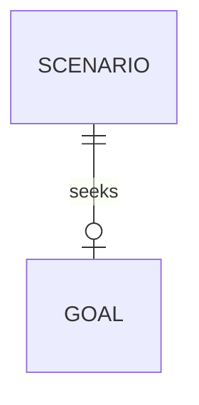
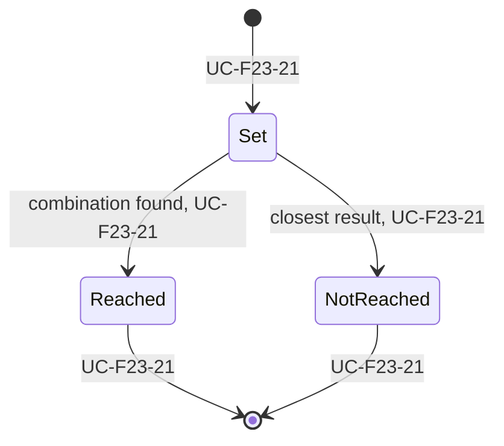

🏠 [Specs](../../../README.md) › 🧩 [Functional capabilities](../../README.md) ›
🔮 [F23 What-if simulation and impact](../README.md) › 🗃️ [Data](README.md) › 🗃️ E-F23-11 Goal

# 🗃️ E-F23-11 Goal

**Status:** ✅ specified

## Purpose

A target the owner wants to reach, with the levers allowed and their bounds.

## Fields

| Name | Type | Required | Validation | Default | Example | Personal data | Custom fields |
|---|---|---|---|---|---|---|---|
| measure | choice | yes | margin, cash, profit, break-even | - | margin | no | no |
| target, by | value, date | yes | - | - | 12 %, 2027-06-30 | no | no |
| levers | list | yes | element and bounds | - | price +0 to +5 %, purchases -5 to 0 % | no | no |
| result | text | after run | - | - | price +2.5 %, purchases -3 % | no | no |

## Relations

## Lifecycle

## Indexes and search

By scenario.

## Retention

As the scenario.

## Audit

Every creation and change, with who, when, the old and the new value.

## Import and export

CSV and JSON export through the API (T5); no bulk import.

## Used by

- [UC-F23-21 Seek a goal](../use-cases/06-goals-and-financing/uc-f23-21-seek-a-goal.md)
- [UC-F23-22 Find the break-even point](../use-cases/06-goals-and-financing/uc-f23-22-find-the-break-even-point.md)

## Open questions

None.

---

⬅️ [E-F23-10 Scenario comment](e-f23-10-scenario-comment.md) · ⬆️ [Up](README.md) ·
➡️ [E-F23-12 Financing option](e-f23-12-financing-option.md)
