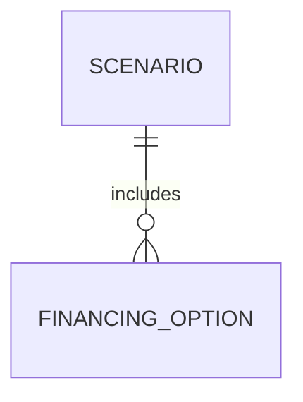
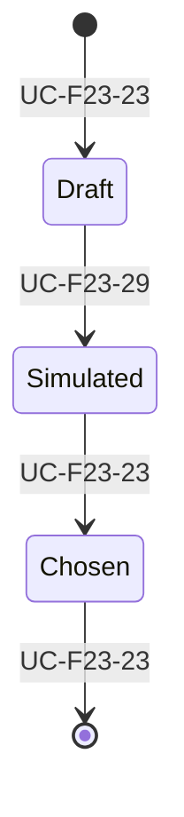

🏠 [Specs](../../../README.md) › 🧩 [Functional capabilities](../../README.md) ›
🔮 [F23 What-if simulation and impact](../README.md) › 🗃️ [Data](README.md) › 🗃️ E-F23-12 Financing option

# 🗃️ E-F23-12 Financing option

**Status:** ✅ specified

## Purpose

A loan, leasing or credit line simulated in a scenario.

## Fields

| Name | Type | Required | Validation | Default | Example | Personal data | Custom fields |
|---|---|---|---|---|---|---|---|
| kind | choice | yes | loan, leasing, credit line | - | loan | no | no |
| amount, rate, duration | amount, percent, months | yes | - | - | 80 000.00, 4.2 %, 60 | no | no |
| fees | amount | no | - | 0 | 800.00 | no | no |
| covenants | list | no | ratio and limit | - | net debt to EBITDA below 3 | no | no |

## Relations

## Lifecycle

## Indexes and search

By scenario and kind.

## Retention

As the scenario.

## Audit

Every creation and change, with who, when, the old and the new value.

## Import and export

CSV and JSON export through the API (T5); no bulk import.

## Used by

- [UC-F23-23 Simulate financing options](../use-cases/06-goals-and-financing/uc-f23-23-simulate-financing-options.md)
- [UC-F23-29 Prepare a forecast pack for the bank](../use-cases/06-goals-and-financing/uc-f23-29-prepare-a-forecast-pack-for-the-bank.md)

## Open questions

None.

---

⬅️ [E-F23-11 Goal](e-f23-11-goal.md) · ⬆️ [Up](README.md) · ➡️ [E-F23-13 Driver accuracy](e-f23-13-driver-accuracy.md)
