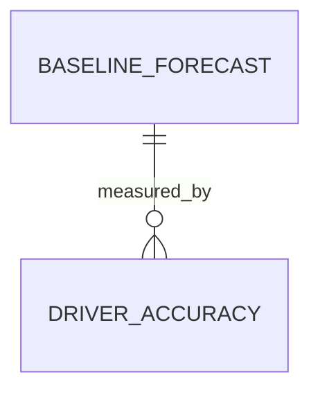
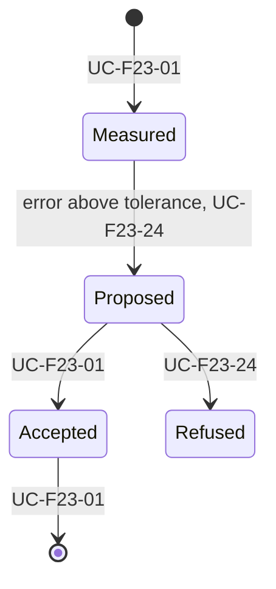

🏠 [Specs](../../../README.md) › 🧩 [Functional capabilities](../../README.md) ›
🔮 [F23 What-if simulation and impact](../README.md) › 🗃️ [Data](README.md) › 🗃️ E-F23-13 Driver accuracy

# 🗃️ E-F23-13 Driver accuracy

**Status:** 🔄 waiting for the owner

## Purpose

The forecast error of one driver for one closed month.

## Fields

| Name | Type | Required | Validation | Default | Example | Personal data | Custom fields |
|---|---|---|---|---|---|---|---|
| driver | text | yes | - | - | sales volume | no | no |
| month | month | yes | closed in F8 | - | 2026-10 | no | no |
| forecast, actual | numbers | yes | - | - | 100, 109 | no | no |
| error | percent | yes | computed | computed | 9 % | no | no |
| recalibration | choice | no | proposed, accepted, refused | - | accepted | no | no |

## Relations

## Lifecycle

## Indexes and search

By driver and month.

## Retention

(Proposed) 5 years.

## Audit

Every creation and change, with who, when, the old and the new value.

## Import and export

CSV and JSON export through the API (T5); no bulk import.

## Used by

- [UC-F23-24 Measure forecast accuracy and recalibrate](../use-cases/07-accuracy-and-drivers/uc-f23-24-measure-forecast-accuracy-and-recalibrate.md)
- [UC-F23-01 See the baseline forecast](../use-cases/01-build-a-scenario/uc-f23-01-see-the-baseline-forecast.md)

## Open questions

None.

---

⬅️ [E-F23-12 Financing option](e-f23-12-financing-option.md) · ⬆️ [Up](README.md) ·
➡️ [E-F23-14 Sector driver](e-f23-14-sector-driver.md)
