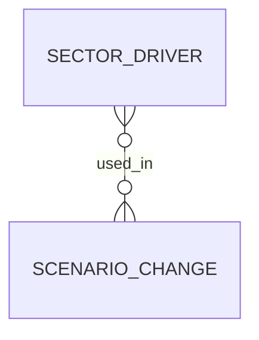
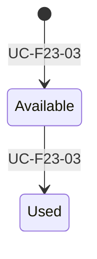

🏠 [Specs](../../../README.md) › 🧩 [Functional capabilities](../../README.md) ›
🔮 [F23 What-if simulation and impact](../README.md) › 🗃️ [Data](README.md) › 🗃️ E-F23-14 Sector driver

# 🗃️ E-F23-14 Sector driver

**Status:** ✅ specified

## Purpose

A driver a sector pack adds, with its formula and data source.

## Fields

| Name | Type | Required | Validation | Default | Example | Personal data | Custom fields |
|---|---|---|---|---|---|---|---|
| sector | link | yes | a sector pack | - | SC06 | no | no |
| name, formula | text | yes | - | from the pack | occupancy, covers over seats | no | no |
| source | text | no | a record type | - | bookings | no | no |
| target | number | no | - | - | 72 % | no | no |

## Relations

## Lifecycle

## Indexes and search

By sector.

## Retention

Shipped with the sector pack.

## Audit

Every creation and change, with who, when, the old and the new value.

## Import and export

CSV and JSON export through the API (T5); no bulk import.

## Used by

- [UC-F23-25 Use sector drivers](../use-cases/07-accuracy-and-drivers/uc-f23-25-use-sector-drivers.md)
- [UC-F23-03 Change one or several elements](../use-cases/01-build-a-scenario/uc-f23-03-change-one-or-several-elements.md)

## Open questions

None.

---

⬅️ [E-F23-13 Driver accuracy](e-f23-13-driver-accuracy.md) · ⬆️ [Up](README.md) ·
➡️ [E-F23-15 Budget contribution](e-f23-15-budget-contribution.md)
