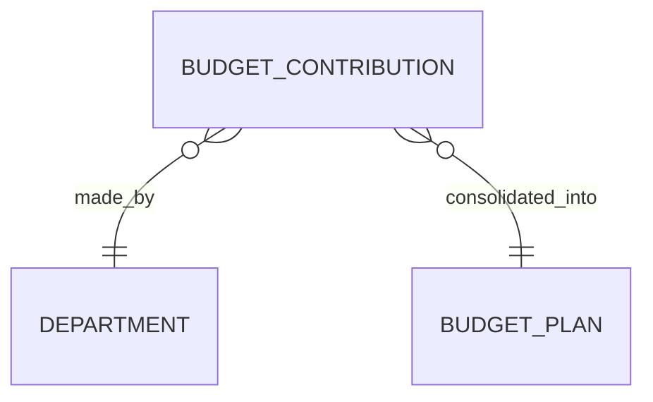
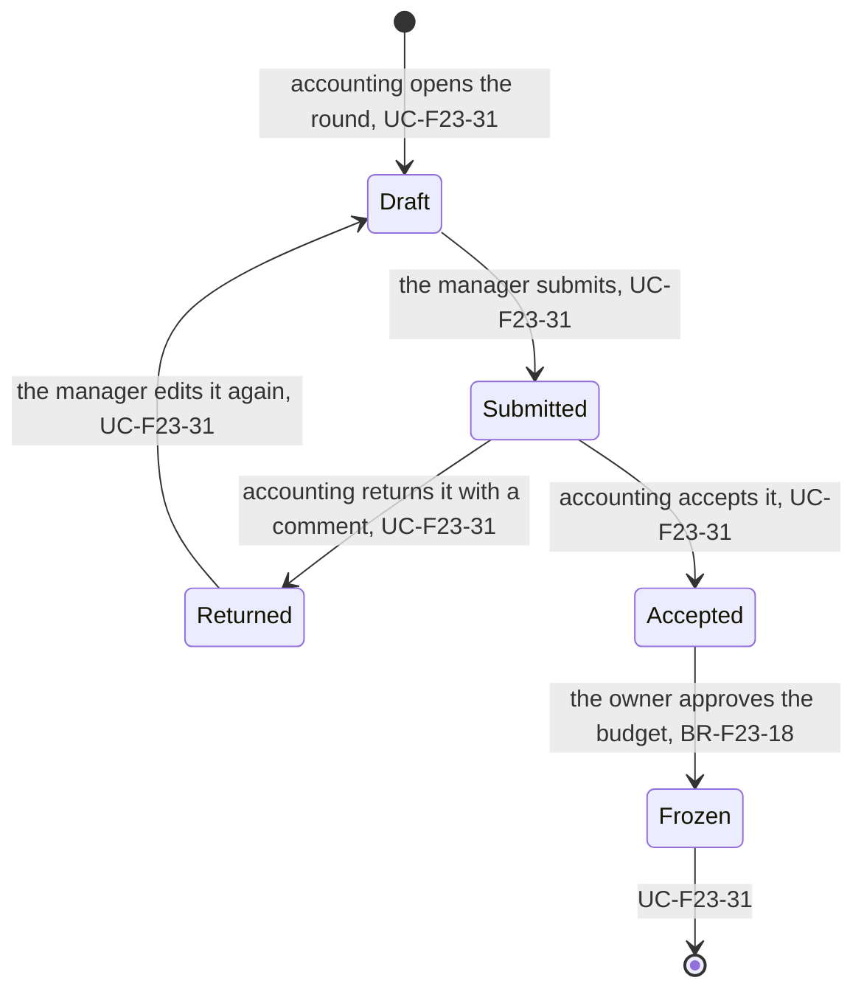

🏠 [Specs](../../../README.md) › 🧩 [Functional capabilities](../../README.md) ›
🔮 [F23 What-if simulation and impact](../README.md) › 🗃️ [Data](README.md) › 🗃️ E-F23-15 Budget contribution

# 🗃️ E-F23-15 Budget contribution

**Status:** ✅ specified

## Purpose

One department's contribution to a budget round: its lines, its assumptions and its state
([D542](../../../06-decisions/f23-what-if-simulation/d542-benchmark-gaps-f23-what-if-simulation.md)). It differs from
the budget plan of the accounting ([E-F8-16 Budget plan](../../f08-accounting/data/e-f08-16-budget-plan.md)), which is
the approved result: a contribution is one owner's input to it, kept as the record of who asked for what and why.

## Fields

| Name | Type | Required | Validation | Default | Example | Personal data | Custom fields |
|---|---|---|---|---|---|---|---|
| round | year | yes | an open or closed round | - | 2027 | no | no |
| department | department | yes | a department of the company | - | Sales | no | no |
| manager | user | yes | a manager of the department | the department head | Claire P. | yes | no |
| envelope | amount with currency | yes | 0 or more | last year's actuals | 120,000 EUR | no | no |
| lines | list of account or analytic target and amount | yes | at least one line | last year's lines | 6411 salaries 90,000 | no | no |
| assumptions | text per line | yes | not empty for a line over 10,000 EUR | - | 2 hires in March | no | no |
| comment | text | no | up to 1,000 characters | none | Reduce travel | no | no |
| state | Draft, Submitted, Returned, Accepted, Frozen | yes | the lifecycle below | Draft | Submitted | no | no |
| owner | user | yes | a user of the company | the creator | Claire P. | yes | no |

## Relations

- [E-F8-16 Budget plan](../../f08-accounting/data/e-f08-16-budget-plan.md)
- [E-F23-01 Baseline forecast](e-f23-01-baseline-forecast.md)

## Lifecycle

## Indexes and search

By round, department, manager and state.

## Retention

Kept 10 years with the budget plan it belongs to.

## Audit

Every line entered, submission, return, acceptance and freezing, with who, when and the amounts before and after.

## Import and export

Import a contribution from a spreadsheet; export the round with the budget reports
([UC-F8-11](../../f08-accounting/use-cases/05-close-report-and-consolidate/uc-f08-11-read-financial-reports.md)).

## Used by

- [UC-F23-31](../use-cases/08-budgets-rolling-group-and-valuation/uc-f23-31-build-the-budget-with-department-owners.md)

## Open questions

None.

---

⬅️ [E-F23-14 Sector driver](e-f23-14-sector-driver.md) · ⬆️ [Up](README.md) ·
➡️ [E-F23-16 Forecast version](e-f23-16-forecast-version.md)
