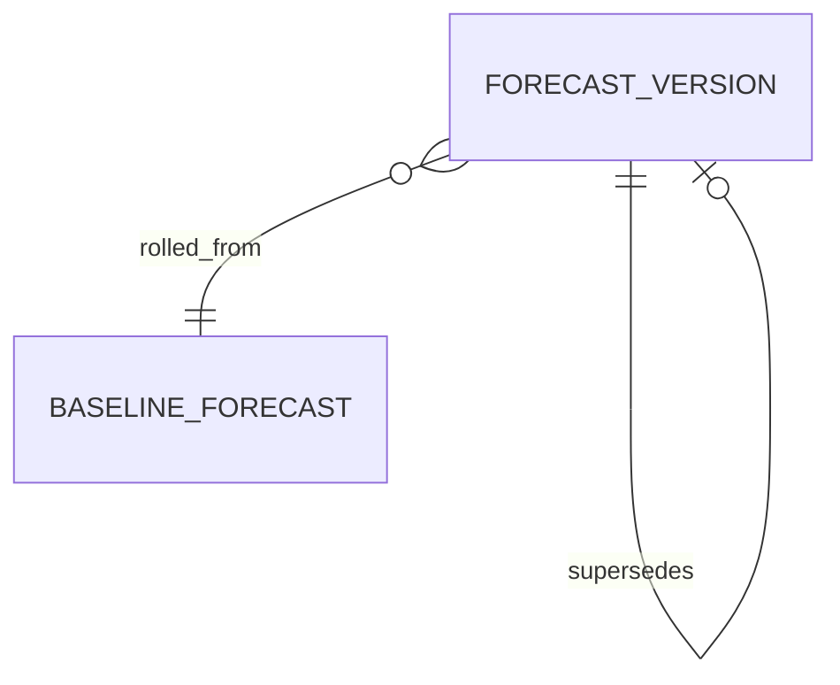
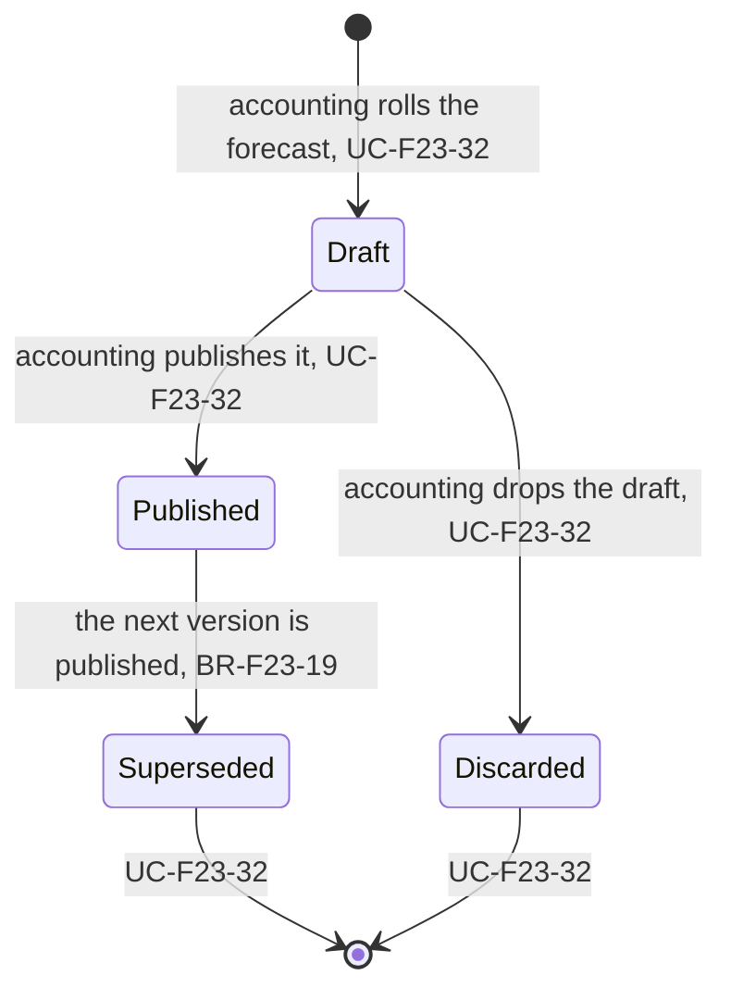

🏠 [Specs](../../../README.md) › 🧩 [Functional capabilities](../../README.md) ›
🔮 [F23 What-if simulation and impact](../README.md) › 🗃️ [Data](README.md) › 🗃️ E-F23-16 Forecast version

# 🗃️ E-F23-16 Forecast version

**Status:** ✅ specified

## Purpose

One numbered version of the rolling forecast: its horizon, its totals, its assumptions and its author
([D542](../../../06-decisions/f23-what-if-simulation/d542-benchmark-gaps-f23-what-if-simulation.md)). It differs from
the baseline forecast ([E-F23-01 Baseline forecast](e-f23-01-baseline-forecast.md)), which is the one current forecast
scenarios start from: a version is the dated copy kept for comparison.

## Fields

| Name | Type | Required | Validation | Default | Example | Personal data | Custom fields |
|---|---|---|---|---|---|---|---|
| number | number | yes | next in the series | next number | 11 | no | no |
| horizon | months | yes | from the first open month | 12 | 2026-11 to 2027-10 | no | no |
| totals | amounts per line and month | yes | from the baseline method | - | revenue 1,790 k | no | no |
| assumptions | text per line | yes | a reason for each change from the previous version | - | supplier +3 % | no | no |
| author | user | yes | a user of the company | the creator | Anna R. | yes | no |
| published on | date | no | after the creation | none | 2026-11-05 | no | no |
| state | Draft, Published, Discarded, Superseded | yes | the lifecycle below | Draft | Published | no | no |
| owner | user | yes | a user of the company | the creator | Claire P. | yes | no |

## Relations

- [E-F23-01 Baseline forecast](e-f23-01-baseline-forecast.md)
- [E-F8-10 Fiscal period](../../f08-accounting/data/e-f08-10-fiscal-period.md)

## Lifecycle

## Indexes and search

By number, horizon, state and publication date.

## Retention

Kept 10 years, to measure accuracy and answer an auditor
([CR-FR-002](../../../10-country-packs/france/accounting/cr-fr-002-accounting-records-kept-ten-years.md)).

## Audit

Every roll, assumption change, publication and supersession, with who, when and the figures.

## Import and export

No import. Export with the forecast reports
([UC-F23-29](../use-cases/06-goals-and-financing/uc-f23-29-prepare-a-forecast-pack-for-the-bank.md)).

## Used by

- [UC-F23-32](../use-cases/08-budgets-rolling-group-and-valuation/uc-f23-32-roll-the-forecast-forward.md)

## Open questions

None.

---

⬅️ [E-F23-15 Budget contribution](e-f23-15-budget-contribution.md) · ⬆️ [Up](README.md) ·
➡️ [E-F23-17 Valuation](e-f23-17-valuation.md)
