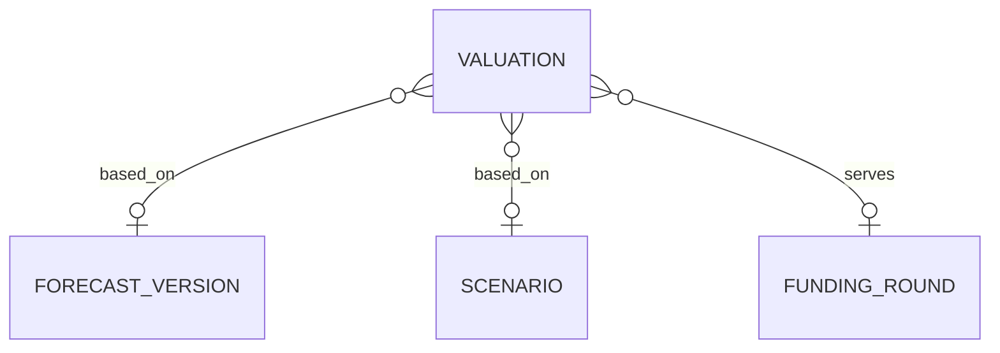
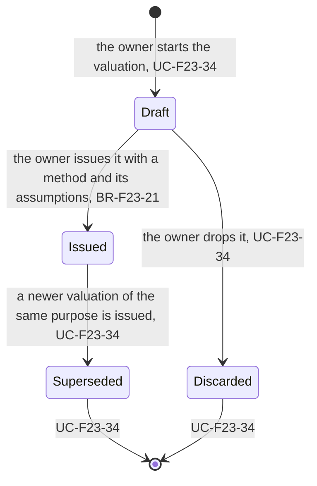

🏠 [Specs](../../../README.md) › 🧩 [Functional capabilities](../../README.md) ›
🔮 [F23 What-if simulation and impact](../README.md) › 🗃️ [Data](README.md) › 🗃️ E-F23-17 Valuation

# 🗃️ E-F23-17 Valuation

**Status:** ✅ specified

## Purpose

A valuation of the company or of a non-profit's net assets at a date: its basis, its purpose, its methods and
assumptions, and its range
([D542](../../../06-decisions/f23-what-if-simulation/d542-benchmark-gaps-f23-what-if-simulation.md)).

## Fields

| Name | Type | Required | Validation | Default | Example | Personal data | Custom fields |
|---|---|---|---|---|---|---|---|
| based on | forecast version or scenario | yes | a published version or a scenario | - | forecast version 11 | no | no |
| purpose | funding round, sale, gift, internal | yes | a value of the list | internal | funding round | no | no |
| methods | list of methods with low, central and high values | yes | at least one method | - | multiple of revenue | no | no |
| assumptions | values with their source | yes | a source for each | - | rate 11 % | no | no |
| valuation date | date | yes | not in the future | today | 2026-11-14 | no | no |
| author | user | yes | the owner or the treasurer | the creator | Claire P. | yes | no |
| state | Draft, Issued, Discarded, Superseded | yes | the lifecycle below | Draft | Issued | no | no |
| owner | user | yes | a user of the company | the creator | Claire P. | yes | no |

## Relations

- [E-F23-02 Scenario](e-f23-02-scenario.md)
- [E-F23-16 Forecast version](e-f23-16-forecast-version.md)
- [E-F15-17 Funding round](../../f15-legal-assistant/data/e-f15-17-funding-round.md)

## Lifecycle

## Indexes and search

By purpose, valuation date, state and author.

## Retention

Kept 10 years with the documents of the operation it served.

## Audit

Every valuation, assumption change, issue and supersession, with who, when and the figures.

## Import and export

No import. Export as a document with its methods and assumptions.

## Used by

- [UC-F23-34](../use-cases/08-budgets-rolling-group-and-valuation/uc-f23-34-value-the-company.md)

## Open questions

None.

---

⬅️ [E-F23-16 Forecast version](e-f23-16-forecast-version.md) · ⬆️ [Up](README.md)
