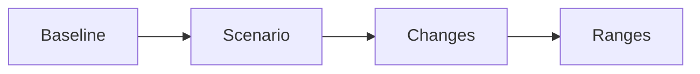

🏠 [Specs](../../../README.md) › 🧩 [Functional capabilities](../../README.md) ›
🔮 [F23 What-if simulation and impact](../README.md) › 🔀 [Flows](README.md) › 🔀 FL-F23-01 Build a scenario

# 🔀 FL-F23-01 Build a scenario

**Status:** ✅ specified

## Summary

Covers UC-F23-01, UC-F23-02, UC-F23-03, UC-F23-04.

## Personas

- [U02 Manager](../../../01-users/personas/u02-manager.md)
- [U05 Accounting](../../../01-users/personas/u05-accounting.md)
- [U13 Owner](../../../01-users/personas/u13-owner.md)
- [U31 Treasurer](../../../01-users/personas/u31-treasurer.md)

## Flowchart

## Sequence diagram

See each use case.

## Steps

| Step | Persona | Screen | Use case | What happens |
|---|---|---|---|---|
| 1 | U13, U05 | [S-F23-01](../screens/01-build-a-scenario/s-f23-01-baseline.md) | [UC-F23-01](../use-cases/01-build-a-scenario/uc-f23-01-see-the-baseline-forecast.md) | See the baseline forecast |
| 2 | U13, U02 | [S-F23-02](../screens/01-build-a-scenario/s-f23-02-new-scenario.md) | [UC-F23-02](../use-cases/01-build-a-scenario/uc-f23-02-create-a-scenario.md) | Create a scenario |
| 3 | U13, U02 | [S-F23-03](../screens/01-build-a-scenario/s-f23-03-changes.md) | [UC-F23-03](../use-cases/01-build-a-scenario/uc-f23-03-change-one-or-several-elements.md) | Change one or several elements |
| 4 | U05, U31 | [S-F23-04](../screens/01-build-a-scenario/s-f23-04-ranges.md) | [UC-F23-04](../use-cases/01-build-a-scenario/uc-f23-04-give-uncertain-inputs-as-ranges.md) | Give uncertain inputs as ranges |

### Entities and screens

| Entity | States in this flow | Shown at step and screen | Aggregated view |
|---|---|---|---|
| [E-F23-01 Baseline forecast](../data/e-f23-01-baseline-forecast.md) | Active | 1 [S-F23-01](../screens/01-build-a-scenario/s-f23-01-baseline.md) | Baseline forecasts |
| [E-F23-02 Scenario](../data/e-f23-02-scenario.md) | Active | 2 [S-F23-02](../screens/01-build-a-scenario/s-f23-02-new-scenario.md) | Scenarios |
| [E-F23-03 Scenario change](../data/e-f23-03-scenario-change.md) | Active | 3 [S-F23-03](../screens/01-build-a-scenario/s-f23-03-changes.md); 4 [S-F23-04](../screens/01-build-a-scenario/s-f23-04-ranges.md) | Scenario changes |

## Errors

As each use case.

## Images

Every step and error, for each persona taking part, in light and dark mode (D120). Steps are numbered as in the Steps
table; E rows are the error cases.

| Step | Persona | Device | Light | Dark |
|---|---|---|---|---|
| 1 | U13 | desktop | [light](../images/01-build-a-scenario/u13-owner/1-baseline-desktop-light.png) | [dark](../images/01-build-a-scenario/u13-owner/1-baseline-desktop-dark.png) |
| 1 | U13 | phone | [light](../images/01-build-a-scenario/u13-owner/1-baseline-phone-light.png) | [dark](../images/01-build-a-scenario/u13-owner/1-baseline-phone-dark.png) |
| 1 | U05 | desktop | [light](../images/01-build-a-scenario/u05-accounting/1-baseline-desktop-light.png) | [dark](../images/01-build-a-scenario/u05-accounting/1-baseline-desktop-dark.png) |
| 2 | U02 | desktop | [light](../images/01-build-a-scenario/u02-manager/2-create-desktop-light.png) | [dark](../images/01-build-a-scenario/u02-manager/2-create-desktop-dark.png) |
| 2 | U02 | phone | [light](../images/01-build-a-scenario/u02-manager/2-create-phone-light.png) | [dark](../images/01-build-a-scenario/u02-manager/2-create-phone-dark.png) |
| 2 | U13 | desktop | [light](../images/01-build-a-scenario/u13-owner/2-create-desktop-light.png) | [dark](../images/01-build-a-scenario/u13-owner/2-create-desktop-dark.png) |
| 2 | U13 | phone | [light](../images/01-build-a-scenario/u13-owner/2-create-phone-light.png) | [dark](../images/01-build-a-scenario/u13-owner/2-create-phone-dark.png) |
| 3 | U13 | desktop | [light](../images/01-build-a-scenario/u13-owner/3-changes-desktop-light.png) | [dark](../images/01-build-a-scenario/u13-owner/3-changes-desktop-dark.png) |
| 3 | U13 | phone | [light](../images/01-build-a-scenario/u13-owner/3-changes-phone-light.png) | [dark](../images/01-build-a-scenario/u13-owner/3-changes-phone-dark.png) |
| 3 | U02 | desktop | [light](../images/01-build-a-scenario/u02-manager/3-changes-desktop-light.png) | [dark](../images/01-build-a-scenario/u02-manager/3-changes-desktop-dark.png) |
| 3 | U02 | phone | [light](../images/01-build-a-scenario/u02-manager/3-changes-phone-light.png) | [dark](../images/01-build-a-scenario/u02-manager/3-changes-phone-dark.png) |
| 4 | U31 | desktop | [light](../images/01-build-a-scenario/u31-treasurer/4-ranges-desktop-light.png) | [dark](../images/01-build-a-scenario/u31-treasurer/4-ranges-desktop-dark.png) |
| 4 | U31 | phone | [light](../images/01-build-a-scenario/u31-treasurer/4-ranges-phone-light.png) | [dark](../images/01-build-a-scenario/u31-treasurer/4-ranges-phone-dark.png) |
| 4 | U05 | desktop | [light](../images/01-build-a-scenario/u05-accounting/4-ranges-desktop-light.png) | [dark](../images/01-build-a-scenario/u05-accounting/4-ranges-desktop-dark.png) |
| E1 | U02 | desktop | [light](../images/01-build-a-scenario/u02-manager/e1-no-right-desktop-light.png) | [dark](../images/01-build-a-scenario/u02-manager/e1-no-right-desktop-dark.png) |
| E1 | U02 | phone | [light](../images/01-build-a-scenario/u02-manager/e1-no-right-phone-light.png) | [dark](../images/01-build-a-scenario/u02-manager/e1-no-right-phone-dark.png) |

## Open questions

None.

---

⬆️ [Up](README.md) · ➡️ [FL-F23-02 Run](fl-f23-02-run.md)
