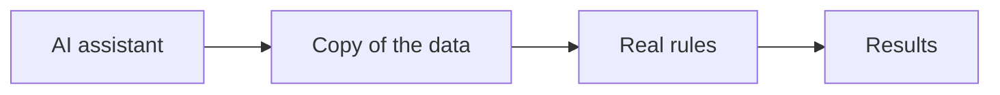

🏠 [Specs](../../../README.md) › 🧩 [Functional capabilities](../../README.md) ›
🔮 [F23 What-if simulation and impact](../README.md) › 🔀 [Flows](README.md) › 🔀 FL-F23-02 Run

# 🔀 FL-F23-02 Run

**Status:** ✅ specified

## Summary

Covers UC-F23-05, UC-F23-20.

## Personas

- [U02 Manager](../../../01-users/personas/u02-manager.md)
- [U05 Accounting](../../../01-users/personas/u05-accounting.md)
- [U13 Owner](../../../01-users/personas/u13-owner.md)

## Flowchart

## Sequence diagram

See each use case.

## Steps

| Step | Persona | Screen | Use case | What happens |
|---|---|---|---|---|
| 1 | U05 | [S-F23-05](../screens/02-run/s-f23-05-run.md) | [UC-F23-05](../use-cases/02-run/uc-f23-05-run-the-scenario-on-a-copy-with-the-real-rules.md) | Run the scenario on a copy with the real rules |
| 2 | U13, U02 | [S-F23-20](../screens/02-run/s-f23-20-what-if-assistant.md) | [UC-F23-20](../use-cases/02-run/uc-f23-20-ask-the-assistant-what-if.md) | Ask the AI assistant what if |

### Entities and screens

| Entity | States in this flow | Shown at step and screen | Aggregated view |
|---|---|---|---|
| [E-T01-04 Copy or overlay](../../../03-technical/t01-companies-and-data-isolation/data/e-t01-04-copy-or-overlay.md) | Active | Shown elsewhere: [S-T01-04 Copy or overlay](../../../03-technical/t01-companies-and-data-isolation/screens/s-t01-04-copy-or-overlay.md), from the admin list [S-T01-L04](../../../03-technical/t01-companies-and-data-isolation/screens/00-lists/s-t01-l04-copy-or-overlays.md) | Copy or overlays |
| [E-F23-05 Impact result](../data/e-f23-05-impact-result.md) | Recorded | 2 [S-F23-20](../screens/02-run/s-f23-20-what-if-assistant.md) | Impact results |

## Errors

As each use case.

## Images

Every step and error, for each persona taking part, in light and dark mode (D120). Steps are numbered as in the Steps
table; E rows are the error cases.

| Step | Persona | Device | Light | Dark |
|---|---|---|---|---|
| 1 | U05 | desktop | [light](../images/02-run/u05-accounting/1-run-desktop-light.png) | [dark](../images/02-run/u05-accounting/1-run-desktop-dark.png) |
| 2 | U13 | desktop | [light](../images/02-run/u13-owner/2-assistant-desktop-light.png) | [dark](../images/02-run/u13-owner/2-assistant-desktop-dark.png) |
| 2 | U13 | phone | [light](../images/02-run/u13-owner/2-assistant-phone-light.png) | [dark](../images/02-run/u13-owner/2-assistant-phone-dark.png) |
| 2 | U02 | desktop | [light](../images/02-run/u02-manager/2-assistant-desktop-light.png) | [dark](../images/02-run/u02-manager/2-assistant-desktop-dark.png) |
| 2 | U02 | phone | [light](../images/02-run/u02-manager/2-assistant-phone-light.png) | [dark](../images/02-run/u02-manager/2-assistant-phone-dark.png) |
| E1 | U05 | desktop | [light](../images/02-run/u05-accounting/e1-too-long-desktop-light.png) | [dark](../images/02-run/u05-accounting/e1-too-long-desktop-dark.png) |

## Open questions

None.

---

⬅️ [FL-F23-01 Build a scenario](fl-f23-01-build-a-scenario.md) · ⬆️ [Up](README.md) ·
➡️ [FL-F23-03 See the impact](fl-f23-03-see-the-impact.md)
