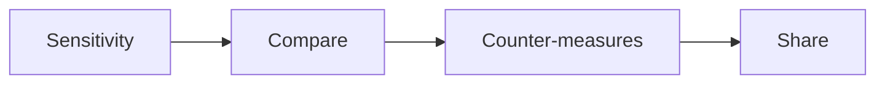

🏠 [Specs](../../../README.md) › 🧩 [Functional capabilities](../../README.md) ›
🔮 [F23 What-if simulation and impact](../README.md) › 🔀 [Flows](README.md) › 🔀 FL-F23-04 Decide

# 🔀 FL-F23-04 Decide

**Status:** ✅ specified

## Summary

Covers UC-F23-14, UC-F23-15, UC-F23-16, UC-F23-19.

## Personas

- [U02 Manager](../../../01-users/personas/u02-manager.md)
- [U05 Accounting](../../../01-users/personas/u05-accounting.md)
- [U08 External accountant](../../../01-users/personas/u08-external-accountant.md)
- [U13 Owner](../../../01-users/personas/u13-owner.md)

## Flowchart

## Sequence diagram

See each use case.

## Steps

| Step | Persona | Screen | Use case | What happens |
|---|---|---|---|---|
| 1 | U13, U05 | [S-F23-14](../screens/04-decide/s-f23-14-sensitivity.md) | [UC-F23-14](../use-cases/04-decide/uc-f23-14-see-what-matters-most.md) | See what matters most |
| 2 | U13 | [S-F23-15](../screens/04-decide/s-f23-15-comparison.md) | [UC-F23-15](../use-cases/04-decide/uc-f23-15-compare-scenarios-side-by-side.md) | Compare scenarios side by side |
| 3 | U13, U02 | [S-F23-16](../screens/04-decide/s-f23-16-counter-measures.md) | [UC-F23-16](../use-cases/04-decide/uc-f23-16-get-counter-measures-proposed.md) | Get counter-measures proposed |
| 4 | U13, U08 | [S-F23-19](../screens/04-decide/s-f23-19-sharing.md) | [UC-F23-19](../use-cases/04-decide/uc-f23-19-share-and-comment-a-scenario.md) | Share and comment a scenario |

### Entities and screens

| Entity | States in this flow | Shown at step and screen | Aggregated view |
|---|---|---|---|
| [E-F23-06 Sensitivity](../data/e-f23-06-sensitivity.md) | Active | 1 [S-F23-14](../screens/04-decide/s-f23-14-sensitivity.md); 2 [S-F23-15](../screens/04-decide/s-f23-15-comparison.md) | Sensitivities |
| [E-F23-07 Counter-measure](../data/e-f23-07-counter-measure.md) | Recorded | 3 [S-F23-16](../screens/04-decide/s-f23-16-counter-measures.md) | Counter-measures |

## Errors

As each use case.

## Images

Every step and error, for each persona taking part, in light and dark mode (D120). Steps are numbered as in the Steps
table; E rows are the error cases.

| Step | Persona | Device | Light | Dark |
|---|---|---|---|---|
| 1 | U13 | desktop | [light](../images/04-decide/u13-owner/1-sensitivity-desktop-light.png) | [dark](../images/04-decide/u13-owner/1-sensitivity-desktop-dark.png) |
| 1 | U13 | phone | [light](../images/04-decide/u13-owner/1-sensitivity-phone-light.png) | [dark](../images/04-decide/u13-owner/1-sensitivity-phone-dark.png) |
| 1 | U05 | desktop | [light](../images/04-decide/u05-accounting/1-sensitivity-desktop-light.png) | [dark](../images/04-decide/u05-accounting/1-sensitivity-desktop-dark.png) |
| 2 | U13 | desktop | [light](../images/04-decide/u13-owner/2-compare-desktop-light.png) | [dark](../images/04-decide/u13-owner/2-compare-desktop-dark.png) |
| 2 | U13 | phone | [light](../images/04-decide/u13-owner/2-compare-phone-light.png) | [dark](../images/04-decide/u13-owner/2-compare-phone-dark.png) |
| 3 | U02 | desktop | [light](../images/04-decide/u02-manager/3-counter-measures-desktop-light.png) | [dark](../images/04-decide/u02-manager/3-counter-measures-desktop-dark.png) |
| 3 | U02 | phone | [light](../images/04-decide/u02-manager/3-counter-measures-phone-light.png) | [dark](../images/04-decide/u02-manager/3-counter-measures-phone-dark.png) |
| 3 | U13 | desktop | [light](../images/04-decide/u13-owner/3-counter-measures-desktop-light.png) | [dark](../images/04-decide/u13-owner/3-counter-measures-desktop-dark.png) |
| 3 | U13 | phone | [light](../images/04-decide/u13-owner/3-counter-measures-phone-light.png) | [dark](../images/04-decide/u13-owner/3-counter-measures-phone-dark.png) |
| 4 | U08 | desktop | [light](../images/04-decide/u08-external-accountant/4-share-desktop-light.png) | [dark](../images/04-decide/u08-external-accountant/4-share-desktop-dark.png) |
| 4 | U13 | desktop | [light](../images/04-decide/u13-owner/4-share-desktop-light.png) | [dark](../images/04-decide/u13-owner/4-share-desktop-dark.png) |
| 4 | U13 | phone | [light](../images/04-decide/u13-owner/4-share-phone-light.png) | [dark](../images/04-decide/u13-owner/4-share-phone-dark.png) |
| E1 | U13 | desktop | [light](../images/04-decide/u13-owner/e1-horizons-desktop-light.png) | [dark](../images/04-decide/u13-owner/e1-horizons-desktop-dark.png) |
| E1 | U13 | phone | [light](../images/04-decide/u13-owner/e1-horizons-phone-light.png) | [dark](../images/04-decide/u13-owner/e1-horizons-phone-dark.png) |

## Open questions

None.

---

⬅️ [FL-F23-03 See the impact](fl-f23-03-see-the-impact.md) · ⬆️ [Up](README.md) ·
➡️ [FL-F23-05 Act and watch](fl-f23-05-act-and-watch.md)
