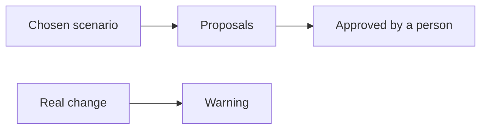

🏠 [Specs](../../../README.md) › 🧩 [Functional capabilities](../../README.md) ›
🔮 [F23 What-if simulation and impact](../README.md) › 🔀 [Flows](README.md) › 🔀 FL-F23-05 Act and watch

# 🔀 FL-F23-05 Act and watch

**Status:** ✅ specified

## Summary

Covers UC-F23-17, UC-F23-18.

## Personas

- [U13 Owner](../../../01-users/personas/u13-owner.md)
- [U31 Treasurer](../../../01-users/personas/u31-treasurer.md)

## Flowchart

## Sequence diagram

See each use case.

## Steps

| Step | Persona | Screen | Use case | What happens |
|---|---|---|---|---|
| 1 | U13 | [S-F23-17](../screens/05-act-and-watch/s-f23-17-actions.md) | [UC-F23-17](../use-cases/05-act-and-watch/uc-f23-17-turn-a-scenario-into-actions.md) | Turn a scenario into actions |
| 2 | U13, U31 | [S-F23-18](../screens/05-act-and-watch/s-f23-18-change-warnings.md) | [UC-F23-18](../use-cases/05-act-and-watch/uc-f23-18-be-warned-when-a-real-change-hits-the-forecast.md) | Be warned when a real change hits the forecast |

### Entities and screens

| Entity | States in this flow | Shown at step and screen | Aggregated view |
|---|---|---|---|
| [E-F23-02 Scenario](../data/e-f23-02-scenario.md) | Active | Shown elsewhere: [S-F23-02 New scenario](../screens/01-build-a-scenario/s-f23-02-new-scenario.md) | Scenarios |
| [E-F23-08 Action proposal](../data/e-f23-08-action-proposal.md) | Draft, Waiting | 1 [S-F23-17](../screens/05-act-and-watch/s-f23-17-actions.md) | Action proposals |
| [E-F23-09 Change warning](../data/e-f23-09-change-warning.md) | Active | 2 [S-F23-18](../screens/05-act-and-watch/s-f23-18-change-warnings.md) | Change warnings |

## Errors

As each use case.

## Images

Every step and error, for each persona taking part, in light and dark mode (D120). Steps are numbered as in the Steps
table; E rows are the error cases.

| Step | Persona | Device | Light | Dark |
|---|---|---|---|---|
| 1 | U13 | desktop | [light](../images/05-act-and-watch/u13-owner/1-actions-desktop-light.png) | [dark](../images/05-act-and-watch/u13-owner/1-actions-desktop-dark.png) |
| 1 | U13 | phone | [light](../images/05-act-and-watch/u13-owner/1-actions-phone-light.png) | [dark](../images/05-act-and-watch/u13-owner/1-actions-phone-dark.png) |
| 2 | U31 | desktop | [light](../images/05-act-and-watch/u31-treasurer/2-warning-desktop-light.png) | [dark](../images/05-act-and-watch/u31-treasurer/2-warning-desktop-dark.png) |
| 2 | U31 | phone | [light](../images/05-act-and-watch/u31-treasurer/2-warning-phone-light.png) | [dark](../images/05-act-and-watch/u31-treasurer/2-warning-phone-dark.png) |
| 2 | U13 | desktop | [light](../images/05-act-and-watch/u13-owner/2-warning-desktop-light.png) | [dark](../images/05-act-and-watch/u13-owner/2-warning-desktop-dark.png) |
| 2 | U13 | phone | [light](../images/05-act-and-watch/u13-owner/2-warning-phone-light.png) | [dark](../images/05-act-and-watch/u13-owner/2-warning-phone-dark.png) |
| E1 | U02 | desktop | [light](../images/05-act-and-watch/u02-manager/e1-no-approval-right-desktop-light.png) | [dark](../images/05-act-and-watch/u02-manager/e1-no-approval-right-desktop-dark.png) |
| E1 | U02 | phone | [light](../images/05-act-and-watch/u02-manager/e1-no-approval-right-phone-light.png) | [dark](../images/05-act-and-watch/u02-manager/e1-no-approval-right-phone-dark.png) |

## Open questions

None.

---

⬅️ [FL-F23-04 Decide](fl-f23-04-decide.md) · ⬆️ [Up](README.md) ·
➡️ [FL-F23-06 Goals and financing](fl-f23-06-goals-and-financing.md)
