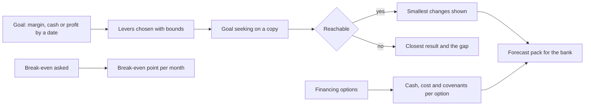
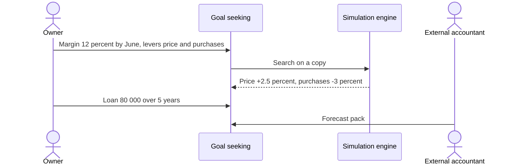

🏠 [Specs](../../../README.md) › 🧩 [Functional capabilities](../../README.md) ›
🔮 [F23 What-if simulation and impact](../README.md) › 🔀 [Flows](README.md) › 🔀 FL-F23-06 Goals and financing

# 🔀 FL-F23-06 Goals and financing

**Status:** ✅ specified

## Summary

Instead of asking "what if", the owner asks "what must change to reach this goal", finds the break-even point, and tries
financing options (loans, leasing, covenants); the external accountant turns the result into a forecast pack for the
bank (D480).

## Personas

- [U13 Owner](../../../01-users/personas/u13-owner.md)
- [U05 Accounting](../../../01-users/personas/u05-accounting.md)
- [U31 Treasurer](../../../01-users/personas/u31-treasurer.md)
- [U08 External accountant](../../../01-users/personas/u08-external-accountant.md)

## Flowchart

## Sequence diagram

## Steps

| Step | Persona | Screen | Use case | What happens |
|---|---|---|---|---|
| 1 | U13, U05 | [S-F23-21](../screens/06-goals-and-financing/s-f23-21-goal-seeking.md) | [UC-F23-21](../use-cases/06-goals-and-financing/uc-f23-21-seek-a-goal.md) | Seek a goal |
| 2 | U13, U05 | [S-F23-21](../screens/06-goals-and-financing/s-f23-21-goal-seeking.md) | [UC-F23-22](../use-cases/06-goals-and-financing/uc-f23-22-find-the-break-even-point.md) | Find the break-even point |
| 3 | U31, U13 | [S-F23-22](../screens/06-goals-and-financing/s-f23-22-financing.md) | [UC-F23-23](../use-cases/06-goals-and-financing/uc-f23-23-simulate-financing-options.md) | Simulate financing options |
| 4 | U08, U13 | [S-F23-22](../screens/06-goals-and-financing/s-f23-22-financing.md) | [UC-F23-29](../use-cases/06-goals-and-financing/uc-f23-29-prepare-a-forecast-pack-for-the-bank.md) | Prepare a forecast pack for the bank |

### Entities and screens

| Entity | States in this flow | Shown at step and screen | Aggregated view |
|---|---|---|---|
| [E-F23-11 Goal](../data/e-f23-11-goal.md) | Set, Reached, Not reached | 1, 2 [S-F23-21](../screens/06-goals-and-financing/s-f23-21-goal-seeking.md) | Goals |
| [E-F10-17 Cash movement](../../f10-point-of-sale/data/e-f10-17-cash-movement.md) | Matched | Shown elsewhere: [S-F10-22 Safe and deposits](../../f10-point-of-sale/screens/09-cash-and-settlements/s-f10-22-safe-and-deposits.md) | Cash movements |
| [E-F23-03 Scenario change](../data/e-f23-03-scenario-change.md) | Active | Shown elsewhere: [S-F23-03 Changes](../screens/01-build-a-scenario/s-f23-03-changes.md) | Scenario changes |
| [E-F23-02 Scenario](../data/e-f23-02-scenario.md) | Active | 1, 2 [S-F23-21](../screens/06-goals-and-financing/s-f23-21-goal-seeking.md) | Scenarios |
| [E-F23-05 Impact result](../data/e-f23-05-impact-result.md) | Recorded | 3, 4 [S-F23-22](../screens/06-goals-and-financing/s-f23-22-financing.md) | Impact results |
| [E-F23-12 Financing option](../data/e-f23-12-financing-option.md) | Draft, Simulated, Chosen | 3, 4 [S-F23-22](../screens/06-goals-and-financing/s-f23-22-financing.md) | Financing options |

## Errors

E1: no combination of the levers within their bounds reaches the goal: the closest result and the gap are shown (step
1). E2: a financing option breaks a covenant: the month and the ratio are shown (step 3).

## Images

Every step and error, for each persona taking part, in light and dark mode (D120). Steps are numbered as in the Steps
table; E rows are the error cases.

| Step | Persona | Device | Light | Dark |
|---|---|---|---|---|
| 1 | U13 | desktop | [light](../images/06-goals-and-financing/u13-owner/1-goal-seeking-desktop-light.png) | [dark](../images/06-goals-and-financing/u13-owner/1-goal-seeking-desktop-dark.png) |
| 1 | U13 | phone | [light](../images/06-goals-and-financing/u13-owner/1-goal-seeking-phone-light.png) | [dark](../images/06-goals-and-financing/u13-owner/1-goal-seeking-phone-dark.png) |
| 1 | U05 | desktop | [light](../images/06-goals-and-financing/u05-accounting/1-goal-seeking-desktop-light.png) | [dark](../images/06-goals-and-financing/u05-accounting/1-goal-seeking-desktop-dark.png) |
| 2 | U13 | desktop | [light](../images/06-goals-and-financing/u13-owner/2-goal-seeking-desktop-light.png) | [dark](../images/06-goals-and-financing/u13-owner/2-goal-seeking-desktop-dark.png) |
| 2 | U13 | phone | [light](../images/06-goals-and-financing/u13-owner/2-goal-seeking-phone-light.png) | [dark](../images/06-goals-and-financing/u13-owner/2-goal-seeking-phone-dark.png) |
| 2 | U05 | desktop | [light](../images/06-goals-and-financing/u05-accounting/2-goal-seeking-desktop-light.png) | [dark](../images/06-goals-and-financing/u05-accounting/2-goal-seeking-desktop-dark.png) |
| 3 | U31 | desktop | [light](../images/06-goals-and-financing/u31-treasurer/3-financing-desktop-light.png) | [dark](../images/06-goals-and-financing/u31-treasurer/3-financing-desktop-dark.png) |
| 3 | U31 | phone | [light](../images/06-goals-and-financing/u31-treasurer/3-financing-phone-light.png) | [dark](../images/06-goals-and-financing/u31-treasurer/3-financing-phone-dark.png) |
| 3 | U13 | desktop | [light](../images/06-goals-and-financing/u13-owner/3-financing-desktop-light.png) | [dark](../images/06-goals-and-financing/u13-owner/3-financing-desktop-dark.png) |
| 3 | U13 | phone | [light](../images/06-goals-and-financing/u13-owner/3-financing-phone-light.png) | [dark](../images/06-goals-and-financing/u13-owner/3-financing-phone-dark.png) |
| 4 | U08 | desktop | [light](../images/06-goals-and-financing/u08-external-accountant/4-financing-desktop-light.png) | [dark](../images/06-goals-and-financing/u08-external-accountant/4-financing-desktop-dark.png) |
| 4 | U13 | desktop | [light](../images/06-goals-and-financing/u13-owner/4-financing-desktop-light.png) | [dark](../images/06-goals-and-financing/u13-owner/4-financing-desktop-dark.png) |
| 4 | U13 | phone | [light](../images/06-goals-and-financing/u13-owner/4-financing-phone-light.png) | [dark](../images/06-goals-and-financing/u13-owner/4-financing-phone-dark.png) |
| E1 | U13 | desktop | [light](../images/06-goals-and-financing/u13-owner/e1-goal-seeking-refused-desktop-light.png) | [dark](../images/06-goals-and-financing/u13-owner/e1-goal-seeking-refused-desktop-dark.png) |
| E1 | U13 | phone | [light](../images/06-goals-and-financing/u13-owner/e1-goal-seeking-refused-phone-light.png) | [dark](../images/06-goals-and-financing/u13-owner/e1-goal-seeking-refused-phone-dark.png) |

## Open questions

None.

---

⬅️ [FL-F23-05 Act and watch](fl-f23-05-act-and-watch.md) · ⬆️ [Up](README.md) ·
➡️ [FL-F23-07 Accuracy and drivers](fl-f23-07-accuracy-and-drivers.md)
