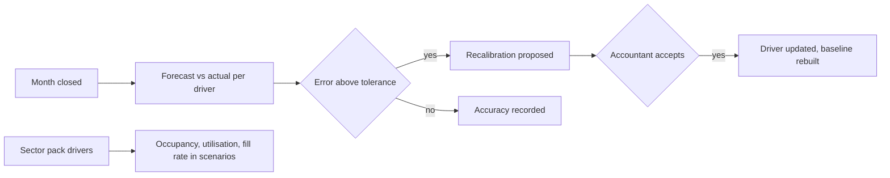
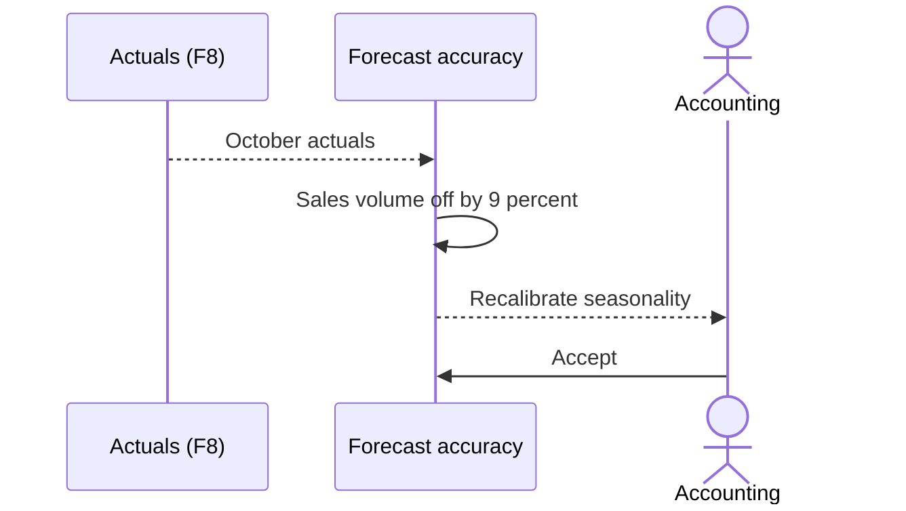

🏠 [Specs](../../../README.md) › 🧩 [Functional capabilities](../../README.md) ›
🔮 [F23 What-if simulation and impact](../README.md) › 🔀 [Flows](README.md) › 🔀 FL-F23-07 Accuracy and drivers

# 🔀 FL-F23-07 Accuracy and drivers

**Status:** ✅ specified

## Summary

Each month the forecast is compared with what happened, driver by driver; drivers that miss are proposed for
recalibration, and sector drivers (occupancy, utilisation, fill rate) make the forecast speak the sector's language
(D480).

## Personas

- [U05 Accounting](../../../01-users/personas/u05-accounting.md)
- [U13 Owner](../../../01-users/personas/u13-owner.md)
- [U02 Manager](../../../01-users/personas/u02-manager.md)
- [U08 External accountant](../../../01-users/personas/u08-external-accountant.md), acting in the chart, step 36i
  (Proposed)

## Flowchart

## Sequence diagram

## Steps

| Step | Persona | Screen | Use case | What happens |
|---|---|---|---|---|
| 1 | U05, U13 | [S-F23-23](../screens/07-accuracy-and-drivers/s-f23-23-forecast-accuracy.md) | [UC-F23-24](../use-cases/07-accuracy-and-drivers/uc-f23-24-measure-forecast-accuracy-and-recalibrate.md) | Measure forecast accuracy and recalibrate |
| 2 | U13, U02 | [S-F23-24](../screens/07-accuracy-and-drivers/s-f23-24-sector-drivers.md) | [UC-F23-25](../use-cases/07-accuracy-and-drivers/uc-f23-25-use-sector-drivers.md) | Use sector drivers |

### Entities and screens

| Entity | States in this flow | Shown at step and screen | Aggregated view |
|---|---|---|---|
| [E-F8-10 Fiscal period](../../f08-accounting/data/e-f08-10-fiscal-period.md) | Active | Shown elsewhere: [S-F8-01 Books setup](../../f08-accounting/screens/01-set-up-and-post/s-f08-01-books-setup.md) | Fiscal periods |
| [E-F22-11 Forecast](../../f22-unified-cost-management/data/e-f22-11-forecast.md) | Active | Shown elsewhere: [S-F22-12 Forecast](../../f22-unified-cost-management/screens/04-accounting/s-f22-12-forecast.md) | Forecasts |
| [E-F23-13 Driver accuracy](../data/e-f23-13-driver-accuracy.md) | Measured, Proposed | 1 [S-F23-23](../screens/07-accuracy-and-drivers/s-f23-23-forecast-accuracy.md) | Driver accuracies |
| [E-F23-08 Action proposal](../data/e-f23-08-action-proposal.md) | Draft, Waiting | Shown elsewhere: [S-F23-17 Actions](../screens/05-act-and-watch/s-f23-17-actions.md) | Action proposals |
| [E-F23-01 Baseline forecast](../data/e-f23-01-baseline-forecast.md) | Active | 1 [S-F23-23](../screens/07-accuracy-and-drivers/s-f23-23-forecast-accuracy.md) | Baseline forecasts |
| [E-F23-14 Sector driver](../data/e-f23-14-sector-driver.md) | Available, Used | 2 [S-F23-24](../screens/07-accuracy-and-drivers/s-f23-24-sector-drivers.md) | Sector drivers |
| [E-F23-02 Scenario](../data/e-f23-02-scenario.md) | Active | Shown elsewhere: [S-F23-02 New scenario](../screens/01-build-a-scenario/s-f23-02-new-scenario.md) | Scenarios |

## Errors

E1: actuals of the month not closed in F8: the comparison waits (step 1). E2: a sector driver has no data source in the
company: it is entered as an assumption and marked so (step 2).

## Images

Every step and error, for each persona taking part, in light and dark mode (D120). Steps are numbered as in the Steps
table; E rows are the error cases.

| Step | Persona | Device | Light | Dark |
|---|---|---|---|---|
| 1 | U05 | desktop | [light](../images/07-accuracy-and-drivers/u05-accounting/1-forecast-accuracy-desktop-light.png) | [dark](../images/07-accuracy-and-drivers/u05-accounting/1-forecast-accuracy-desktop-dark.png) |
| 1 | U13 | desktop | [light](../images/07-accuracy-and-drivers/u13-owner/1-forecast-accuracy-desktop-light.png) | [dark](../images/07-accuracy-and-drivers/u13-owner/1-forecast-accuracy-desktop-dark.png) |
| 1 | U13 | phone | [light](../images/07-accuracy-and-drivers/u13-owner/1-forecast-accuracy-phone-light.png) | [dark](../images/07-accuracy-and-drivers/u13-owner/1-forecast-accuracy-phone-dark.png) |
| 2 | U13 | desktop | [light](../images/07-accuracy-and-drivers/u13-owner/2-sector-drivers-desktop-light.png) | [dark](../images/07-accuracy-and-drivers/u13-owner/2-sector-drivers-desktop-dark.png) |
| 2 | U13 | phone | [light](../images/07-accuracy-and-drivers/u13-owner/2-sector-drivers-phone-light.png) | [dark](../images/07-accuracy-and-drivers/u13-owner/2-sector-drivers-phone-dark.png) |
| 2 | U02 | desktop | [light](../images/07-accuracy-and-drivers/u02-manager/2-sector-drivers-desktop-light.png) | [dark](../images/07-accuracy-and-drivers/u02-manager/2-sector-drivers-desktop-dark.png) |
| 2 | U02 | phone | [light](../images/07-accuracy-and-drivers/u02-manager/2-sector-drivers-phone-light.png) | [dark](../images/07-accuracy-and-drivers/u02-manager/2-sector-drivers-phone-dark.png) |
| E1 | U05 | desktop | [light](../images/07-accuracy-and-drivers/u05-accounting/e1-forecast-accuracy-refused-desktop-light.png) | [dark](../images/07-accuracy-and-drivers/u05-accounting/e1-forecast-accuracy-refused-desktop-dark.png) |

## Open questions

None.

---

⬅️ [FL-F23-06 Goals and financing](fl-f23-06-goals-and-financing.md) · ⬆️ [Up](README.md) ·
➡️ [FL-F23-08 Budgets, rolling forecasts, group and valuation](fl-f23-08-budgets-rolling-group-and-valuation.md)
