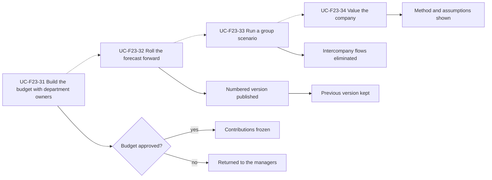
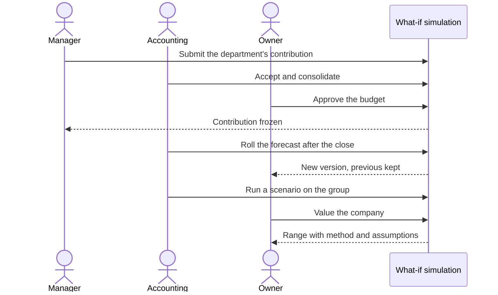

🏠 [Specs](../../../README.md) › 🧩 [Functional capabilities](../../README.md) ›
🔮 [F23 What-if simulation and impact](../README.md) › 🔀 [Flows](README.md) ›
🔀 FL-F23-08 Budgets, rolling forecasts, group and valuation

# 🔀 FL-F23-08 Budgets, rolling forecasts, group and valuation

**Status:** ✅ specified

## Summary

Accounting collects the budget from the department managers, who submit contributions the owner approves and freezes.
After each month close, accounting rolls the forecast forward into a numbered version. Accounting runs a scenario on a
whole group with the intercompany flows eliminated, and the owner values the company with every method and assumption
shown ([D542](../../../06-decisions/f23-what-if-simulation/d542-benchmark-gaps-f23-what-if-simulation.md)).

## Personas

- [U02 Manager](../../../01-users/personas/u02-manager.md), who enters the department's contribution
- [U05 Accounting](../../../01-users/personas/u05-accounting.md), who runs the round, the forecast and the group
- [U13 Owner](../../../01-users/personas/u13-owner.md), who approves the budget and values the company
- [U31 Treasurer](../../../01-users/personas/u31-treasurer.md), who values a non-profit's net assets

## Flowchart

## Sequence diagram

## Steps

| Step | Persona | Screen | Use case | What happens |
|---|---|---|---|---|
| 1 | [U02](../../../01-users/personas/u02-manager.md) | [S-F23-25](../screens/08-budgets-rolling-group-and-valuation/s-f23-25-collaborative-budget.md) | [UC-F23-31](../use-cases/08-budgets-rolling-group-and-valuation/uc-f23-31-build-the-budget-with-department-owners.md) | A manager submits the department's contribution and accounting consolidates the budget |
| 2 | [U05](../../../01-users/personas/u05-accounting.md) | [S-F23-26](../screens/08-budgets-rolling-group-and-valuation/s-f23-26-rolling-forecast.md) | [UC-F23-32](../use-cases/08-budgets-rolling-group-and-valuation/uc-f23-32-roll-the-forecast-forward.md) | Accounting rolls the forecast after the month close and publishes a numbered version |
| 3 | [U05](../../../01-users/personas/u05-accounting.md) | [S-F23-27](../screens/08-budgets-rolling-group-and-valuation/s-f23-27-group-scenario.md) | [UC-F23-33](../use-cases/08-budgets-rolling-group-and-valuation/uc-f23-33-run-a-group-scenario.md) | Accounting runs a scenario on the group and reads the eliminations |
| 4 | [U13](../../../01-users/personas/u13-owner.md) | [S-F23-28](../screens/08-budgets-rolling-group-and-valuation/s-f23-28-valuation.md) | [UC-F23-34](../use-cases/08-budgets-rolling-group-and-valuation/uc-f23-34-value-the-company.md) | The owner values the company and issues the valuation with its assumptions |

### Entities and screens

| Entity | States in this flow | Shown at step and screen | Aggregated view |
|---|---|---|---|
| [E-F23-15 Budget contribution](../data/e-f23-15-budget-contribution.md) | Draft, Submitted, Returned, Accepted, Frozen | 1 [S-F23-25](../screens/08-budgets-rolling-group-and-valuation/s-f23-25-collaborative-budget.md) | Budget contributions |
| [E-F23-16 Forecast version](../data/e-f23-16-forecast-version.md) | Draft, Published, Discarded, Superseded | 2 [S-F23-26](../screens/08-budgets-rolling-group-and-valuation/s-f23-26-rolling-forecast.md) | Forecast versions |
| [E-F23-17 Valuation](../data/e-f23-17-valuation.md) | Draft, Issued, Discarded, Superseded | 4 [S-F23-28](../screens/08-budgets-rolling-group-and-valuation/s-f23-28-valuation.md) | Valuations |

## Errors

- **E1 The budget is frozen.** A change to an approved contribution is refused and the way to revise the budget is shown
  ([BR-F23-18](../business-rules/br-f23-18-a-budget-is-frozen-once-approved.md), step 1).

## Images

Every step and error, for each persona taking part, in light and dark mode (D120). Steps are numbered as in the Steps
table; E rows are the error cases.

| Step | Persona | Device | Light | Dark |
|---|---|---|---|---|
| 1 | U02 | desktop | [light](../images/08-budgets-rolling-group-and-valuation/u02-manager/1-collaborative-budget-desktop-light.png) | [dark](../images/08-budgets-rolling-group-and-valuation/u02-manager/1-collaborative-budget-desktop-dark.png) |
| 1 | U05 | desktop | [light](../images/08-budgets-rolling-group-and-valuation/u05-accounting/1-collaborative-budget-desktop-light.png) | [dark](../images/08-budgets-rolling-group-and-valuation/u05-accounting/1-collaborative-budget-desktop-dark.png) |
| 1 | U02 | phone | [light](../images/08-budgets-rolling-group-and-valuation/u02-manager/1-collaborative-budget-phone-light.png) | [dark](../images/08-budgets-rolling-group-and-valuation/u02-manager/1-collaborative-budget-phone-dark.png) |
| 2 | U05 | desktop | [light](../images/08-budgets-rolling-group-and-valuation/u05-accounting/2-rolling-forecast-desktop-light.png) | [dark](../images/08-budgets-rolling-group-and-valuation/u05-accounting/2-rolling-forecast-desktop-dark.png) |
| 2 | U13 | desktop | [light](../images/08-budgets-rolling-group-and-valuation/u13-owner/2-rolling-forecast-desktop-light.png) | [dark](../images/08-budgets-rolling-group-and-valuation/u13-owner/2-rolling-forecast-desktop-dark.png) |
| 3 | U05 | desktop | [light](../images/08-budgets-rolling-group-and-valuation/u05-accounting/3-group-scenario-desktop-light.png) | [dark](../images/08-budgets-rolling-group-and-valuation/u05-accounting/3-group-scenario-desktop-dark.png) |
| 4 | U13 | desktop | [light](../images/08-budgets-rolling-group-and-valuation/u13-owner/4-valuation-desktop-light.png) | [dark](../images/08-budgets-rolling-group-and-valuation/u13-owner/4-valuation-desktop-dark.png) |
| 4 | U31 | desktop | [light](../images/08-budgets-rolling-group-and-valuation/u31-treasurer/4-valuation-desktop-light.png) | [dark](../images/08-budgets-rolling-group-and-valuation/u31-treasurer/4-valuation-desktop-dark.png) |
| 4 | U13 | phone | [light](../images/08-budgets-rolling-group-and-valuation/u13-owner/4-valuation-phone-light.png) | [dark](../images/08-budgets-rolling-group-and-valuation/u13-owner/4-valuation-phone-dark.png) |
| E1 | U02 | desktop | [light](../images/08-budgets-rolling-group-and-valuation/u02-manager/e1-the-budget-is-frozen-desktop-light.png) | [dark](../images/08-budgets-rolling-group-and-valuation/u02-manager/e1-the-budget-is-frozen-desktop-dark.png) |
| E1 | U02 | phone | [light](../images/08-budgets-rolling-group-and-valuation/u02-manager/e1-the-budget-is-frozen-phone-light.png) | [dark](../images/08-budgets-rolling-group-and-valuation/u02-manager/e1-the-budget-is-frozen-phone-dark.png) |

## Open questions

None.

---

⬅️ [FL-F23-07 Accuracy and drivers](fl-f23-07-accuracy-and-drivers.md) · ⬆️ [Up](README.md)
