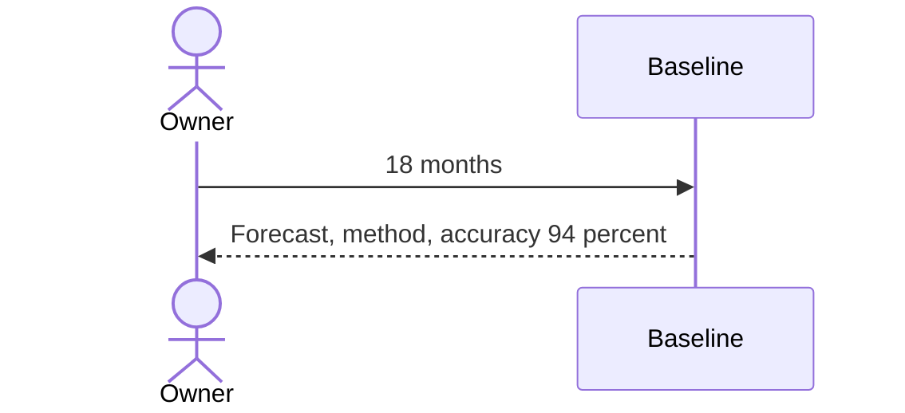

🏠 [Specs](../../../../README.md) › 🧩 [Functional capabilities](../../../README.md) ›
🔮 [F23 What-if simulation and impact](../../README.md) › 📝 [Use cases](../README.md) ›
📝 [Use cases: FL-F23-01 Build a scenario](README.md) › 📝 UC-F23-01 See the baseline forecast

# 📝 UC-F23-01 See the baseline forecast

**Status:** ✅ specified

## Summary

The owner and accounting see the baseline forecast built from history, open orders, contracts, the F8 budget and plans,
with its method and its measured accuracy.

## Personas

- [U13 Owner](../../../../01-users/personas/u13-owner.md)
- [U05 Accounting](../../../../01-users/personas/u05-accounting.md)

## Goal

A trusted starting point.

## Trigger

Any time.

## Frequency

Monthly.

## Preconditions

- History or budgets exist.

## Postconditions

- Success: read.
- Failure: thin history said.

## Main flow

1. Open the Baseline (S-F23-01).
2. Choose the horizon.
3. Read the forecast and its method (BR-F23-02).
4. See its accuracy by driver (UC-F23-24).

## Alternative flows

- 3a. The F8 budget as input (BR-F23-16).

## Error flows

- 3e. Little history: said.
- Any step: a service does not answer; the call is retried first (BR-F3-32), then the message follows the error pattern
  (D122) and what was typed stays on the screen.

## Business rules

- [BR-F23-02 The baseline comes from history and plans](../../business-rules/br-f23-02-baseline-from-history-and-plans.md)
- [BR-F23-16 Budgets in F8, scenarios in F23](../../business-rules/br-f23-16-budgets-in-f8-scenarios-in-f23.md)
- [BR-F23-15 Accuracy measured, recalibration decided](../../business-rules/br-f23-15-accuracy-measured-recalibration-decided.md)

## Entities

- [E-F23-01 Baseline forecast](../../data/e-f23-01-baseline-forecast.md)
- [E-F23-13 Driver accuracy](../../data/e-f23-13-driver-accuracy.md)

## Permissions

Owner, accounting.

## Notifications

- None.

## Audit events

None.

## AI involvement

Explains.

## API, MCP and A2A exposure

Through T5 and T6 with the caller's rights (BR-F3-34).

## Screens

- [S-F23-01 Baseline](../../screens/01-build-a-scenario/s-f23-01-baseline.md)

## Flowchart

See [FL-F23-01 Build a scenario](../../flows/fl-f23-01-build-a-scenario.md#flowchart).

## Sequence diagram

## Acceptance criteria

1. **Given** 18 months **when** opened **then** the forecast and method show.
2. **Given** the F8 budget 2027 **when** built **then** it is an input.
3. **Given** little history **when** built **then** said.

## Non-functional notes

D408's targets ([Performance](../../../../05-non-functional/performance.md)): 95 % of screens within 1 second; lists
paged on the server, the first page within 1 second; reports within 5 seconds or in the background.

## Regulatory references

Values of the France country pack read by scenarios:
[CR-FR-046 Headcount thresholds](../../../../10-country-packs/france/labour/cr-fr-046-headcount-thresholds.md),
[CR-FR-008 VAT rates](../../../../10-country-packs/france/tax-and-vat/cr-fr-008-vat-rates.md),
[CR-FR-185 Minimum wage (SMIC)](../../../../10-country-packs/france/payroll/cr-fr-185-minimum-wage.md),
[CR-FR-064 Accounting frameworks of the books](../../../../10-country-packs/france/accounting/cr-fr-064-accounting-frameworks.md),
[CR-FR-058 AI in recruitment and work is high-risk](../../../../10-country-packs/france/ai-and-recording/cr-fr-058-high-risk-ai-in-employment.md),
[CR-FR-057 A person confirms what the AI does](../../../../10-country-packs/france/ai-and-recording/cr-fr-057-human-oversight.md).

## Related use cases

- [UC-F23-24 Measure forecast accuracy and recalibrate](../07-accuracy-and-drivers/uc-f23-24-measure-forecast-accuracy-and-recalibrate.md)

## Open questions

None.

---

⬆️ [Up](README.md) · ➡️ [UC-F23-02 Create a scenario](uc-f23-02-create-a-scenario.md)
