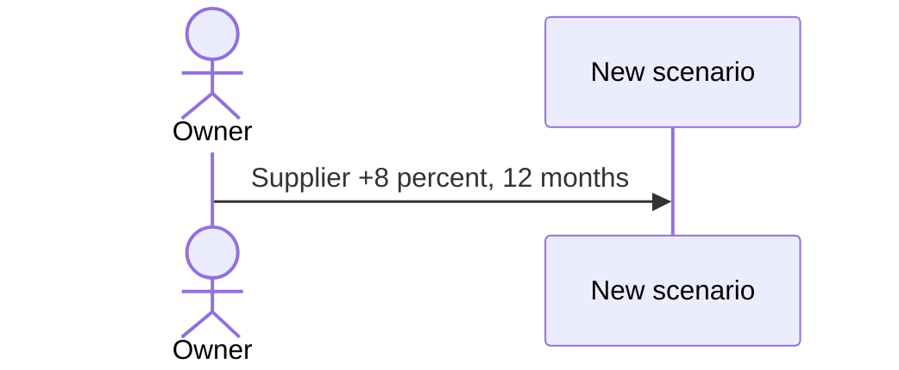

🏠 [Specs](../../../../README.md) › 🧩 [Functional capabilities](../../../README.md) ›
🔮 [F23 What-if simulation and impact](../../README.md) › 📝 [Use cases](../README.md) ›
📝 [Use cases: FL-F23-01 Build a scenario](README.md) › 📝 UC-F23-02 Create a scenario

# 📝 UC-F23-02 Create a scenario

**Status:** ✅ specified

## Summary

The owner or a manager creates a scenario with name, horizon and readers.

## Personas

- [U13 Owner](../../../../01-users/personas/u13-owner.md)
- [U02 Manager](../../../../01-users/personas/u02-manager.md)

## Goal

A place to test.

## Trigger

A question.

## Frequency

Monthly.

## Preconditions

- Baseline.

## Postconditions

- Success: saved.
- Failure: none.

## Main flow

1. Open New scenario (S-F23-02).
2. Name.
3. Horizon.
4. Readers; save (BR-F23-03).

## Alternative flows

- 1a. From a goal (UC-F23-21).

## Error flows

- 4e. Name taken.
- Any step: a service does not answer; the call is retried first (BR-F3-32), then the message follows the error pattern
  (D122) and what was typed stays on the screen.

## Business rules

- [BR-F23-03 A scenario runs on a copy](../../business-rules/br-f23-03-runs-on-a-copy.md)
- [BR-F23-09 Assumptions are visible](../../business-rules/br-f23-09-assumptions-visible.md)

## Entities

- [E-F23-02 Scenario](../../data/e-f23-02-scenario.md)

## Permissions

Owner, managers.

## Notifications

- Readers.

## Audit events

Scenarios.

## AI involvement

None.

## API, MCP and A2A exposure

Through T5 and T6 with the caller's rights (BR-F3-34).

## Screens

- [S-F23-02 New scenario](../../screens/01-build-a-scenario/s-f23-02-new-scenario.md)

## Flowchart

See [FL-F23-01 Build a scenario](../../flows/fl-f23-01-build-a-scenario.md#flowchart).

## Sequence diagram

## Acceptance criteria

1. **Given** a name **when** saved **then** a copy is prepared.
2. **Given** readers **when** saved **then** told.
3. **Given** a taken name **when** saved **then** refused.

## Non-functional notes

D408's targets ([Performance](../../../../05-non-functional/performance.md)): 95 % of screens within 1 second; lists
paged on the server, the first page within 1 second; reports within 5 seconds or in the background.

## Regulatory references

Values of the France country pack read by scenarios:
[CR-FR-046 Headcount thresholds](../../../../10-country-packs/france/labour/cr-fr-046-headcount-thresholds.md),
[CR-FR-008 VAT rates](../../../../10-country-packs/france/tax-and-vat/cr-fr-008-vat-rates.md),
[CR-FR-185 Minimum wage (SMIC)](../../../../10-country-packs/france/payroll/cr-fr-185-minimum-wage.md),
[CR-FR-064 Accounting frameworks of the books](../../../../10-country-packs/france/accounting/cr-fr-064-accounting-frameworks.md),
[CR-FR-058 AI in recruitment and work is high-risk](../../../../10-country-packs/france/ai-and-recording/cr-fr-058-high-risk-ai-in-employment.md),
[CR-FR-057 A person confirms what the AI does](../../../../10-country-packs/france/ai-and-recording/cr-fr-057-human-oversight.md).

## Related use cases

- [UC-F23-03 Change one or several elements](uc-f23-03-change-one-or-several-elements.md)

## Open questions

None.

---

⬅️ [UC-F23-01 See the baseline forecast](uc-f23-01-see-the-baseline-forecast.md) · ⬆️ [Up](README.md) ·
➡️ [UC-F23-03 Change one or several elements](uc-f23-03-change-one-or-several-elements.md)
