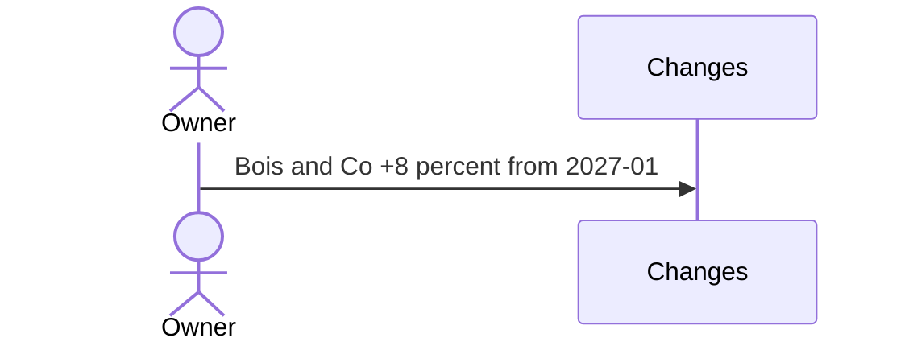

🏠 [Specs](../../../../README.md) › 🧩 [Functional capabilities](../../../README.md) ›
🔮 [F23 What-if simulation and impact](../../README.md) › 📝 [Use cases](../README.md) ›
📝 [Use cases: FL-F23-01 Build a scenario](README.md) › 📝 UC-F23-03 Change one or several elements

# 📝 UC-F23-03 Change one or several elements

**Status:** ✅ specified

## Summary

The owner or a manager changes one or several elements with dates, including sector drivers.

## Personas

- [U13 Owner](../../../../01-users/personas/u13-owner.md)
- [U02 Manager](../../../../01-users/personas/u02-manager.md)

## Goal

The question expressed.

## Trigger

Scenario.

## Frequency

Monthly.

## Preconditions

- Scenario.

## Postconditions

- Success: saved.
- Failure: refused.

## Main flow

1. Open Changes (S-F23-03).
2. Pick elements.
3. Set changes and dates.
4. Save (BR-F23-09).

## Alternative flows

- 2a. Sector drivers (UC-F23-25).

## Error flows

- 3e. Element not visible: hidden (BR-F23-06).
- Any step: a service does not answer; the call is retried first (BR-F3-32), then the message follows the error pattern
  (D122) and what was typed stays on the screen.

## Business rules

- [BR-F23-06 Rights apply to scenarios](../../business-rules/br-f23-06-rights-apply-to-scenarios.md)
- [BR-F23-09 Assumptions are visible](../../business-rules/br-f23-09-assumptions-visible.md)
- [BR-F23-17 Sector drivers from the sector pack](../../business-rules/br-f23-17-sector-drivers-from-the-sector-pack.md)

## Entities

- [E-F23-03 Scenario change](../../data/e-f23-03-scenario-change.md)
- [E-F23-14 Sector driver](../../data/e-f23-14-sector-driver.md)

## Permissions

Owner, managers.

## Notifications

- None.

## Audit events

Changes.

## AI involvement

Suggests.

## API, MCP and A2A exposure

Through T5 and T6 with the caller's rights (BR-F3-34).

## Screens

- [S-F23-03 Changes](../../screens/01-build-a-scenario/s-f23-03-changes.md)

## Flowchart

See [FL-F23-01 Build a scenario](../../flows/fl-f23-01-build-a-scenario.md#flowchart).

## Sequence diagram

## Acceptance criteria

1. **Given** +8 % from 2027-01 **when** saved **then** listed.
2. **Given** an element not visible **when** picked **then** hidden.
3. **Given** a sector driver **when** changed **then** saved.

## Non-functional notes

D408's targets ([Performance](../../../../05-non-functional/performance.md)): 95 % of screens within 1 second; lists
paged on the server, the first page within 1 second; reports within 5 seconds or in the background.

## Regulatory references

Values of the France country pack read by scenarios:
[CR-FR-046 Headcount thresholds](../../../../10-country-packs/france/labour/cr-fr-046-headcount-thresholds.md),
[CR-FR-008 VAT rates](../../../../10-country-packs/france/tax-and-vat/cr-fr-008-vat-rates.md),
[CR-FR-185 Minimum wage (SMIC)](../../../../10-country-packs/france/payroll/cr-fr-185-minimum-wage.md),
[CR-FR-064 Accounting frameworks of the books](../../../../10-country-packs/france/accounting/cr-fr-064-accounting-frameworks.md),
[CR-FR-058 AI in recruitment and work is high-risk](../../../../10-country-packs/france/ai-and-recording/cr-fr-058-high-risk-ai-in-employment.md),
[CR-FR-057 A person confirms what the AI does](../../../../10-country-packs/france/ai-and-recording/cr-fr-057-human-oversight.md).

## Related use cases

- [UC-F23-25 Use sector drivers](../07-accuracy-and-drivers/uc-f23-25-use-sector-drivers.md)

## Open questions

None.

---

⬅️ [UC-F23-02 Create a scenario](uc-f23-02-create-a-scenario.md) · ⬆️ [Up](README.md) ·
➡️ [UC-F23-04 Give uncertain inputs as ranges](uc-f23-04-give-uncertain-inputs-as-ranges.md)
