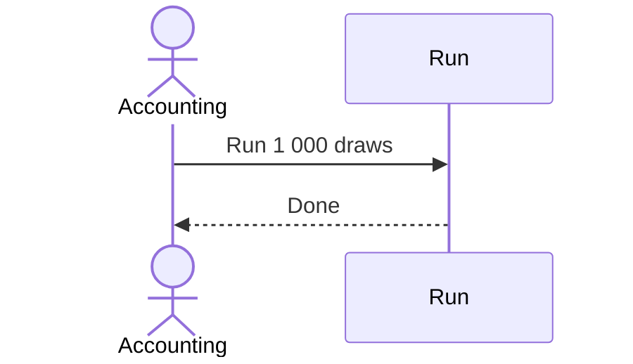

🏠 [Specs](../../../../README.md) › 🧩 [Functional capabilities](../../../README.md) ›
🔮 [F23 What-if simulation and impact](../../README.md) › 📝 [Use cases](../README.md) ›
📝 [Use cases: FL-F23-02 Run](README.md) › 📝 UC-F23-05 Run the scenario on a copy with the real rules

# 📝 UC-F23-05 Run the scenario on a copy with the real rules

**Status:** ✅ specified

## Summary

Accounting runs the scenario on a copy with the real rules.

## Personas

- [U05 Accounting](../../../../01-users/personas/u05-accounting.md)

## Goal

Trustworthy results.

## Trigger

Scenario ready.

## Frequency

Monthly.

## Preconditions

- Changes.

## Postconditions

- Success: results.
- Failure: retried.

## Main flow

1. Run (S-F23-05).
2. Copy prepared (BR-F23-03).
3. Rules applied (BR-F23-04).
4. Results.

## Alternative flows

- 3a. Draws for ranges.

## Error flows

- 3e. Fails: retried.
- Any step: a service does not answer; the call is retried first (BR-F3-32), then the message follows the error pattern
  (D122) and what was typed stays on the screen.

## Business rules

- [BR-F23-03 A scenario runs on a copy](../../business-rules/br-f23-03-runs-on-a-copy.md)
- [BR-F23-04 The same rules as the ERP](../../business-rules/br-f23-04-same-rules-as-the-erp.md)

## Entities

- [E-F23-04 Simulation run](../../data/e-f23-04-simulation-run.md)

## Permissions

Accounting.

## Notifications

- When done.

## Audit events

Runs.

## AI involvement

None.

## API, MCP and A2A exposure

Through T5 and T6 with the caller's rights (BR-F3-34).

## Screens

- [S-F23-05 Run](../../screens/02-run/s-f23-05-run.md)

## Flowchart

See [FL-F23-02 Run](../../flows/fl-f23-02-run.md#flowchart).

## Sequence diagram

## Acceptance criteria

1. **Given** a run **when** done **then** live unchanged.
2. **Given** 1 000 draws **when** run **then** ranges.
3. **Given** failure **when** run **then** retried.

## Non-functional notes

D408's targets ([Performance](../../../../05-non-functional/performance.md)): 95 % of screens within 1 second; lists
paged on the server, the first page within 1 second; reports within 5 seconds or in the background.

## Regulatory references

Values of the France country pack read by scenarios:
[CR-FR-046 Headcount thresholds](../../../../10-country-packs/france/labour/cr-fr-046-headcount-thresholds.md),
[CR-FR-008 VAT rates](../../../../10-country-packs/france/tax-and-vat/cr-fr-008-vat-rates.md),
[CR-FR-185 Minimum wage (SMIC)](../../../../10-country-packs/france/payroll/cr-fr-185-minimum-wage.md),
[CR-FR-064 Accounting frameworks of the books](../../../../10-country-packs/france/accounting/cr-fr-064-accounting-frameworks.md),
[CR-FR-058 AI in recruitment and work is high-risk](../../../../10-country-packs/france/ai-and-recording/cr-fr-058-high-risk-ai-in-employment.md),
[CR-FR-057 A person confirms what the AI does](../../../../10-country-packs/france/ai-and-recording/cr-fr-057-human-oversight.md).

## Related use cases

- [UC-F23-06 See the impact on sales and margin](../03-see-the-impact/uc-f23-06-see-the-impact-on-sales-and-margin.md)

## Open questions

None.

---

⬅️ [UC-F23-04 Give uncertain inputs as ranges](../01-build-a-scenario/uc-f23-04-give-uncertain-inputs-as-ranges.md) ·
⬆️ [Up](README.md) · ➡️ [UC-F23-06](../03-see-the-impact/uc-f23-06-see-the-impact-on-sales-and-margin.md)
