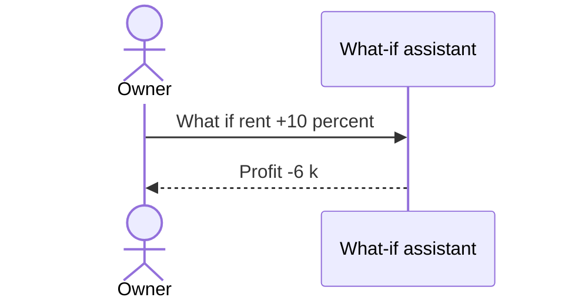

🏠 [Specs](../../../../README.md) › 🧩 [Functional capabilities](../../../README.md) ›
🔮 [F23 What-if simulation and impact](../../README.md) › 📝 [Use cases](../README.md) ›
📝 [Use cases: FL-F23-02 Run](README.md) › 📝 UC-F23-20 Ask the AI assistant what if

# 📝 UC-F23-20 Ask the AI assistant what if

**Status:** ✅ specified

## Summary

The owner or a manager asks the AI assistant what if, including goals.

## Personas

- [U13 Owner](../../../../01-users/personas/u13-owner.md)
- [U02 Manager](../../../../01-users/personas/u02-manager.md)

## Goal

Answers.

## Trigger

Question.

## Frequency

Weekly.

## Preconditions

- None.

## Postconditions

- Success: answered.
- Failure: none.

## Main flow

1. Ask (S-F23-20).
2. Scenario built and run.
3. Explained with figures.
4. Saved if wanted.

## Alternative flows

- 1a. "What must change to reach" (UC-F23-21).

## Error flows

- 2e. Beyond rights.
- Any step: a service does not answer; the call is retried first (BR-F3-32), then the message follows the error pattern
  (D122) and what was typed stays on the screen.

## Business rules

- [BR-F23-09 Assumptions are visible](../../business-rules/br-f23-09-assumptions-visible.md)
- [BR-F23-06 Rights apply to scenarios](../../business-rules/br-f23-06-rights-apply-to-scenarios.md)
- [BR-F23-10 Actions need a person](../../business-rules/br-f23-10-actions-need-a-person.md)

## Entities

- [E-F23-02 Scenario](../../data/e-f23-02-scenario.md)
- [E-F23-04 Simulation run](../../data/e-f23-04-simulation-run.md)
- [E-F23-05 Impact result](../../data/e-f23-05-impact-result.md)

## Permissions

Within rights.

## Notifications

- None.

## Audit events

Questions.

## AI involvement

Builds.

## API, MCP and A2A exposure

Through T5 and T6 with the caller's rights (BR-F3-34).

## Screens

- [S-F23-20 What-if assistant](../../screens/02-run/s-f23-20-what-if-assistant.md)

## Flowchart

See [FL-F23-02 Run](../../flows/fl-f23-02-run.md#flowchart).

## Sequence diagram

## Acceptance criteria

1. **Given** rent +10 % **when** asked **then** -6 000.00 EUR.
2. **Given** a goal **when** asked **then** goal seeking.
3. **Given** beyond rights **when** asked **then** refused.

## Non-functional notes

D408's targets ([Performance](../../../../05-non-functional/performance.md)): 95 % of screens within 1 second; lists
paged on the server, the first page within 1 second; reports within 5 seconds or in the background.

## Regulatory references

Values of the France country pack read by scenarios:
[CR-FR-046 Headcount thresholds](../../../../10-country-packs/france/labour/cr-fr-046-headcount-thresholds.md),
[CR-FR-008 VAT rates](../../../../10-country-packs/france/tax-and-vat/cr-fr-008-vat-rates.md),
[CR-FR-185 Minimum wage (SMIC)](../../../../10-country-packs/france/payroll/cr-fr-185-minimum-wage.md),
[CR-FR-064 Accounting frameworks of the books](../../../../10-country-packs/france/accounting/cr-fr-064-accounting-frameworks.md),
[CR-FR-058 AI in recruitment and work is high-risk](../../../../10-country-packs/france/ai-and-recording/cr-fr-058-high-risk-ai-in-employment.md),
[CR-FR-057 A person confirms what the AI does](../../../../10-country-packs/france/ai-and-recording/cr-fr-057-human-oversight.md).

## Related use cases

- [UC-F23-21 Seek a goal](../06-goals-and-financing/uc-f23-21-seek-a-goal.md)

## Open questions

None.

---

⬅️ [UC-F23-19 Share and comment a scenario](../04-decide/uc-f23-19-share-and-comment-a-scenario.md) ·
⬆️ [Up](README.md) · ➡️ [UC-F23-21 Seek a goal](../06-goals-and-financing/uc-f23-21-seek-a-goal.md)
