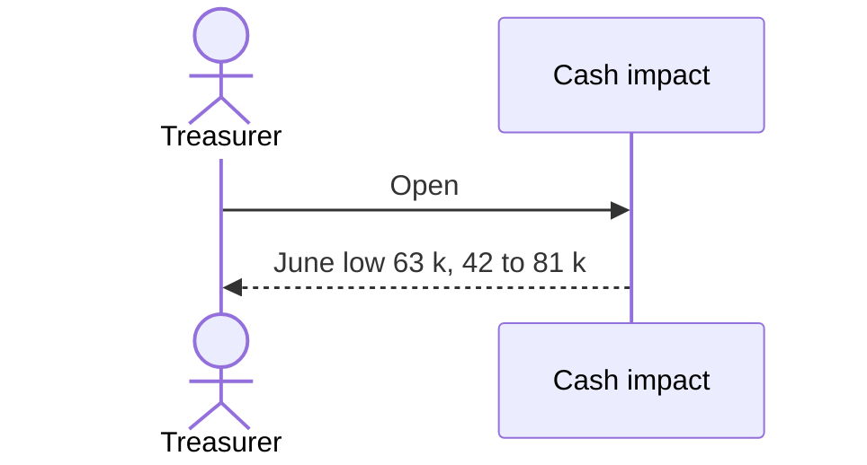

🏠 [Specs](../../../../README.md) › 🧩 [Functional capabilities](../../../README.md) ›
🔮 [F23 What-if simulation and impact](../../README.md) › 📝 [Use cases](../README.md) ›
📝 [Use cases: FL-F23-03 See the impact](README.md) › 📝 UC-F23-07 See the impact on cash and treasury

# 📝 UC-F23-07 See the impact on cash and treasury

**Status:** ✅ specified

## Summary

The treasurer and accounting see the impact on cash with the lowest point and range.

## Personas

- [U31 Treasurer](../../../../01-users/personas/u31-treasurer.md)
- [U05 Accounting](../../../../01-users/personas/u05-accounting.md)

## Goal

No cash surprise.

## Trigger

Run.

## Frequency

Monthly.

## Preconditions

- Run.

## Postconditions

- Success: read.
- Failure: none.

## Main flow

1. Open (S-F23-07).
2. See the lowest point.
3. Read the range (BR-F23-07).
4. Try financing (UC-F23-23).

## Alternative flows

- 4a. Counter-measures.

## Error flows

- 1e. Not run.
- Any step: a service does not answer; the call is retried first (BR-F3-32), then the message follows the error pattern
  (D122) and what was typed stays on the screen.

## Business rules

- [BR-F23-05 The impact across every area](../../business-rules/br-f23-05-impact-across-every-area.md)
- [BR-F23-07 Ranges for uncertain inputs](../../business-rules/br-f23-07-ranges-for-uncertain-inputs.md)

## Entities

- [E-F23-05 Impact result](../../data/e-f23-05-impact-result.md)

## Permissions

Treasurer, accounting.

## Notifications

- None.

## Audit events

None.

## AI involvement

Explains.

## API, MCP and A2A exposure

Through T5 and T6 with the caller's rights (BR-F3-34).

## Screens

- [S-F23-07 Cash impact](../../screens/03-see-the-impact/s-f23-07-cash-impact.md)

## Flowchart

See [FL-F23-03 See the impact](../../flows/fl-f23-03-see-the-impact.md#flowchart).

## Sequence diagram

## Acceptance criteria

1. **Given** June **when** read **then** low 63 000.00 EUR.
2. **Given** range **when** read **then** 42 000 to 81 000.
3. **Given** financing **when** tried **then** cash updated.

## Non-functional notes

D408's targets ([Performance](../../../../05-non-functional/performance.md)): 95 % of screens within 1 second; lists
paged on the server, the first page within 1 second; reports within 5 seconds or in the background.

## Regulatory references

Values of the France country pack read by scenarios:
[CR-FR-046 Headcount thresholds](../../../../10-country-packs/france/labour/cr-fr-046-headcount-thresholds.md),
[CR-FR-008 VAT rates](../../../../10-country-packs/france/tax-and-vat/cr-fr-008-vat-rates.md),
[CR-FR-185 Minimum wage (SMIC)](../../../../10-country-packs/france/payroll/cr-fr-185-minimum-wage.md),
[CR-FR-064 Accounting frameworks of the books](../../../../10-country-packs/france/accounting/cr-fr-064-accounting-frameworks.md),
[CR-FR-058 AI in recruitment and work is high-risk](../../../../10-country-packs/france/ai-and-recording/cr-fr-058-high-risk-ai-in-employment.md),
[CR-FR-057 A person confirms what the AI does](../../../../10-country-packs/france/ai-and-recording/cr-fr-057-human-oversight.md).

## Related use cases

- [UC-F23-23 Simulate financing options](../06-goals-and-financing/uc-f23-23-simulate-financing-options.md)

## Open questions

None.

---

⬅️ [UC-F23-06 See the impact on sales and margin](uc-f23-06-see-the-impact-on-sales-and-margin.md) ·
⬆️ [Up](README.md) · ➡️ [UC-F23-08](uc-f23-08-see-the-impact-on-the-profit-and-loss-and-balance-sheet.md)
