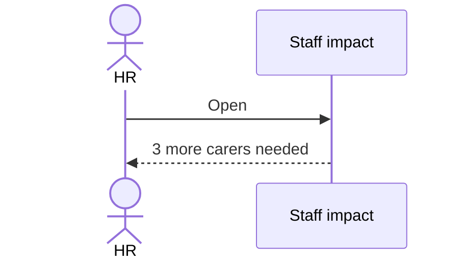

🏠 [Specs](../../../../README.md) › 🧩 [Functional capabilities](../../../README.md) ›
🔮 [F23 What-if simulation and impact](../../README.md) › 📝 [Use cases](../README.md) ›
📝 [Use cases: FL-F23-03 See the impact](README.md) › 📝 UC-F23-11 See the impact on staff, payroll and planning

# 📝 UC-F23-11 See the impact on staff, payroll and planning

**Status:** ✅ specified

## Summary

HR sees the impact on staff, payroll and planning in totals only.

## Personas

- [U06 HR](../../../../01-users/personas/u06-hr.md)

## Goal

Staff needs known.

## Trigger

Run.

## Frequency

Quarterly.

## Preconditions

- Run.

## Postconditions

- Success: read.
- Failure: none.

## Main flow

1. Open (S-F23-11).
2. Totals (BR-F23-12).
3. Options.
4. Hiring plan (UC-F23-28).

## Alternative flows

- 3a. Overtime.

## Error flows

- 2e. Named person: refused.
- Any step: a service does not answer; the call is retried first (BR-F3-32), then the message follows the error pattern
  (D122) and what was typed stays on the screen.

## Business rules

- [BR-F23-04 The same rules as the ERP](../../business-rules/br-f23-04-same-rules-as-the-erp.md)
- [BR-F23-12 No automated decisions about people](../../business-rules/br-f23-12-no-automated-decisions-on-people.md)
- [BR-F23-06 Rights apply to scenarios](../../business-rules/br-f23-06-rights-apply-to-scenarios.md)

## Entities

- [E-F23-05 Impact result](../../data/e-f23-05-impact-result.md)

## Permissions

HR.

## Notifications

- None.

## Audit events

None.

## AI involvement

Explains.

## API, MCP and A2A exposure

Through T5 and T6 with the caller's rights (BR-F3-34).

## Screens

- [S-F23-11 Staff impact](../../screens/03-see-the-impact/s-f23-11-staff-impact.md)

## Flowchart

See [FL-F23-03 See the impact](../../flows/fl-f23-03-see-the-impact.md#flowchart).

## Sequence diagram

## Acceptance criteria

1. **Given** activity +10 % **when** read **then** 3 more carers.
2. **Given** a named person **when** asked **then** refused.
3. **Given** overtime **when** chosen **then** cost shown.

## Non-functional notes

D408's targets ([Performance](../../../../05-non-functional/performance.md)): 95 % of screens within 1 second; lists
paged on the server, the first page within 1 second; reports within 5 seconds or in the background.

## Regulatory references

Values of the France country pack read by scenarios:
[CR-FR-046 Headcount thresholds](../../../../10-country-packs/france/labour/cr-fr-046-headcount-thresholds.md),
[CR-FR-008 VAT rates](../../../../10-country-packs/france/tax-and-vat/cr-fr-008-vat-rates.md),
[CR-FR-185 Minimum wage (SMIC)](../../../../10-country-packs/france/payroll/cr-fr-185-minimum-wage.md),
[CR-FR-064 Accounting frameworks of the books](../../../../10-country-packs/france/accounting/cr-fr-064-accounting-frameworks.md),
[CR-FR-058 AI in recruitment and work is high-risk](../../../../10-country-packs/france/ai-and-recording/cr-fr-058-high-risk-ai-in-employment.md),
[CR-FR-057 A person confirms what the AI does](../../../../10-country-packs/france/ai-and-recording/cr-fr-057-human-oversight.md).

## Related use cases

- [UC-F23-28 Simulate a hiring plan](uc-f23-28-simulate-a-hiring-plan.md)

## Open questions

None.

---

⬅️ [UC-F23-10 See the impact on production and capacity](uc-f23-10-see-the-impact-on-production-and-capacity.md) ·
⬆️ [Up](README.md) ·
➡️ [UC-F23-12 See legal thresholds and taxes crossed](uc-f23-12-see-legal-thresholds-and-taxes-crossed.md)
