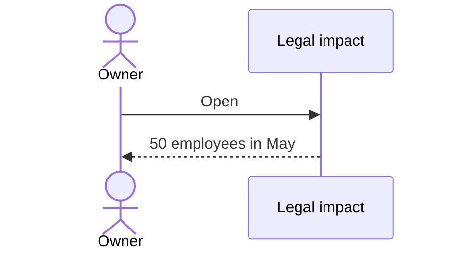

🏠 [Specs](../../../../README.md) › 🧩 [Functional capabilities](../../../README.md) ›
🔮 [F23 What-if simulation and impact](../../README.md) › 📝 [Use cases](../README.md) ›
📝 [Use cases: FL-F23-03 See the impact](README.md) › 📝 UC-F23-12 See legal thresholds and taxes crossed

# 📝 UC-F23-12 See legal thresholds and taxes crossed

**Status:** ✅ specified

## Summary

The owner and accounting see legal thresholds and taxes crossed.

## Personas

- [U13 Owner](../../../../01-users/personas/u13-owner.md)
- [U05 Accounting](../../../../01-users/personas/u05-accounting.md)

## Goal

Duties foreseen.

## Trigger

Run.

## Frequency

Quarterly.

## Preconditions

- Run.

## Postconditions

- Success: read.
- Failure: none.

## Main flow

1. Open (S-F23-12).
2. See thresholds (BR-F23-01).
3. Read duties.
4. Add to the compliance calendar if chosen.

## Alternative flows

- 2a. Tax change announced.

## Error flows

- 1e. Not run.
- Any step: a service does not answer; the call is retried first (BR-F3-32), then the message follows the error pattern
  (D122) and what was typed stays on the screen.

## Business rules

- [BR-F23-01 Legal values from the country pack](../../business-rules/br-f23-01-legal-values-from-the-country-pack.md)

## Entities

- [E-F23-05 Impact result](../../data/e-f23-05-impact-result.md)

## Permissions

Owner, accounting.

## Notifications

- None.

## Audit events

None.

## AI involvement

Explains.

## API, MCP and A2A exposure

Through T5 and T6 with the caller's rights (BR-F3-34).

## Screens

- [S-F23-12 Legal impact](../../screens/03-see-the-impact/s-f23-12-legal-impact.md)

## Flowchart

See [FL-F23-03 See the impact](../../flows/fl-f23-03-see-the-impact.md#flowchart).

## Sequence diagram

## Acceptance criteria

1. **Given** 50 in May **when** read **then** duties listed.
2. **Given** an announced tax **when** read **then** from its date.
3. **Given** none **when** read **then** said.

## Non-functional notes

D408's targets ([Performance](../../../../05-non-functional/performance.md)): 95 % of screens within 1 second; lists
paged on the server, the first page within 1 second; reports within 5 seconds or in the background.

## Regulatory references

Values of the France country pack read by scenarios:
[CR-FR-046 Headcount thresholds](../../../../10-country-packs/france/labour/cr-fr-046-headcount-thresholds.md),
[CR-FR-008 VAT rates](../../../../10-country-packs/france/tax-and-vat/cr-fr-008-vat-rates.md),
[CR-FR-185 Minimum wage (SMIC)](../../../../10-country-packs/france/payroll/cr-fr-185-minimum-wage.md),
[CR-FR-064 Accounting frameworks of the books](../../../../10-country-packs/france/accounting/cr-fr-064-accounting-frameworks.md),
[CR-FR-058 AI in recruitment and work is high-risk](../../../../10-country-packs/france/ai-and-recording/cr-fr-058-high-risk-ai-in-employment.md),
[CR-FR-057 A person confirms what the AI does](../../../../10-country-packs/france/ai-and-recording/cr-fr-057-human-oversight.md).

## Related use cases

- [UC-F23-28 Simulate a hiring plan](uc-f23-28-simulate-a-hiring-plan.md)

## Open questions

None.

---

⬅️ [UC-F23-11](uc-f23-11-see-the-impact-on-staff-payroll-and-planning.md) · ⬆️ [Up](README.md) ·
➡️ [UC-F23-13 Include platform costs in a scenario](uc-f23-13-include-platform-costs-in-a-scenario.md)
