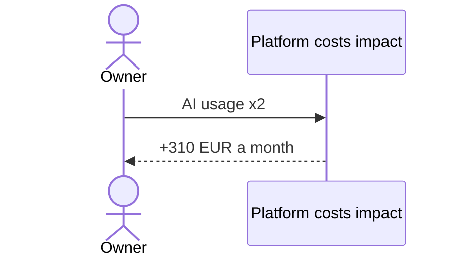

🏠 [Specs](../../../../README.md) › 🧩 [Functional capabilities](../../../README.md) ›
🔮 [F23 What-if simulation and impact](../../README.md) › 📝 [Use cases](../README.md) ›
📝 [Use cases: FL-F23-03 See the impact](README.md) › 📝 UC-F23-13 Include platform costs in a scenario

# 📝 UC-F23-13 Include platform costs in a scenario

**Status:** ✅ specified

## Summary

The owner includes platform costs (AI, scraping usage) in a scenario.

## Personas

- [U13 Owner](../../../../01-users/personas/u13-owner.md)

## Goal

Full cost.

## Trigger

Scenario.

## Frequency

Rare.

## Preconditions

- Usage.

## Postconditions

- Success: costs shown.
- Failure: none.

## Main flow

1. Change usage (S-F23-13).
2. Run.
3. See costs (BR-F23-05).
4. Compare with F22 budgets.

## Alternative flows

- 1a. Local model.

## Error flows

- 2e. Prices missing.
- Any step: a service does not answer; the call is retried first (BR-F3-32), then the message follows the error pattern
  (D122) and what was typed stays on the screen.

## Business rules

- [BR-F23-05 The impact across every area](../../business-rules/br-f23-05-impact-across-every-area.md)

## Entities

- [E-F23-03 Scenario change](../../data/e-f23-03-scenario-change.md)
- [E-F23-05 Impact result](../../data/e-f23-05-impact-result.md)

## Permissions

Owner.

## Notifications

- None.

## Audit events

None.

## AI involvement

None.

## API, MCP and A2A exposure

Through T5 and T6 with the caller's rights (BR-F3-34).

## Screens

- [S-F23-13 Platform costs impact](../../screens/03-see-the-impact/s-f23-13-platform-costs-impact.md)

## Flowchart

See [FL-F23-03 See the impact](../../flows/fl-f23-03-see-the-impact.md#flowchart).

## Sequence diagram

## Acceptance criteria

1. **Given** usage x2 **when** run **then** +310.00 EUR.
2. **Given** local model **when** chosen **then** compute cost.
3. **Given** prices missing **when** run **then** flagged.

## Non-functional notes

D408's targets ([Performance](../../../../05-non-functional/performance.md)): 95 % of screens within 1 second; lists
paged on the server, the first page within 1 second; reports within 5 seconds or in the background.

## Regulatory references

Values of the France country pack read by scenarios:
[CR-FR-046 Headcount thresholds](../../../../10-country-packs/france/labour/cr-fr-046-headcount-thresholds.md),
[CR-FR-008 VAT rates](../../../../10-country-packs/france/tax-and-vat/cr-fr-008-vat-rates.md),
[CR-FR-185 Minimum wage (SMIC)](../../../../10-country-packs/france/payroll/cr-fr-185-minimum-wage.md),
[CR-FR-064 Accounting frameworks of the books](../../../../10-country-packs/france/accounting/cr-fr-064-accounting-frameworks.md),
[CR-FR-058 AI in recruitment and work is high-risk](../../../../10-country-packs/france/ai-and-recording/cr-fr-058-high-risk-ai-in-employment.md),
[CR-FR-057 A person confirms what the AI does](../../../../10-country-packs/france/ai-and-recording/cr-fr-057-human-oversight.md).

## Related use cases

- [UC-F23-05 Run the scenario on a copy with the real rules](../02-run/uc-f23-05-run-the-scenario-on-a-copy-with-the-real-rules.md)

## Open questions

None.

---

⬅️ [UC-F23-12 See legal thresholds and taxes crossed](uc-f23-12-see-legal-thresholds-and-taxes-crossed.md) ·
⬆️ [Up](README.md) · ➡️ [UC-F23-14 See what matters most](../04-decide/uc-f23-14-see-what-matters-most.md)
