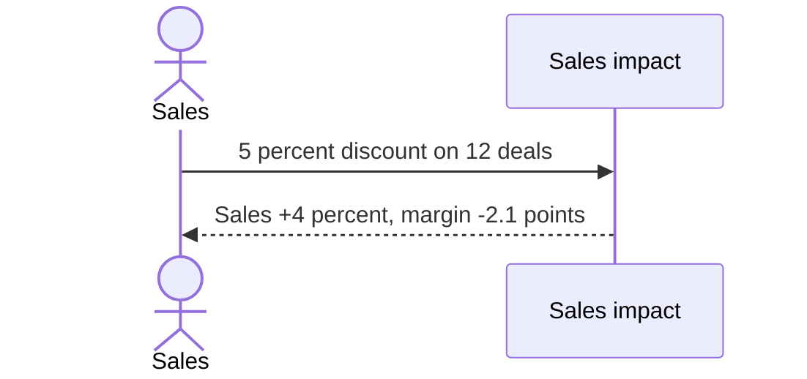

🏠 [Specs](../../../../README.md) › 🧩 [Functional capabilities](../../../README.md) ›
🔮 [F23 What-if simulation and impact](../../README.md) › 📝 [Use cases](../README.md) ›
📝 [Use cases: FL-F23-03 See the impact](README.md) › 📝 UC-F23-26 Simulate a price change on the pipeline

# 📝 UC-F23-26 Simulate a price change on the pipeline

**Status:** ✅ specified

## Summary

A sales person simulates a price or discount change on their open deals and sees its effect on expected sales and
margin.

## Personas

- [U03 Sales](../../../../01-users/personas/u03-sales.md)

## Goal

Know what a discount costs before offering it.

## Trigger

A pricing question on deals.

## Frequency

Monthly.

## Preconditions

- Open deals in F6.

## Postconditions

- Success: impact shown.
- Failure: none.

## Main flow

1. The sales person opens Sales impact (S-F23-06) from a new scenario.
2. They choose their open deals.
3. They set a 5 % discount.
4. The run shows expected sales and margin.

## Alternative flows

- 3a. A price rise with lower win probability.

## Error flows

- 2e. Deals of others: hidden.
- Any step: a service does not answer; the call is retried first (BR-F3-32), then the message follows the error pattern
  (D122) and what was typed stays on the screen.

## Business rules

- [BR-F23-06 Rights apply to scenarios](../../business-rules/br-f23-06-rights-apply-to-scenarios.md)

## Entities

None.

## Permissions

Sales on their own deals.

## Notifications

- None.

## Audit events

Scenarios.

## AI involvement

Explains.

## API, MCP and A2A exposure

Through the API (T5) and as AI assistant tools (T6), with the caller's rights (BR-F3-34).

## Screens

None.

## Flowchart

See [FL-F23-03 See the impact](../../flows/fl-f23-03-see-the-impact.md#flowchart).

## Sequence diagram

## Acceptance criteria

1. **Given** 12 open deals **when** 5 % discount is simulated **then** expected sales and margin show.
2. **Given** others' deals **when** chosen **then** hidden.
3. **Given** the result **when** saved **then** no deal changes.

## Non-functional notes

D408's targets ([Performance](../../../../05-non-functional/performance.md)): 95 % of screens within 1 second; lists
paged on the server, the first page within 1 second; reports within 5 seconds or in the background.

## Regulatory references

None.

## Related use cases

- [UC-F23-06 See the impact on sales and margin](uc-f23-06-see-the-impact-on-sales-and-margin.md)

## Open questions

None.

---

⬅️ [UC-F23-25 Use sector drivers](../07-accuracy-and-drivers/uc-f23-25-use-sector-drivers.md) · ⬆️ [Up](README.md) ·
➡️ [UC-F23-27 Simulate a supplier switch](uc-f23-27-simulate-a-supplier-switch.md)
