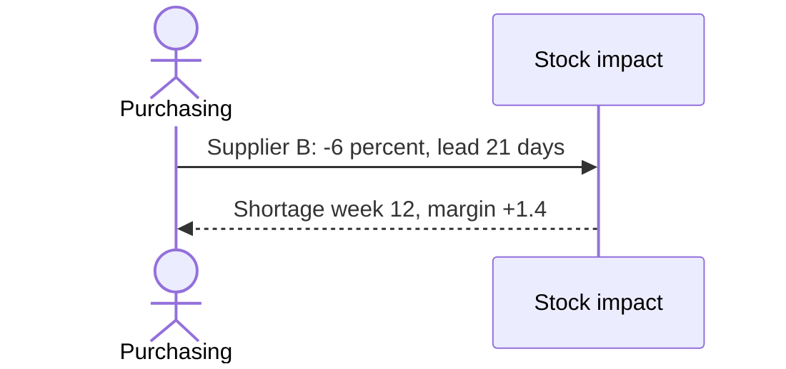

🏠 [Specs](../../../../README.md) › 🧩 [Functional capabilities](../../../README.md) ›
🔮 [F23 What-if simulation and impact](../../README.md) › 📝 [Use cases](../README.md) ›
📝 [Use cases: FL-F23-03 See the impact](README.md) › 📝 UC-F23-27 Simulate a supplier switch

# 📝 UC-F23-27 Simulate a supplier switch

**Status:** ✅ specified

## Summary

Purchasing simulates switching a supplier (price, lead time, minimum order) and sees the effect on stock, cash and
margin.

## Personas

- [U04 Purchasing and stock](../../../../01-users/personas/u04-purchasing.md)

## Goal

Compare suppliers on their full effect.

## Trigger

A new supplier offer.

## Frequency

A few a year.

## Preconditions

- Current supplier's terms in F7.

## Postconditions

- Success: impact shown.
- Failure: none.

## Main flow

1. Purchasing opens Stock impact (S-F23-09) from a scenario.
2. They enter the new supplier's price, lead time and minimum.
3. The run shows stock levels, shortages, cash and margin.
4. They compare with the current supplier.

## Alternative flows

- 2a. Partial switch: half the volume.

## Error flows

- 3e. Shortage: flagged with dates.
- Any step: a service does not answer; the call is retried first (BR-F3-32), then the message follows the error pattern
  (D122) and what was typed stays on the screen.

## Business rules

- [BR-F23-04 The same rules as the ERP](../../business-rules/br-f23-04-same-rules-as-the-erp.md)

## Entities

None.

## Permissions

Purchasing.

## Notifications

- None.

## Audit events

Scenarios.

## AI involvement

Explains.

## API, MCP and A2A exposure

Through the API (T5) and as AI assistant tools (T6), with the caller's rights (BR-F3-34).

## Screens

None.

## Flowchart

See [FL-F23-03 See the impact](../../flows/fl-f23-03-see-the-impact.md#flowchart).

## Sequence diagram

## Acceptance criteria

1. **Given** supplier B 6 % cheaper with 21 days lead time **when** simulated **then** a shortage in week 12 shows.
2. **Given** half the volume **when** simulated **then** no shortage.
3. **Given** the result **when** saved **then** no order changes.

## Non-functional notes

D408's targets ([Performance](../../../../05-non-functional/performance.md)): 95 % of screens within 1 second; lists
paged on the server, the first page within 1 second; reports within 5 seconds or in the background.

## Regulatory references

None.

## Related use cases

- [UC-F23-09 See the impact on stock and purchases](uc-f23-09-see-the-impact-on-stock-and-purchases.md)

## Open questions

None.

---

⬅️ [UC-F23-26 Simulate a price change on the pipeline](uc-f23-26-simulate-a-price-change-on-the-pipeline.md) ·
⬆️ [Up](README.md) · ➡️ [UC-F23-28 Simulate a hiring plan](uc-f23-28-simulate-a-hiring-plan.md)
